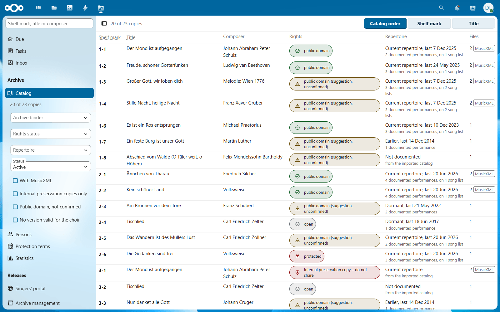
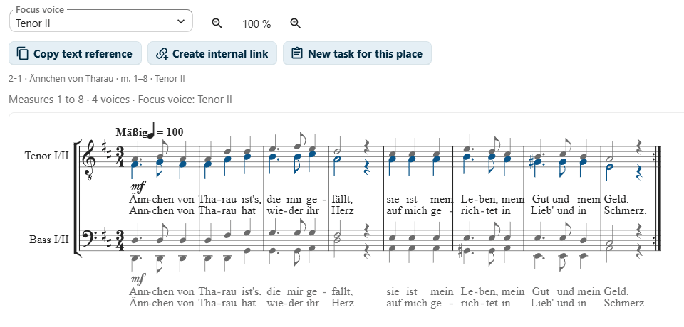
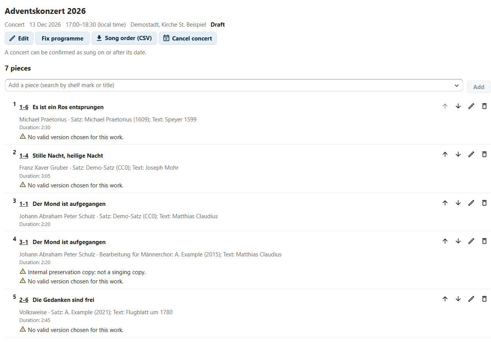
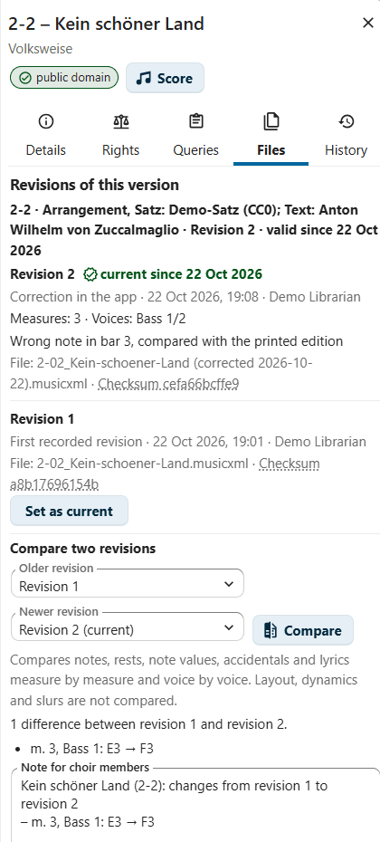

<p align="center">
  <picture>
    <source media="(prefers-color-scheme: dark)" srcset="img/app.svg">
    
  </picture>
</p>

<h1 align="center">Cantoria</h1>

<p align="center"><em>Cantoria – the sheet music archive for choirs</em></p>

<p align="center">
  <strong>The sheet music archive of your choir in Nextcloud: catalog, rights per version, scores with voice focus and concerts in one place.</strong>
</p>

<p align="center">
  <a href="https://github.com/thoscut/choircoresmanager/actions/workflows/ci.yml"></a>
  <a href="LICENSE"></a>
  <a href="#requirements"></a>
  <a href="#accessibility"></a>
  <!-- Once the app is listed in the Nextcloud App Store, add:
  <a href="https://apps.nextcloud.com/apps/cantoria"></a>
  -->
</p>

<picture>
  <source media="(prefers-color-scheme: dark)" srcset="docs/screenshots/catalog-dark.png">
  
</picture>

Cantoria keeps the catalog of a choir's sheet music archive: works,
versions (settings, arrangements, editions), copies with their shelf marks,
and the scans, MusicXML and MuseScore files that already live in your
Nextcloud. It is made for the people who look after the music: the music
librarians, the conductor, the board and the auditors. If you switch it on,
choir members get excerpts to view, play and practise; the catalog itself is
never shown to them.

The screenshots show the invented demo archive from [tools/demo](tools/demo/README.md).

## Features

<table>
  <tr>
    <td width="33%" valign="top">
      <a href="docs/screenshots/copy-overview.png"></a>
      <h3>Catalog</h3>
      <p>Works, versions and copies as separate levels, with the files of the archive folder matched by the shelf mark at the start of each file name. Search by shelf mark, title or composer and filter by binder, rights status, repertoire and status. Nothing is deleted: a copy gets a status (active, retired, missing, lent), and every change goes into the audit log.</p>
    </td>
    <td width="33%" valign="top">
      <a href="docs/screenshots/rights-panel.png"></a>
      <h3>Rights</h3>
      <p>The rights belong to the version. An imported assessment stays a recommendation until a music librarian confirms public domain or protection with reason and evidence. Licenses list each use separately, and the singers' portal, the print station and publication are released separately. Internal preservation copies are never shared or played. Only the conductor chooses the version valid for the choir.</p>
    </td>
    <td width="33%" valign="top">
      <a href="docs/screenshots/score-excerpt.png"></a>
      <h3>Score viewer with voice focus and playback</h3>
      <p>MusicXML is rendered in the browser and cut to a range of printed bar numbers. The chosen voice is highlighted, also when it shares a staff, and can be played louder or alone. Repeats and endings are played in order; a count-in of one or two bars, a loop over the shown bars and a click on any note to start there help when practising. Space plays and pauses, the arrow keys go from bar to bar, the current bar is announced to screen readers, and a text description of the excerpt is available. Playback is offered for public domain and licensed versions only.</p>
    </td>
  </tr>
  <tr>
    <td width="33%" valign="top">
      <a href="docs/screenshots/practice-audio-dialog.png"></a>
      <h3>Practice audio</h3>
      <p>Music librarians and the conductor make practice files per voice from the bars, tempo and repeats chosen in the score viewer: WAV that sounds like the playback, or MIDI with one track per voice; one file or a ZIP archive with every voice plus a tutti. The server allows each export only for confirmed public domain versions or a license for practice audio, never for preservation copies, and records it. The files are uploaded to the practice system by hand; the app gives nothing to singers.</p>
    </td>
    <td width="33%" valign="top">
      <a href="docs/screenshots/task-question.png"></a>
      <h3>Questions and sharing</h3>
      <p>Questions and tasks point to a place in the score (page, bars, voice, verse) and go to a role. A place can be shared as a text reference without notation or as an internal link for people with an archive role. Links expire after at most six months, can be revoked, are checked on every call and say when the score has changed. The start page shows what is due for each role, and the conductor chooses the valid versions of several works in one list.</p>
    </td>
    <td width="33%" valign="top">
      <a href="docs/screenshots/concert-warnings.png"></a>
      <h3>Concerts</h3>
      <p>Plan concerts and song lists piece by piece with durations, rights warnings and deadline reminders. After the concert, confirm what was sung; repertoire figures and "last sung" follow from the documented performances. Export the song order for the collecting society and import existing performance records and song lists from CSV or Excel.</p>
    </td>
  </tr>
  <tr>
    <td width="33%" valign="top">
      <a href="docs/screenshots/accession-form.png"></a>
      <h3>Maintaining the catalog</h3>
      <p>A new accession gets the next free shelf mark of its binder, and shelf labels print on A4 label sheets. A register of persons with life dates suggests when protection ends. Works listed twice can be merged and copies moved, with undo. Inventory lists per binder, and background checksums warn about files that changed although nobody modified them.</p>
    </td>
    <td width="33%" valign="top">
      <a href="docs/screenshots/notifications.png"></a>
      <h3>Notifications</h3>
      <p>Role holders are notified through Nextcloud about proposals waiting, questions and answers, ending licenses, versions to take out of the singers' portal, concert deadlines, ended protection terms, checksum mismatches and failed backups. Notifications never go to singers, contain no personal data and are withdrawn when the task is done.</p>
    </td>
    <td width="33%" valign="top">
      <a href="docs/screenshots/backup-restore.png"></a>
      <h3>Backups</h3>
      <p>Every week the app writes the catalog as CSV and ODS (with the audit log) and a complete JSON backup into a backup folder outside the archive folder, which the role groups do not see. Librarians can make a backup at any time, download it and restore it into an empty catalog, in the web interface or with <code>occ cantoria:restore</code>. Paper stays the fallback: every list prints in A4 black and white.</p>
    </td>
  </tr>
  <tr>
    <td width="33%" valign="top">
      <a href="docs/screenshots/statistics.png"></a>
      <a href="docs/screenshots/annual-report.png"></a>
      <h3>Statistics and annual report</h3>
      <p>Figures for the board, the music librarians and the conductor: stock per binder, new copies per year, rights and releases, licenses, concerts and pieces per year, the most performed works and composers, repertoire classes, open tasks and protection terms that end. Every figure is a number in a table; the bars are only for comparison. The annual report summarises one year for the general meeting and prints on A4, also in large print; both download as CSV. They contain no personal data of choir members.</p>
    </td>
    <td width="33%" valign="top">
      <a href="docs/screenshots/dashboard-widget.png"></a>
      <a href="docs/screenshots/calendar-dialog.png"></a>
      <h3>Dashboard widget and calendar</h3>
      <p>The dashboard widget "Cantoria – due" shows the concert deadlines, things to do and tasks of the start page, with links into the app, to accounts with an archive role. A concert can have a start and end time. "Add to my calendar" puts one concert or all upcoming concerts into one of your Nextcloud calendars and updates them when added again; a calendar file (.ics) works with any calendar program. The preparation deadlines can be added as all-day entries. There is no public subscription link.</p>
    </td>
    <td width="33%" valign="top">
      <h3>Agents and tools</h3>
      <p>An optional interface for agents: a stable, versioned API (OCS, v1, with an OpenAPI description) and an MCP server for Claude Desktop, Claude Code and other clients. With an account and app password of its own, an agent searches the catalog, reads copies, concerts and statistics, asks questions and proposes changes. It never decides: rights, the valid version and every proposal stay with people, and the server checks every request against the agent's role. Off until the administration switches it on.</p>
    </td>
  </tr>
  <tr>
    <td width="33%" valign="top">
      <a href="docs/screenshots/shared-with-me.png"></a>
      <h3>Sharing with choir members and the public</h3>
      <p>If the administration switches it on, the conductor or the music librarians share an excerpt from the score viewer: choir members see it under "Shared with me", play it with their voice emphasised and make a practice file; a public link shows it without signing in; a public repertoire page lists the works in the public domain with links to CPDL and IMSLP. The dialog says beforehand what the recipients will see. The server cuts the score to the shared bars, adds the scan only where the rights allow it and checks the rights on every call; what arrives in a browser can be saved there. These modules are off until switched on.</p>
    </td>
    <td width="33%" valign="top">
      <a href="docs/screenshots/revisions.png"></a>
      <h3>Revisions, review and corrections</h3>
      <p>Every correction in the app and every changed MusicXML found by the file sync becomes a revision of the version with its checksum; the music librarians choose the current one. Two revisions are compared bar by bar and voice by voice, with a short plain-text note for the choir, and concerts keep the revision sung. Reports of transcription rounds become review points that the conductor and the librarians decide in the score view; small corrections of pitches, accidentals and syllables are saved as a new file next to the old one.</p>
    </td>
    <td width="33%" valign="top">
      <a href="docs/screenshots/folder-book.png"></a>
      <h3>Folder book and print station</h3>
      <p>The folder book records which choir folder is out with whom, what it holds, its condition and the missing sheets, and points out folders with a copy that was retired or a version that no longer applies; names are removed automatically after a retention period. Optionally, a mirror folder for the print station receives the scans released for printing, kept up to date every day, with a preview before the first sync. Both are modules.</p>
    </td>
  </tr>
  <tr>
    <td width="33%" valign="top">
      <a href="docs/screenshots/admin-settings.png"></a>
      <h3>Easy to set up</h3>
      <p>Administration → Cantoria guides through six steps (archive folder, roles and groups, access, the functions for the choir, import, file sync) and shows what is done and what needs attention. It checks who of the role groups cannot open the archive folder and says what to do. Admins can give the page to a group, such as the music librarians. In the app, a "?" next to the terms explains them, empty views name the next step, and accounts without a role learn whom to ask.</p>
    </td>
    <td width="33%" valign="top">
      <a href="docs/screenshots/files-action.png"></a>
      <h3>Part of your Nextcloud</h3>
      <p>"Open in Cantoria" in the Files app opens a MusicXML file in the score viewer and any other file of a copy in the catalog. The search of Nextcloud finds copies by shelf mark, title and person. Concerts go into your calendar, the dashboard widget shows what is due, and notifications reach the people responsible. Rights are checked as in the app.</p>
    </td>
    <td width="33%" valign="top">
      <a href="docs/screenshots/annual-snapshots.png"></a>
      <h3>Annual snapshots and gaps</h3>
      <p>Once a year, in January or on request, the app freezes the catalog as CSV and JSON with a checksum list of the archive files in a dated folder; two snapshots are compared and printed for the general meeting or the auditors. The gaps in the shelf marks of each binder are listed for the inventory, and the protection-term suggestion also knows scientific editions and posthumous works.</p>
    </td>
  </tr>
</table>

## Principles

The app suggests, people decide: a rights status is confirmed by a music
librarian, the valid version is chosen by the conductor, and no import or
automatic job sets either. Rights belong to the version, and an excerpt counts
as much as the whole sheet. Nothing is deleted, every change is logged, and
files in the archive folder are only read. Roles are bound to groups, not to
persons. There is always a way back without the developer, paper stays the
fallback, and no external server is involved. The rights helpers model German
copyright law; they support a decision and are no legal advice. The interface
aims at WCAG 2.2 AA and uses plain, inclusive language.

Every function outside the core is a module that admins can switch off,
with the presets Simple, Standard and Complete. Sharing with choir members
and the public, the public pages, the mirror folder of the print station, the
hand-over to a choir system and the interface for agents belong to no preset: they stay off until an admin
switches them on. All principles and milestones are in
[ROADMAP.md](ROADMAP.md) (German).

## Trying it out

[tools/demo](tools/demo/README.md) builds the invented archive of a fictitious
choir, the "Demochor": 23 copies of 20 public domain works with placeholder
scans, seven MusicXML settings, persons, concerts and song lists, all CC0.

```sh
node tools/demo/build.mjs     # writes build/demo/Cantoria-Demo/ (Node.js 22 or newer)
```

Upload the folder to your Nextcloud, choose it as archive folder, import
`_Import/catalog.csv` and run the file sync; the
[demo README](tools/demo/README.md#trying-it-out) lists every step with the
figures to expect.

## Installation

- **From the Nextcloud App Store** (once the app is published there): Apps →
  search "Cantoria" → Download and enable. This is the way for managed
  instances without shell access.
- **Manually from a release archive:** download `cantoria-<version>.tar.gz`
  from the [releases](https://github.com/thoscut/choircoresmanager/releases)
  as soon as one is published, unpack it into the `apps` (or `custom_apps`)
  folder of your Nextcloud so that you get `apps/cantoria`, make the web
  server user its owner and enable the app under Apps or with
  `occ app:enable cantoria`.
- **From source** (needs Node.js 24 and npm 11; run the commands as the web
  server user):

  ```sh
  cd /path/to/nextcloud/apps
  git clone https://github.com/thoscut/choircoresmanager.git cantoria
  cd cantoria
  npm ci && npm run build
  php ../../occ app:enable cantoria
  ```

  The app has no PHP dependencies at runtime; Composer is only needed for the
  development tools.

## Requirements

- Nextcloud 33–35 with PHP 8.2 or newer
- MySQL or MariaDB as Nextcloud's database; Nextcloud refuses to install the
  app on PostgreSQL, SQLite or Oracle, which are not tested
- the archive files in a folder the music librarians can read, typically a
  group folder
- recommended: the Notifications app and a background job runner (system
  cron) for the weekly backups, deadline reminders and checksum checks

## Setup in short

1. Create Nextcloud groups for the offices, e.g. "Music librarians",
   "Conductor", "Board".
2. As an admin, open **Administration → Cantoria** and assign the
   groups to the roles: Catalog (music librarian), Operations (music
   librarian), Conductor, Proposals (tools), Read only (board, auditors) and,
   if you share excerpts with them, Choir members. The list "Setting up" at
   the top of the page shows what is done and what is still to do.
   Other accounts do not see the app; admins without a role may read it and
   change the settings. Admins can give this page to a group (e.g. the
   music librarians) under Administration privileges.
3. Choose the **archive folder** with the score files and share it with the
   groups of the roles (reading is enough); **Access to the archive folder**
   on the same page shows who cannot open it. File names start with the
   shelf mark, e.g. `5-01_Title_Composer.pdf`.
4. A music librarian imports the existing catalog from CSV (always a dry run
   first) and runs the file sync.

The [administration guide](docs/admin-guide.md) explains each step; self-hosted
instances can also use `occ cantoria:setup`.

## Privacy and security

- **No external requests.** Notation engine, music fonts and the synthesizer
  are part of the app; there is no CDN and no telemetry.
- **Files stay where they are.** The app reads the archive folder through each
  user's own view of Nextcloud and never changes, moves or deletes a file; it
  only writes exports of the catalog into its own sub folder
  `_cantoria-app`, and backups and annual snapshots into a backup folder
  outside the archive folder.
- **Server-side checks.** Every request checks the caller's role. The only
  pages without login are a public link and the public repertoire page, and
  only while their modules are switched on (they start off); they are
  limited per address, protected against guessing and show only what the
  rights allow, never a file of the archive.
- **Little data about singers.** The audit log records which account holder
  changed what; the register of persons holds composers, arrangers, lyricists
  and publishers for the rights assessment. Choir members appear only as
  accounts of the role "Choir members" and, if you use the folder book, as
  holders of a folder; their names are removed automatically after a
  retention period.

Please report vulnerabilities privately, as described in
[SECURITY.md](SECURITY.md), which also explains the security design. The
[administration guide](docs/admin-guide.md) has a section on data protection.

## Accessibility

The interface targets WCAG 2.2 AA. Information is never shown by colour
alone: the rights badge always has text and a symbol, and the focus voice in
the score has bolder note heads and stems. The app is built for keyboard and
screen reader use, and the notation has alternatives: a text reference, a text
description of the excerpt, announced bar numbers and playback.

Before the first release, an end-to-end acceptance test in Nextcloud 33
covered all roles with axe-core, keyboard-only operation, 320 px width, 200 %
zoom, increased text spacing and a catalog of 2,000 copies; the
[changelog](CHANGELOG.md) lists what was found and fixed. The views added
since then (settings page, sharing, public pages, folder book, revisions,
annual snapshots) were checked again in Nextcloud 33 with axe-core in the
light and the dark theme. This is a self-check, not a formal audit; the
known limitations are in the [accessibility statement](docs/accessibility.md).
Please report barriers as issues.

## Translations

The interface is available in seven languages. English is the source
language. The German translation comes in an informal ("du") and a formal
("Sie") variant, with neutral, inclusive wording. French, Spanish, Italian,
Dutch and Polish are machine translations that still wait for a review by
native speakers. The texts live in `tools/l10n/translations.mjs`;
`npm run l10n` writes `l10n/` and fails when a German text has no
translation; a missing text of another language falls back to English. See
[CONTRIBUTING.md](CONTRIBUTING.md#translations) if you would like to review
or add a language.

## Documentation

- [Documentation overview](docs/README.md)
- [User guide](docs/user-guide.md): daily work for music librarians,
  conductors, the board and auditors
  ([Benutzerhandbuch](docs/de/benutzerhandbuch.md), German)
- [Administration guide](docs/admin-guide.md): installation, roles, archive
  folder, import, backups and restore, managed hosting
  ([Administrationshandbuch](docs/de/administrationshandbuch.md), German)
- [Schnellstart](docs/de/schnellstart.md): German quick start for the archive
  management and the conductor
- [API](docs/api.md): the internal JSON API of the user interface
- [API for agents](docs/api-v1.md): the stable OCS API v1 with its
  description [openapi.json](openapi.json), and the
  [MCP server](tools/mcp/README.md) for agents
- [Tests](tests/README.md): unit and integration tests
- [Releasing](docs/release.md): signing and publishing in the App Store
- [Roadmap](ROADMAP.md) (German): principles and milestones
- [Changelog](CHANGELOG.md)

## Development

```sh
npm ci && npm run build        # frontend (Vue 3, Vite)
npm run lint && npm run stylelint && npm run typecheck && npm test
npm run l10n                   # regenerate translations, fails on missing texts
composer install               # PHP tools (Psalm, PHPUnit, coding standard)
composer test:unit && composer psalm && composer cs:check
composer run openapi           # regenerate openapi.json (API for agents)
(cd tools/mcp && npm ci && npm test)   # MCP server for agents
```

Code, identifiers and comments are in English; user-facing texts are English
source strings translated in `l10n/`. The CI workflow runs all checks and the
integration tests with the demo data against fresh Nextcloud 33 and 35
instances. [tools/screenshots](tools/screenshots/README.md) recreates the
screenshots of this documentation.

## Contributing

Bug reports, ideas and pull requests are welcome. Please read
[CONTRIBUTING.md](CONTRIBUTING.md) first; it covers the checks, translations,
style and commit messages. Report security issues privately as described in
[SECURITY.md](SECURITY.md). This project follows the
[Nextcloud Code of Conduct](https://nextcloud.com/contribute/code-of-conduct/).

## License and acknowledgements

Cantoria is free software under the
[GNU Affero General Public License v3.0 or later](LICENSE).

It is built on the work of others; bundled components keep their own
licenses:

- [Verovio](https://www.verovio.org) renders the notation (LGPL-3.0-or-later);
  its WebAssembly binary and music fonts are part of the app bundle.
- [@nextcloud/vue](https://github.com/nextcloud-libraries/nextcloud-vue) and
  the other Nextcloud libraries provide the components and the integration
  with Nextcloud (AGPL-3.0-or-later and others).
- [Vue.js](https://vuejs.org) (MIT), [DOMPurify](https://github.com/cure53/DOMPurify)
  (MPL-2.0 or Apache-2.0) and the
  [Material Design Icons](https://pictogrammers.com/library/mdi/) from `@mdi/js`
  (Apache-2.0).

The built JavaScript files come with `.license` files that list every bundled
package and its license.
