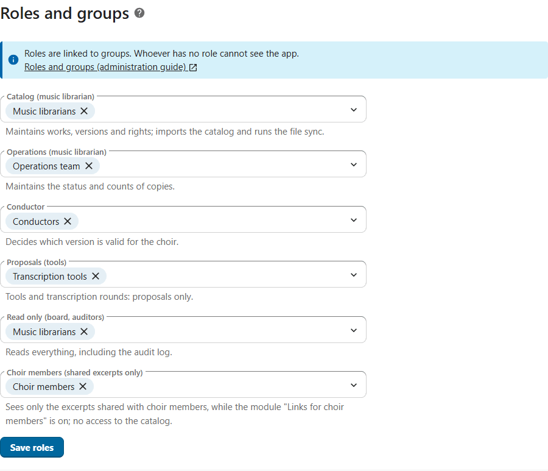
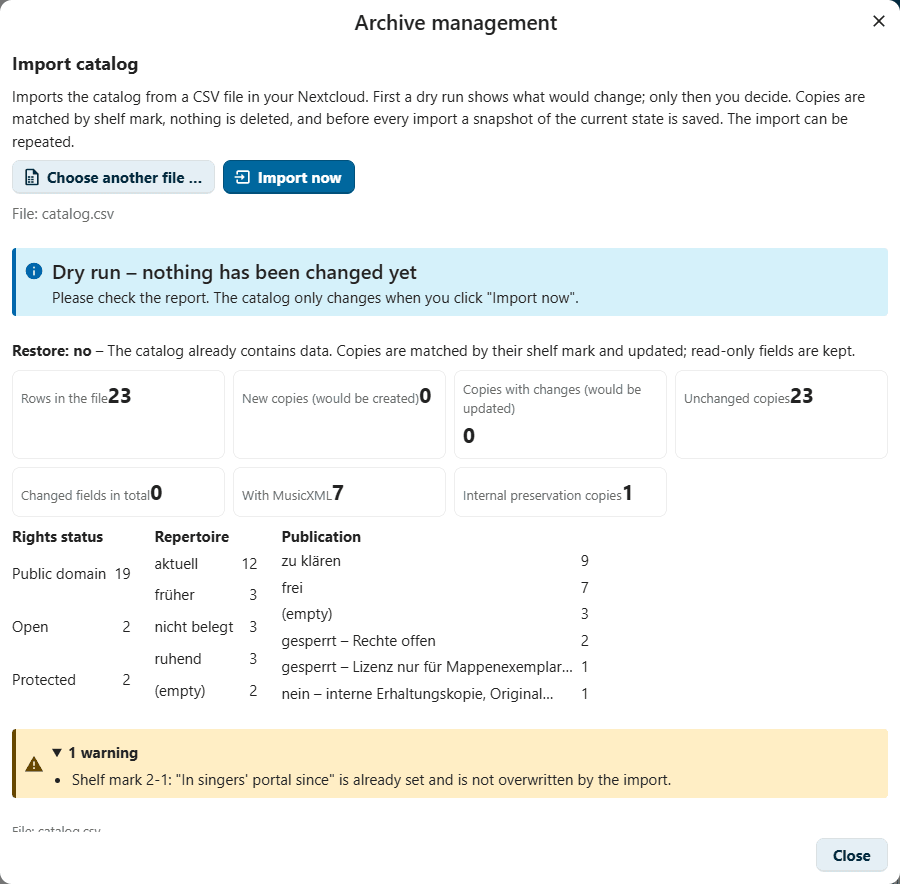

# Administration guide

This guide is for Nextcloud administrators who install and set up the
Notenarchiv app, and for the music librarians who take it over afterwards.
Daily work with the app is described in the [user guide](user-guide.md).

**Contents**

- [Setting up in five steps](#setting-up-in-five-steps) – the short way
1. [Installation](#1-installation)
2. [Roles and groups](#2-roles-and-groups) – the settings page, giving it to a group
3. [Archive folder](#3-archive-folder) – sharing it, the access check
4. [First import](#4-first-import)
5. [Backups and restore](#5-backups-and-restore)
6. [Notifications](#6-notifications)
7. [Dashboard widget, calendar and Files app](#7-dashboard-widget-calendar-and-files-app)
8. [Security settings of the instance](#8-security-settings-of-the-instance)
9. [Managed hosting](#9-managed-hosting)
10. [Data protection](#10-data-protection)
11. [Accessibility](#11-accessibility)
12. [Modules and presets](#12-modules-and-presets)
13. [Agents and the API](#13-agents-and-the-api)
14. [Sharing with choir members and the public](#14-sharing-with-choir-members-and-the-public)
15. [Folder book: retention period](#15-folder-book-retention-period)
16. [Mirror folder for the print station](#16-mirror-folder-for-the-print-station)
- [Common problems](#common-problems) – a message, its cause and what to do

## Setting up in five steps

After the [installation](#1-installation), open **Administration → Music
archive**. The list **Setting up** at the top of the page shows these five
steps, each as *done*, *missing* or *problem*, with a link to the place where
it is done.

1. **Archive folder** – choose the folder with the score files
   ([section 3](#3-archive-folder)). Right after choosing, before you save,
   the page shows which accounts of the role groups cannot open it.
2. **Roles and groups** – give each role its groups, at least the catalog
   role (music librarians) ([section 2](#2-roles-and-groups)). Before you
   save, the page lists which groups get or lose a role.
3. **Access to the archive folder** – share the folder with the groups of the
   roles (reading is enough) and **Check access** until nobody is listed
   ([Sharing the archive folder](#sharing-the-archive-folder)).
4. **Import the catalog** – a music librarian, in the app: **Archive
   management → Import catalog**, a dry run first
   ([section 4](#4-first-import)).
5. **File sync** – a music librarian, in the app: **Archive management →
   Run file sync**; it links the files of the archive folder to the copies.

Steps 1 to 3 can also be done by a group you give the settings page
([Giving the settings to a group](#giving-the-settings-to-a-group)); steps 4
and 5 need the catalog role. To try the app first, use the
[demo data](../tools/demo/README.md).

## 1. Installation

### Requirements

- Nextcloud 33–35 and PHP 8.2 or newer.
- MySQL or MariaDB as Nextcloud's database. The app is tested only with
  these; Nextcloud refuses to install it on PostgreSQL, SQLite or Oracle.
- Recommended: the Notifications app and a working background job runner
  (system cron). Without cron, weekly backups, deadline reminders and checksum
  checks run only when the instance is used ("AJAX" mode) and may be late.
- For the calendar features: the **dav** app, which is part of Nextcloud.
  The Calendar app is only needed to look at the calendars.

### From the App Store

> [!NOTE]
> The app is not yet published in the Nextcloud App Store. Once it is, this
> is the only way on managed instances without shell access.

Apps → search "Notenarchiv" → **Download and enable**.

### From a release archive

1. Download `notenarchiv-<version>.tar.gz` from the
   [releases of the repository](https://github.com/thoscut/choircoresmanager/releases).
2. Unpack it into the `apps` folder of your Nextcloud, so that the app lies
   in `apps/notenarchiv`.
3. Enable it under Apps, or run `occ app:enable notenarchiv`.

### From the source code

The folder must be named after the app id, `notenarchiv`. Building needs
Node.js 24 and npm 11:

```sh
cd /path/to/nextcloud/apps
git clone https://github.com/thoscut/choircoresmanager.git notenarchiv
cd notenarchiv
npm ci
npm run build
occ app:enable notenarchiv
```

The app needs no Composer packages at runtime; `composer install` only
installs the development tools.

## 2. Roles and groups

Permissions are bound to **groups**, never to persons: a change of office is a
change of group membership.

1. Create the groups under Users, for example "Music librarians",
   "Conductor", "Board".
2. Open **Administration → Music archive** (the section of the app in
   Nextcloud's administration settings). In the app, **Settings** at the
   bottom of the navigation leads there.
3. Under **Roles and groups**, choose the groups for each role. Before you
   save, the page lists which groups get or lose a role, and warns when the
   catalog role would have no group. **Save roles**.
4. Check access to the archive folder: new role holders need it, too
   ([section 3](#checking-who-can-open-the-archive-folder)).



The page **Administration → Music archive** holds all settings of the app:
archive folder, roles and groups, access to the archive folder (see
[section 3](#3-archive-folder)), modules ([section 12](#12-modules-and-presets)),
repertoire and, for admins, the complete backup and restore
([section 5](#5-backups-and-restore)). How each person sees the app
(**Customize view**) stays in the app.

| Role (German interface) | Typical holder | May |
|---|---|---|
| Catalog (music librarian) – *Bestand (Archivverwaltung)* | the person who keeps the catalog | edit works, versions and rights; confirm rights; licenses and releases; imports, file sync, exports, backups and restore; accept proposals; close tasks; new accessions, persons, merges; everything operations may do with copies |
| Operations (music librarian) – *Betrieb (Archivverwaltung)* | the person who hands out the binders | status, kind and counts of copies; inventory |
| Conductor – *Chorleitung* | conductor and deputy | choose the valid version; key, scoring, language, duration and review of a transcription; answer questions; plan concerts and song lists |
| Proposals (tools) – *Vorschläge (Werkzeuge)* | transcription rounds, scripts | only propose changes, which a music librarian accepts; ask questions |
| Read only (board, auditors) – *Lesen (Vorstand, Revision)* | board, auditors | read everything including the audit log |
| Choir members (shared excerpts only) – *Chormitglieder (nur geteilte Ausschnitte)* | the singers | no archive role: only the page "Shared with me" with the excerpts shared with choir members, and only while the module "Links for choir members" is on (see [section 14](#14-sharing-with-choir-members-and-the-public)) |

Concerts and song lists are planned by the conductor and the catalog role
together. Practice files are made by the catalog role and the conductor; only
these two may view internal preservation copies, and nobody plays them.

> [!IMPORTANT]
> Accounts without any role do not see the app; the server refuses every
> request. Admins without a role read the catalog, the lists and the
> programmes and change the settings. The proposals inbox and internal
> preservation copies stay closed to them, and they write catalog data only
> if they also hold a role. To do that, add yourself to a group with the role
> you need. To open scores and scans, their account needs access to the
> archive folder like everybody else ([section 3](#sharing-the-archive-folder)).

**Repertoire** in the same settings sets when a work counts as current
repertoire (sung within the last 3 years by default) and when as dormant
(within 10 years); earlier performances make it "earlier".

### Giving the settings to a group

Admins can give the settings page to a group, for example to the archive
management, so that changing a setting does not need an admin:

1. **Administration → Administration privileges**.
2. At **Music archive**, add the group.

Members of that group then see **Administration → Music archive** and may
change the archive folder, the roles and groups, the modules and the
repertoire thresholds, and run the access check. This gives them **no role**:
they see the app only if they hold a role as well. Complete backup and
restore stay with admins (and with the catalog role in the archive
management of the app); the page does not show them to the group.

> [!WARNING]
> Whoever may change the settings can give any group any role, also a group
> of their own. Give the page only to people you would also entrust with the
> catalog role.

On self-hosted instances the roles can also be set with
`occ notenarchiv:setup <account> --role librarian=<group>,<group> --role conductor=<group> …`
(roles: `librarian`, `operations`, `conductor`, `contributor`, `reader`,
`member` for the choir members).

## 3. Archive folder

The archive folder holds the score files, for example one subfolder per
binder.

1. **Administration → Music archive** → **Archive folder** → **Choose folder …**.
2. Choose the folder. Before you save, the page says what saving does and
   lists the accounts of the role groups that cannot open the chosen folder;
   share it with their groups (see below).
3. **Save archive folder**.

It should be a group folder or a share that every role holder can open in
their own Nextcloud. The app reads files through the account of the person
who uses it, so everybody only sees files they may see anyway. Background
jobs (weekly backup, checksums) read through the account that chose the
folder. The app never changes, moves or deletes files; it only writes into
its own subfolder `_notenarchiv-app`, for exports, snapshots and backups.
The one exception is a small correction of a MusicXML in the score view
(module "Small corrections"): the app saves it as a **new file**
next to the old one, with the Nextcloud permissions of the person who
corrects (for example `5-01_Title (korrigiert 2026-10-22).mxl`); the old file
stays unchanged. Without write permission in that folder the app says so and
saves nothing. The mirror folder for the print station (section 16) is the
other exception: the app writes into a target folder of its own, never into
the archive folder.

File names start with the shelf mark: `5-01_Title_Composer.pdf` belongs to
copy 5-1 (leading zeros do not matter). Folders whose name starts with `_` or
`.` are skipped. A file whose name does not fit can be linked to a copy by
hand; such a link stays. A file with a shelf mark whose name ends with
`bericht.json` (for example `5-01_Title - Bericht.json`) is the report of a
transcription: the file sync counts it as a report, not as a score file, and
reads it into review points (module "Reviewing transcriptions").

With shell access: `occ notenarchiv:setup <account> <folder>` (the folder
relative to the account's files). With an archive folder set, the command
ends with the access check below in short and names the accounts of the
role groups that cannot open the folder.

### Sharing the archive folder

The app reads files only with the permissions of the person who uses it. A
role holder whose account cannot open the archive folder sees the catalog,
but no scores, scans or practice files; the score view then says
"The file lies in a folder that is not shared with your account". Admins
without a role are no exception: to open scores they need access to the
folder, too.

- Share the archive folder with the **groups of the roles**, or keep it in a
  **team folder** (group folder) that these groups can open. Sharing with
  single persons works, but a group follows a change of office by itself.
- **Read permission is enough.** Permission to edit is only needed by those
  who put corrected files into the folder, and by those who store exports and
  backups in its subfolder `_notenarchiv-app`: the catalog role (archive
  management) and the account that chose the folder, through which the
  weekly backups are written.
- Never share the folder with all singers: the backups in it contain the
  whole catalog including the audit log (see [section 5](#5-backups-and-restore)).

### Checking who can open the archive folder

**Administration → Music archive → Access to the archive folder → Check
access** looks at every member of the role groups and at the admins without
a role:


- For each role and group it says, in words and with an icon, whether every
  checked member can open the folder, and names the accounts that cannot
  (display name and account name). A group that was deleted after it was
  given a role is marked as well.
- It also tells whether you can open the folder yourself.
- Disabled accounts and accounts that have never logged in are not checked
  (Nextcloud would first have to set up their file storage); their access
  follows from their groups like that of the others. At most 500 accounts
  are checked; the page says so when it stopped there.
- The check only reads. It shares nothing and changes nothing; share the
  folder in **Files** (the page has a link to open it) and check again.

In the app, the link **Check access to the archive folder** in the score
view and in the notes about the archive folder leads straight to the check,
for everybody who may change the settings.

## 4. First import

An existing catalog is imported from a CSV file (UTF-8, separated by
semicolons) with the columns of the original catalog. Upload it to
Nextcloud first; an import file may be at most 20 MB.

1. **Archive management** (bottom of the navigation, music librarians) →
   **Import catalog** → **Choose CSV file …**. The app runs a **dry run**
   right away; nothing is stored yet.

   

   The picture shows the catalog file of the demo archive imported a second
   time: all 23 rows are unchanged, and the warning says that a value set
   in the app is kept.

2. Check the report: rows, new and changed copies, copies with MusicXML,
   internal preservation copies, the distribution of rights status,
   repertoire and publication, and warnings.
3. **Import now**. Before an import into a catalog that already holds data,
   the app stores a snapshot of the previous state in `_notenarchiv-app`.
4. **File sync** → **Run file sync** links the files of the archive folder to
   the copies.

   

   The report lists files whose shelf mark is not in the catalog, copies
   without a file and the skipped folders. Files are only read.
5. Optionally import, in the same dialog, **performances and song lists**
   (`.xlsx` or `.csv`; unclear lines can be assigned afterwards) and the
   **persons** (CSV research list of composers, lyricists and arrangers).
   Both start with a dry run as well.

> [!IMPORTANT]
> An import never takes the decisions that belong to people: it does not
> confirm rights and does not choose a valid version. Only restoring an
> extended export into an empty catalog takes over the decisions recorded in
> it.

A repeated import (while the CSV is still the leading source) matches copies
by shelf mark, updates changed values and keeps decisions taken in the app.
Copies missing from the CSV stay in the catalog; nothing is deleted.

To try the app first, [tools/demo](../tools/demo/README.md) builds the
invented archive of a fictitious choir with step-by-step instructions.

## 5. Backups and restore

Nextcloud is no backup: synchronisation also replicates deletions. The app
therefore writes, every week, into `_notenarchiv-app/`:

- `…_catalog_weekly.csv`: the catalog in the legacy column layout plus all
  fields, readable in any spreadsheet program
- `…_catalog_weekly.ods`: the same plus the audit log and the register of
  persons as further sheets
- `…_backup_weekly.json`: the **complete** backup of all tables (works,
  versions, copies, files, licenses, proposals, tasks, links, concerts and
  song lists with their programme lines, persons, contributions, merges,
  transcription reports and review points, the folder book with its loans,
  audit log) for a lossless restore


In **Archive management**, **Store a complete backup now** writes the same
three files at once, for example before larger changes, and **Download
complete backup (JSON)** saves the backup on your computer.

> [!WARNING]
> The backups hold the complete catalog including the audit log (who changed
> what), tasks, the register of persons and the folder book (names of choir
> members until the retention period ends, section 15). Share the archive
> folder only with people who may read all of this, the role holders, and not
> for example with all choir members. The role "Proposals (tools)" cannot
> download the complete backup.

The files in `_notenarchiv-app` are part of the archive folder and are
covered by your regular file backup of that folder. Keep yearly snapshots
that are never overwritten. Open the CSV files in a spreadsheet program
through its import dialog (all columns as text) rather than by double-click,
or use the ODS file: the catalog CSV keeps every cell exactly as stored, so a
cell starting with `=` could be read as a formula; the ODS file stores every
cell as text. See also [SECURITY.md](../SECURITY.md).

### Restore

A backup can only be restored into an **empty** catalog, for example after
reinstalling the app. Nothing existing is overwritten.

1. **Archive management** → **Complete backup and restore** → **Restore from
   a backup …** (admins find the same under **Administration → Music
   archive**; giving the settings page to a group does not include it).
2. Choose a `…_backup_….json` file.
3. Confirm that it is the right and most recent backup and **Restore now**.

In the web interface a backup file may be at most 64 MB. On self-hosted
instances `occ notenarchiv:restore <file> [<account>]` reads the file from the
server's file system without that limit, and
`occ notenarchiv:export --full` writes a complete backup to standard output.
Every value of the backup is checked against the database schema before
anything is written; a refused restore changes nothing.

Without the app, the CSV and ODS files still contain everything needed to
continue working on paper or in a spreadsheet. If a weekly backup fails,
music librarians and admins get a notification.

## 6. Notifications

The app notifies the members of the groups of a role through Nextcloud's
notifications. A notification is withdrawn when the matter is resolved.


| Notification | To | When |
|---|---|---|
| Proposals waiting in the inbox | catalog role | while open proposals exist (one notification with the count) |
| Version to take out of the singers' portal | catalog role | daily check: in the portal, but no longer released |
| License ending or ended | catalog role | daily check: ends within 30 days or has ended |
| New question or task | the addressed role | when it is created |
| Answer to apply | catalog role | when a task is answered |
| Concert deadline | conductor and catalog role | 10, 8 and 6 weeks before a planned concert |
| Confirm what was sung | conductor | after the date of the concert |
| Protection term ended | catalog role | daily check: marked protected, but public domain by the life dates |
| File changed without modification | catalog role | when the checksum job finds a deviation |
| Weekly backup failed | catalog role and admins | when the weekly backup fails |
| New review points | the role responsible: conductor (musical points) and/or catalog role (material, questions without a measure) | a transcription report brings review points; one notification per report and role, withdrawn when none of them is open any more |
| Correction received | catalog role (not the person who made it) | a correction was saved in the app, or a new round of a transcription closed review points |
| Print station sync failed | catalog role and admins | the daily sync of the mirror folder for the print station fails; withdrawn after the next sync that works |

Notifications never go to singers and contain no personal data. The deadline
notifications of a cancelled concert are withdrawn. Every user chooses in
their personal settings whether notifications also arrive by email and how
often (for example weekly).

## 7. Dashboard widget, calendar and Files app

### Dashboard widget

The dashboard widget **Music archive – due** shows the same as the start page
of the app: concert deadlines, the start page cards and the tasks for the
user's roles, each with a link into the app. Nextcloud offers it only to
accounts with an archive role; admins without a role do not get it. It
contains concert titles and dates, numbers and shelf marks with titles, never
the text of a question or a person's name.

### Calendar

Concerts can be added to the users' own Nextcloud calendars and downloaded as
calendar files (iCalendar). This uses the calendars of the **dav** app;
accounts without a writable calendar can still download the files.

- New entries are created through Nextcloud's calendar interface for apps.
  That interface cannot change existing entries, so an entry that is already
  in a calendar is updated by the user's browser with a normal CalDAV request
  in the user's own session (the same as the Calendar app does). Proxies or
  web application firewalls that block `PUT` requests to `/remote.php/dav/`
  prevent these updates; the app then reports the entries it could not save.
- Times of a concert refer to the Nextcloud time zone of the account that
  entered them (personal settings). Check that the planners' time zones are
  right.

> [!NOTE]
> There is deliberately **no public subscription link** (webcal feed with a
> token): it would be a new way to the concert data without logging in, and
> it is a decision for the choir (who may see concerts, how links are
> revoked).

### Files app

With the module **Opening from the Files app** (on in the presets Standard
and Complete), files of the archive folder get the action **Open in music
archive** in the Files app: a click on MusicXML (`.musicxml`, `.mxl`) opens
the score view of its copy, other files of a copy (scans, MuseScore, audio)
open the copy from the actions menu. PDFs keep Nextcloud's viewer, and a
click on MusicXML stays with another app if one already opens MusicXML
through Nextcloud's viewer.

The Files app loads the small script of the action only for accounts with
an archive role and for admins, and only when the account can see the
archive folder; other accounts get nothing. Which copy a file belongs to is
decided by the server when the action runs. It answers only for files the
account can see in its own files (otherwise 404, the same as for a file that
is not listed), so the action tells nobody whether a file of another account
is in the archive. The score view checks the rights as always.

## 8. Security settings of the instance

The app works with Nextcloud's defaults; nothing has to be relaxed:

- The app page allows WebAssembly (`'wasm-unsafe-eval'` in its content
  security policy) for the bundled notation engine; no other exception.
- The app makes no requests to other servers: notation, fonts and sounds are
  bundled.
- Imports, exports, backups, statistics, calendar files and the file sync are
  rate limited per user. Guessing excerpt links is slowed down by Nextcloud's
  brute-force protection (Administration → Security shows blocked addresses;
  behind a reverse proxy, set `trusted_proxies` so that Nextcloud sees the
  real client addresses).

[SECURITY.md](../SECURITY.md) describes the design and how to report a
vulnerability.

## 9. Managed hosting

On instances without shell access everything is done in the web interface:
installation from the App Store, settings (Administration → Music archive),
imports and restore. The `occ`
commands are a convenience for self-hosted instances:

| Command | Does |
|---|---|
| `occ notenarchiv:setup <account> [<folder>] [--role role=groups]` | sets the archive folder and the role groups; with an archive folder it names the accounts of the role groups that cannot open it |
| `occ notenarchiv:import <account> <file> [--execute]` | imports the catalog CSV; a dry run unless `--execute` is given |
| `occ notenarchiv:export [--extended] [--full]` | writes the catalog CSV, all fields, or the complete backup (JSON) to standard output |
| `occ notenarchiv:file-sync <account>` | runs the file sync |
| `occ notenarchiv:restore <file> [<account>]` | restores a complete backup into an empty catalog |
| `occ notenarchiv:modules list\|enable\|disable\|preset` | shows and switches the modules (section 12) |

## 10. Data protection

The app stores catalog data and the names of the function holders who changed
it (audit log, as a snapshot of the display name). The register of persons
holds names, life dates and roles of composers, arrangers, lyricists and
other persons involved; for living persons this is personal data from public
sources (prints, publisher catalogues) kept for the rights assessment.
Transcription reports are kept as received (as evidence, with their
checksum); their rights section may name the persons involved in a work.
Review points record who decided them and when.

Without the folder book the app stores no data about choir members. The
folder book (section 15) stores the name or the Nextcloud account of the
person who has a choir folder and notes about the loan; they are removed
after the retention period. Excerpt links count calls without
recording who opened them. The statistics contain no personal data of choir
members and no account names; calendar entries contain no notes and no
persons; the dashboard widget shows no question texts and no names. Record
the processing in your register of processing activities (GDPR Art. 30).

## 11. Accessibility

The interface targets WCAG 2.2 AA: keyboard operation, screen reader labels,
sufficient contrast in the light and the dark theme, information never by
colour alone, zoom to 200 %, reduced motion respected. The score viewer offers
a text description of the excerpt, announces the current measure during
playback and offers playback and text references as alternatives to the
notation. The statistics show every figure as a number in a table; the bars
are only an addition.

## 12. Modules and presets

Not every choir needs every function. Everything outside the core is a
**module** that admins switch on and off under **Administration → Music
archive → Modules** (also the groups the settings page was given to). The core is always on: the catalog (works, versions, copies,
fields, search, status), the start page, the file sync with the archive
folder, roles, the audit log, CSV import and export, backup and restore, and
the settings.

Rules:

- **Off means off on the server, too.** The routes of a switched-off module
  answer 404 ("This function is switched off."); background jobs,
  notifications, start page cards and the dashboard widget leave it out, and
  the navigation, sidebar tabs and buttons disappear. Links to it (e.g. from
  older notifications) open the start page with a note.
- **Nothing is deleted.** The data of a module stay in the catalog, the CSV
  and the backups. Switching the module on again shows everything again.
- **Switching off never makes anything less safe.** The rights checks for the
  score view, playback, practice audio files and internal preservation copies
  apply whatever is switched on. Without the module "Rights confirmation and
  licenses" nothing can be confirmed or licensed, so nothing more is played or
  released than before.
- **Dependencies.** Some modules need others (e.g. playback needs the score
  view, the calendar needs the concerts). Switching a module on also switches
  on what it needs. Switching off a module that others need first lists them;
  their own switches stay as they are, they stop working and come back with
  the module. Each switch shows what it needs and why it is not working.

Every change of a switch is recorded in the audit log (object type
`settings`).

### Presets

| Preset | Switches on |
|---|---|
| **Simple** | the core, the score view with playback and the notifications (of the core only the one about a failed weekly backup is left) |
| **Standard** | everything except practice audio files, the print station, the proposals inbox, checksums, the folder book and statistics |
| **Complete** | everything except the interface for agents, the four sharing modules and the mirror folder for the print station |

A preset sets every switch at once; the settings ask first and list what
changes.

**New installations** start with the preset **Standard**. It is chosen for
small choirs with one volunteer music librarian: catalog, rights, scores,
questions, concerts and the care of the stock are what such a choir uses in
its first year. Left off, and easy to switch on when needed:

- *Practice audio files*: the files leave the app and are passed on; making
  them is a decision of the choir about rights.
- *Print station*: only for choirs that run one.
- *Proposals inbox*: only useful with tools or transcription rounds (role
  "Proposals (tools)").
- *Checksums*: the job reads all archive files again and again in the
  background; that is for large archives that must document their integrity.
  The weekly backup is the safety net of every installation.
- *Statistics and annual report*: figures for the board of a larger archive.
- *Folder book*: it stores names of choir members; the club decides first
  whether to keep it in the app (section 15).

*Reviewing transcriptions* and *small corrections in the app* are on in
**Standard**: they only show something where a transcription report or a
MusicXML exists, and they spare the conductor the detour over questions and
files. **Simple** leaves them off: it keeps to reading the catalog and the
scores. The corrections need only the score view, not the review, so that a
choir without transcription reports can still correct a wrong note.

**Existing installations** keep every function: an update from a version
before 0.1.27 stores all switches as on. The switches are stored on every
installation and update, so a later change of the defaults never switches
anything at an existing installation; a module added by a later version gets
its default. The **interface for agents** starts off everywhere and is
part of no preset: no preset switches it on or off, not even "Complete". It
is an access path for tools rather than a function for people, so the
administration switches it on on purpose (see section 13), and choosing a
preset later neither opens nor closes it. The same holds for the four
modules of the group **Sharing beyond the archive roles**: they open the
archive to choir members or the public, which the choir decides (see
section 14), and for the **mirror folder for the print station**: it
writes files into a folder others can open (see section 16).

### The modules

| Module | Needs | Standard | Switched off |
|---|---|---|---|
| Rights confirmation and licenses | – | on | No confirming, no licenses to add or change, no list of ending licenses, no license reminders. Existing licenses and confirmations still count for playback and releases. |
| Valid version | – | on | The conductor cannot choose or clear the valid version; no card "no valid version chosen". A chosen version stays recorded. |
| Register of persons | – | on | No register, no contributions, no import of a research list. |
| Protection terms | Register of persons | on | No protection proposal, no resubmission list, no notification about ended protection terms. |
| Releases | Rights confirmation and licenses | on | The three releases below are inactive. |
| Singers' portal | Releases | on | No portal list, no adding to or removing from the portal, no cards and notification; song lists without the portal column. |
| Print station | Releases | off | No print station list. |
| Mirror folder for the print station | Print station | off (in no preset) | No sync, no preview, no daily sync, no notification. The files in the target folder stay as they are. |
| Publication | Releases | on | The publication status is not shown. |
| Score view | – | on | No score view; the server does not hand out the MusicXML. |
| Playback | Score view | on | No playback. |
| Practice audio files | Playback | off | The server refuses every export. |
| Excerpt links | Score view | on | No new links, and existing links do not open (they are kept and expire as before). |
| Reviewing transcriptions | Score view | on | The file sync still recognises transcription reports, but does not read them; no review points, no correction orders, no review in the score view, no filter "open review points". Reports, points and decisions are kept. |
| Small corrections | Score view | on | No corrections in the score view; files corrected before stay as they are. |
| Opening from the Files app | – | on | The Files app has no action "Open in music archive"; a click on MusicXML in the archive folder does what it did before. Without the score view, MusicXML opens its copy instead. |
| Questions and tasks | – | on | No questions and tasks, no task cards and notifications. Existing tasks are kept. |
| Proposals inbox | – | off | No inbox; tools cannot propose. Open proposals are kept. |
| Concerts and song lists | – | on | No concerts and song lists, no deadlines on the start page, in the dashboard or as notifications. |
| Import of performance lists | Concerts and song lists | on | No import, no list of unclear programme lines. |
| Repertoire figures | Concerts and song lists | on | The catalog shows the repertoire values of the imported catalog; no thresholds in the settings. |
| Concerts in the calendar | Concerts and song lists | on | No calendar files and entries. Entries in calendars stay there. |
| New accessions and shelf labels | – | on | No accession assistant and no labels. The import still creates copies. |
| Merging works | – | on | No merge proposals, no merging and no undo. Merges done stay. |
| Inventory | – | on | No inventory lists. Recorded counts stay in the catalog. |
| Folder book | – | off | No folder book. Folders and loans stay; names are still removed after the retention period. |
| Checksums | – | off | The hourly job does nothing; no checksum list, no notification. |
| Statistics and annual report | – | off | No statistics, no annual report. |
| Dashboard widget | – | on | Nextcloud does not offer the widget. |
| Notifications | – | on | The app sends no notifications; notifications sent before disappear when they are shown. |
| One switch per occasion | Notifications and the module of the occasion | on | That notification is not sent; the daily checks withdraw it. Occasions: proposals waiting, remove from the singers' portal, license ends soon, license has ended, weekly backup failed, new question or task, question answered, concert deadlines, confirm what was sung, protection term ended, file changed unnoticed, new review points, correction received, print station sync failed. |
| Links for choir members | Excerpt links, Playback, Releases | off (in no preset) | Choir members see neither the app nor "Shared with me"; their routes answer 404; no links for choir members can be made. Existing links are kept and expire as before. |
| Practice audio for choir members | Links for choir members, Practice audio files | off (in no preset) | Choir members make no practice files; the server refuses every request. |
| Public links | Excerpt links, Playback, Publication | off (in no preset) | Every public link answers the same 404 page; no new public links. Existing links are kept and expire as before. |
| Public repertoire page | Rights confirmation and licenses | off (in no preset) | `/apps/notenarchiv/repertoire` answers 404; the work fields for the page are hidden. |
| Interface for agents | – | off (in no preset) | The API for agents (`/ocs/v2.php/apps/notenarchiv/api/v1/…`) answers 404; the MCP server reports the interface as switched off. Nothing else changes. |

### Command line

On instances with shell access the same is possible with `occ`; the command
resolves the dependencies and reports them:

```sh
occ notenarchiv:modules list            # table: switch, active, needs (--json for scripts)
occ notenarchiv:modules enable calendar # also switches on "concerts" if needed
occ notenarchiv:modules disable statistics practice_audio
occ notenarchiv:modules preset standard # simple | standard | complete
```

Module keys are listed in `docs/api.md` ("Modules and the personal view").

### Personal view

Independently of the modules, every person can hide navigation areas and
start page cards they do not need (**Customize view** in the navigation). It
is stored on the server for the account and changes no permission; hidden
areas still open through links and notifications.

## 13. Agents and the API

Tools and assistants ("agents") can work with the archive through a fixed,
versioned interface: the **API for agents** (OCS, version 1, described in
[api-v1.md](api-v1.md) and in `openapi.json`) and an **MCP server** for
clients such as Claude Desktop or Claude Code ([tools/mcp](../tools/mcp/README.md)).
An agent can read the catalog, a copy with its rights, the due list,
concerts and statistics, build text references, ask questions, answer
questions addressed to its role and propose changes. For the review of
transcriptions it reads the review points of a copy and the correction
orders, and hands in the report of a transcription (`bericht.json`), which
becomes review points as if it had come through the file sync.

**Agents never decide.** The interface has no way to confirm a rights status,
to add or change licenses, to choose the valid version, to accept proposals,
to close tasks, to decide review points, to save corrections, to delete or
restore anything, to make backups or to change settings. People do that in
the app, as before. A proposal of an agent lands in the proposals inbox; a
question goes to the role it is addressed to; the review points of its
report go to the conductor and the catalog librarian. A corrected MusicXML
of the tool chain reaches the archive as a new file in the archive folder
(file sync), not through the interface.

Setting up:

1. Switch on the module **Interface for agents** (Settings → Modules, or
   `occ notenarchiv:modules enable agent_api`). For proposals, the
   **Proposals inbox** must be on as well; for questions, **Questions and
   tasks**; for review points and reports, **Reviewing transcriptions**.
2. Create an account that only the agent uses and a group for it, and give
   the group the role **Proposals (tools)** (reads, proposes, asks) or
   **Read only**. Do not give agents the roles of the catalog or operations
   librarian or the conductor.
3. Create an app password for that account (Personal settings → Security,
   logged in as the agent's account) and give it to the agent's MCP
   configuration only. Revoke it when the agent is no longer used.

What the server enforces: every request is checked against the roles of
the agent's account and the modules, as in the app; every route is limited
per account; internal preservation copies stay hidden from roles that may
not view them; answers contain no account names. Proposals, questions and
reports of the agent appear in the audit log under its account.

To stop all agents at once, switch the module off: the interface answers
404 immediately. Deleting an app password or the account ends the access of
one agent.

Note: Nextcloud lets every client with an app password also call the
internal interface of the app's user interface (with the same role checks).
The module does not open more than the roles allow; it offers a stable,
documented contract that stays the same across updates of the app.

## 14. Sharing with choir members and the public

Four modules in the group **Sharing beyond the archive roles** open parts of
the archive to people without an archive role. They are off on every
installation and part of no preset, not even "Complete": switch them on
one by one, after the choir has decided.

| Module | What it opens |
|---|---|
| **Links for choir members** | The role **Choir members** sees the page "Shared with me": the excerpts that the music librarians or the conductor share with the choir, to view and play with a voice emphasised. Only for versions released for the singers' portal. |
| **Practice audio for choir members** | Choir members make a WAV or MIDI file of one voice of such an excerpt, where the rights allow practice audio files. Every file is recorded in the audit log. |
| **Public links** | A link that shows and plays an excerpt without login (`/apps/notenarchiv/p/<token>`). Only for versions released for publication that are confirmed public domain or have a license for online publication. |
| **Public repertoire page** | `/apps/notenarchiv/repertoire`: the works the catalog librarian chooses among those with a version confirmed as public domain, with life dates, scoring and links to CPDL and IMSLP. |

Whatever the switches say, choir members and the public only ever get the
measures of an excerpt, never a file of the archive; internal preservation
copies are never shared; the rights are checked again on every call; links
expire after at most six months and can be revoked. [SECURITY.md](../SECURITY.md)
describes the threat model.

**Setting up the choir members:**

1. Create a group for the singers, for example "Choir", and add their
   accounts. Do not use a group that also holds an archive role: an account
   with an archive role always gets the archive, not "Shared with me".
2. Settings → **Roles and groups** → **Choir members (shared excerpts
   only)**: choose the group and **Save roles** (or
   `occ notenarchiv:setup <account> --role member=Choir`).
3. Switch on **Links for choir members** (Settings → Modules, or
   `occ notenarchiv:modules enable member_links`). It also switches on what
   it needs: excerpt links, playback and the releases.

**Recommended order:**

1. Keep the rights first: confirm public domain or record licenses with the
   use "Singers' portal". Without them no link for choir members is
   possible.
2. Then switch on **Links for choir members** and try it with one test
   account in the group.
3. **Practice audio for choir members** only when the licenses of the
   versions you share cover practice audio, or the versions are confirmed
   public domain.
4. **Public links** and the **Public repertoire page** last, after a
   decision of the board: they are reachable by everyone on the internet.
   Public links additionally need the publication status "Released for
   publication" on the version and confirmed public domain or a license with
   the use "Online publication (public links)".

**Risks to weigh:** an excerpt that reaches a browser can be saved; legally
it counts as much as the whole sheet, which is why only released versions
can be shared. Links can be passed on until they expire or are revoked. The
note of a link for choir members is read by all choir members. Calls are
counted, but without names.

**Common problems:**

| Problem | What to do |
|---|---|
| A choir member does not see the app | Check that **Links for choir members** is on and active (all its requirements on) and that the account is in the group of the role **Choir members**. |
| A choir member sees the archive instead of "Shared with me" | The account is also in a group with an archive role; remove it there. |
| The dialog says a link is not possible | It names the reason and the next step: usually the rights of the version are not confirmed, a license for the singers' portal or for online publication is missing, or the publication status is not "Released for publication". |
| The dialog says "This kind of link is switched off" | Switch on the module in the settings (Modules). |
| "The score of this excerpt is not available at the moment." | The account that chose the archive folder (Settings → Archive folder) must still exist and see the folder, and the MusicXML file must still be in it. |
| A public link shows "not found" | It has expired, was revoked, the version is no longer released, or the module is off; the page does not tell which. Make a new link if needed. |

## 15. Folder book: retention period

The **folder book** (module "Folder book", in the preset "Complete") records
which choir folder is out with whom since when (see the
[user guide](user-guide.md#folder-book)). It is the one part of the app that
holds personal data of choir members: the name or the Nextcloud account of
the person who has a folder, and notes about the loan.

**Who sees it.** The catalog and operations roles keep it; the conductor
and the read-only role read it. Proposals (tools), administrators without a
role and any other role, for example choir members, do not see it, nor its
entries in the audit log; they cannot download the complete backup either.

**Retention period.** In **Settings → Folder book: retention period** you
set after how many months after the return (1 to 120, default 12) the app
removes the personal data of a loan:

| When | What happens |
|---|---|
| The folder is out | Name or account and the note stay; they are needed. |
| The folder comes back | The loan keeps name, days, condition, missing sheets and notes. |
| Retention period after the return | The daily check removes name, account and both notes from the loan and from its entries in the audit log (shown as `(anonymised)`). The loan stays as "former loan" with its days, condition and missing sheets; the audit log notes "Name removed after the retention period" without the name and without a user. |

The removal also runs while the folder book is switched off: switching off
never makes anything less safe. It needs Nextcloud's background jobs (cron).

> [!WARNING]
> Backups made before the removal still contain the names: the weekly files
> in `_notenarchiv-app/` (CSV, ODS with the audit log, complete JSON backup),
> downloaded backups and the regular backups of the server. The app never
> deletes files. Keep these backups no longer than the retention period, or
> record in your register of processing activities how long they are kept.

Write the purpose and the period into your register of processing
activities (GDPR Art. 30) and tell the choir members (GDPR Art. 13), for
example: "We record who has which choir folder, to get the folders back.
Names are deleted 12 months after the return."

## 16. Mirror folder for the print station

The module **Mirror folder for the print station** copies the PDF scans of
the versions on the list **Print station** into a folder of the print
station and keeps it up to date (see the
[user guide](user-guide.md#mirror-folder-for-the-print-station)). It is the
only function besides small corrections that writes files, and it writes
only into this folder, never into the archive folder (guideline 4 of the
[roadmap](../ROADMAP.md)). It is part of no preset; switch it on on purpose.

Setting up:

1. Switch on **Print station** and **Mirror folder for the print station**
   (Settings → Modules, or `occ notenarchiv:modules enable print_mirror`).
2. Create or choose a folder for the print station **outside the archive
   folder**, for example a folder shared with the print station's account.
   Your account must be able to read the archive folder and to create,
   change and delete files in the target folder.
3. **Settings → Print station: mirror folder → Choose folder …**. The app
   checks the folder right away: not the archive folder, not inside it (also
   through shares), write permission. Then **Save target folder**.
4. Look at the preview and start the first sync (in the settings or in the
   list **Print station**). The daily sync starts only after this first sync
   by hand.

The app reads the scans and writes the files as the account that chose the
folder. Choosing another folder starts afresh: the files in the old folder
stay there and are no longer looked after. **Remove target folder** stops the
sync; the files stay.

What it copies: for every version on the list of the print station (rows
"add" and "not decided", the same rule as the list) the PDF scans of its
active copies, never internal preservation copies, named
`<shelf mark> <title>.pdf`, and a `LIESMICH.txt`. Every write and every
removal is in the audit log. It replaces or removes only files it wrote
itself and that nobody changed since (it keeps their checksums); every other
file in the folder stays. If the daily sync fails (folder gone, no write
permission), the catalog role and the administrators get a notification
"Print station sync failed".

Risks:

- **Everyone who can open the target folder can print and copy the scans.**
  The list of the print station only says what may be printed there; share
  the folder only with the print station or the people who may print.
- The files leave the archive: a scan removed from the list is removed from
  the folder at the next sync, but copies made meanwhile stay where they
  were made.
- The app writes as the account that chose the folder; if that account is
  deleted or loses access, the sync stops and notifies.

## Common problems

Each entry gives the message (in the German interface in brackets), its
cause and what to do.

### The score cannot be shown

*"The file lies in a folder that is not shared with your account"*
(*Die Noten können nicht angezeigt werden – Die Datei liegt in einem Ordner,
der für dein Konto nicht freigegeben ist*). The same account also gets a note
at the top of the app and on the tab "Files".

- **Cause:** the app reads files only with the permissions of the person who
  uses it, and the archive folder is not shared with this account. This also
  happens to admins without a role.
- **To do:** share the archive folder with the group of the person's role,
  or keep it in a team folder; reading is enough. Then
  **Administration → Music archive → Access to the archive folder → Check
  access** must list nobody
  ([Sharing the archive folder](#sharing-the-archive-folder)). People who may
  change the settings get a button to the check right in the message.

### File sync or export: the archive folder is not accessible

*"The archive folder is not accessible for this account."* (*Der
Archivordner ist für dieses Konto nicht erreichbar.*) or *"No write
permission for exports in the archive folder."* (*Keine Schreibberechtigung
für Exporte im Archivordner.*)

- **Cause:** the music librarian who runs the file sync or stores an export
  or backup cannot open the folder, or may only read it. The weekly backup
  writes through the account that chose the folder, so it fails the same way
  when that account loses access (the catalog role and admins are notified).
- **To do:** give the catalog role permission to edit the folder (at least
  its subfolder `_notenarchiv-app`), and make sure the account shown as
  "chosen by" under **Archive folder** still has access, or choose the folder
  again with an account that has.

### No access to the music archive

*"You have no access to the music archive."* (*Du hast keinen Zugang zum
Notenarchiv.*)

- **Cause:** the account is in no group with a role (and is no admin).
- **To do:** add the person to the group of their role, or give that group
  the role under **Roles and groups** ([section 2](#2-roles-and-groups)).

### A role has a group that no longer exists

The setup list shows **Roles and groups** as a problem; the access check
says *"The group no longer exists"*.

- **Cause:** the group was deleted or renamed after it was given the role.
- **To do:** choose the right group for the role under **Roles and groups**
  and save.

### Music librarians do not see "Administration → Music archive"

- **Cause:** the settings page is for admins only, unless it was given to a
  group.
- **To do:** an admin gives it to the group under **Administration →
  Administration privileges**
  ([Giving the settings to a group](#giving-the-settings-to-a-group)).
  Complete backup and restore stay with admins; music librarians find them
  in the archive management of the app.

### A restore is refused

*"A backup can only be restored into an empty catalog."* (*Eine Sicherung
lässt sich nur in einen leeren Bestand zurückspielen.*)

- **Cause:** nothing is ever overwritten; already one row in a table of the
  app (also an audit log entry) counts.
- **To do:** restore only into a new installation of the app; see
  [section 5](#5-backups-and-restore).

### Too many requests

*"Too many requests. Please wait a moment and try again."* (*Zu viele
Anfragen …*)

- **Cause:** expensive functions are limited per account, e.g. the access
  check to 20 runs in 10 minutes.
- **To do:** wait a few minutes.
