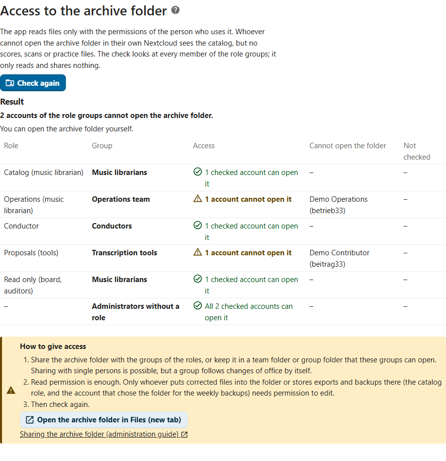
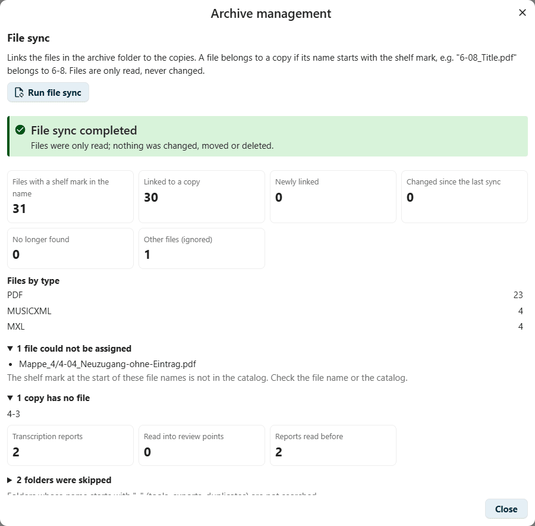
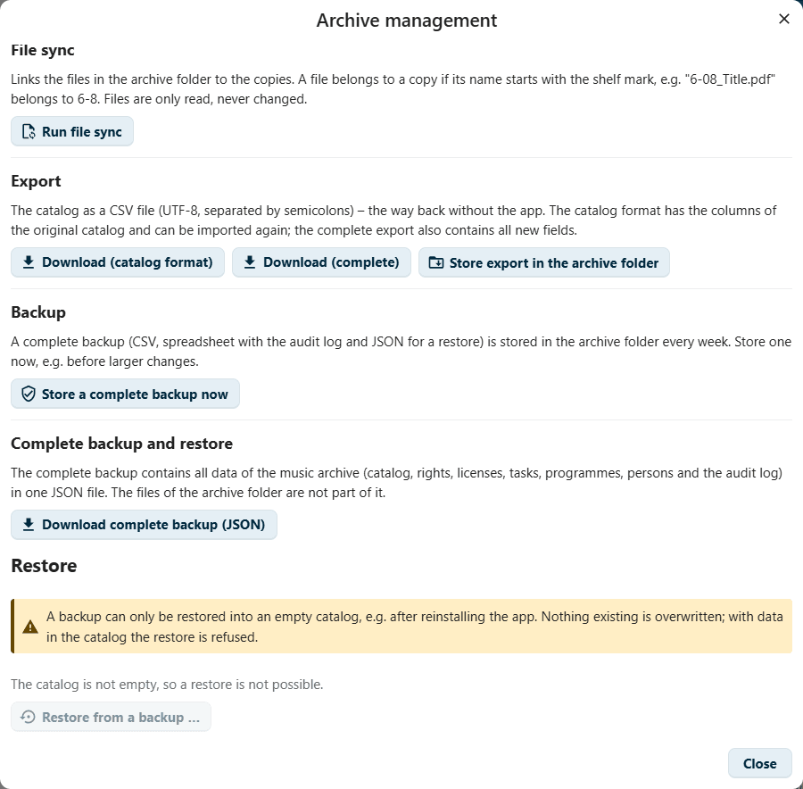
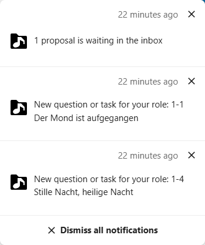

<!--
  - SPDX-FileCopyrightText: 2026 Thomas Scheel and Cantoria contributors
  - SPDX-License-Identifier: AGPL-3.0-or-later
-->
# Administrationshandbuch

[English](../admin-guide.md) | **Deutsch**

Dieses Handbuch ist für die Nextcloud-Administration, die die App
Notenarchiv installiert und einrichtet, und für die Archivverwaltung, die sie
danach übernimmt. Die tägliche Arbeit mit der App beschreibt das
[Benutzerhandbuch](benutzerhandbuch.md).

**Inhalt**

- [Einrichten in fünf Schritten](#einrichten-in-fünf-schritten) – der kurze Weg
1. [Installation](#1-installation)
2. [Rollen und Gruppen](#2-rollen-und-gruppen) – die Einstellungsseite, sie einer Gruppe übertragen
3. [Archivordner](#3-archivordner) – ihn freigeben, die Zugriffsprüfung
4. [Erster Import](#4-erster-import)
5. [Sicherung und Wiederherstellung](#5-sicherung-und-wiederherstellung)
6. [Benachrichtigungen](#6-benachrichtigungen)
7. [Dashboard-Widget, Kalender und Dateien-App](#7-dashboard-widget-kalender-und-dateien-app)
8. [Sicherheitseinstellungen der Instanz](#8-sicherheitseinstellungen-der-instanz)
9. [Verwaltetes Hosting](#9-verwaltetes-hosting)
10. [Datenschutz](#10-datenschutz)
11. [Barrierefreiheit](#11-barrierefreiheit)
12. [Module und Voreinstellungen](#12-module-und-voreinstellungen)
13. [Agenten und die API](#13-agenten-und-die-api)
14. [Mit Chormitgliedern und der Öffentlichkeit teilen](#14-mit-chormitgliedern-und-der-öffentlichkeit-teilen)
15. [Mappenbuch: Löschfrist](#15-mappenbuch-löschfrist)
16. [Spiegelordner für die Druckstation](#16-spiegelordner-für-die-druckstation)
- [Häufige Probleme](#häufige-probleme) – eine Meldung, ihre Ursache und was zu tun ist

## Einrichten in fünf Schritten

Öffne nach der [Installation](#1-installation) **Verwaltungseinstellungen →
Notenarchiv**. Die Liste **Einrichtung** oben auf der Seite zeigt diese fünf
Schritte, jeden als *Erledigt*, *Noch zu tun* oder *Bitte prüfen*, mit einem
Link an die Stelle, wo er erledigt wird.

1. **Archivordner** – wähle den Ordner mit den Notendateien
   ([Abschnitt 3](#3-archivordner)). Gleich nach der Wahl, vor dem Speichern,
   zeigt die Seite, welche Konten der Rollengruppen ihn nicht öffnen können.
2. **Rollen und Gruppen** – gib jeder Rolle ihre Gruppen, mindestens der
   Rolle „Bestand“ (Archivverwaltung) ([Abschnitt 2](#2-rollen-und-gruppen)).
   Vor dem Speichern listet die Seite, welche Gruppen eine Rolle bekommen
   oder verlieren.
3. **Zugriff auf den Archivordner** – teile den Ordner mit den Gruppen der
   Rollen (Lesen genügt) und wähle **Zugriff prüfen**, bis niemand mehr
   aufgeführt ist ([Den Archivordner freigeben](#den-archivordner-freigeben)).
4. **Werkverzeichnis importieren** – die Archivverwaltung, in der App:
   **Archivverwaltung → Werkverzeichnis importieren**, zuerst ein Probelauf
   ([Abschnitt 4](#4-erster-import)).
5. **Dateiabgleich** – die Archivverwaltung, in der App: **Archivverwaltung →
   Dateiabgleich starten**; er verknüpft die Dateien des Archivordners mit den
   Exemplaren.

Die Schritte 1 bis 3 kann auch eine Gruppe erledigen, der du die
Einstellungsseite überträgst
([Die Einstellungen einer Gruppe übertragen](#die-einstellungen-einer-gruppe-übertragen));
die Schritte 4 und 5 brauchen die Rolle „Bestand“. Um die App erst
auszuprobieren, nimm die [Demodaten](../../tools/demo/README.md) (englisch).

## 1. Installation

### Voraussetzungen

- Nextcloud 33–35 und PHP 8.2 oder neuer.
- MySQL oder MariaDB als Datenbank der Nextcloud. Die App ist nur damit
  getestet; auf PostgreSQL, SQLite oder Oracle verweigert Nextcloud die
  Installation.
- Empfohlen: die App Benachrichtigungen (Notifications) und ein
  funktionierender Ausführer für Hintergrundjobs (System-Cron). Ohne Cron
  laufen wöchentliche Sicherungen, Fristerinnerungen und Prüfsummenprüfungen
  nur, wenn die Instanz benutzt wird (Modus „AJAX“), und kommen
  möglicherweise zu spät.
- Für die Kalenderfunktionen: die App **dav**, die zu Nextcloud gehört. Die
  App Kalender braucht es nur, um die Kalender anzusehen.

### Aus dem App Store

> [!NOTE]
> Die App ist noch nicht im Nextcloud App Store veröffentlicht. Sobald sie es
> ist, ist das auf verwalteten Instanzen ohne Shell-Zugang der einzige Weg.

Apps → nach „Notenarchiv“ suchen → **Herunterladen und aktivieren**.

### Aus einem Release-Archiv

1. Lade `cantoria-<version>.tar.gz` aus den
   [Releases des Repositorys](https://github.com/thoscut/choircoresmanager/releases)
   herunter.
2. Entpacke es in den Ordner `apps` deiner Nextcloud, sodass die App in
   `apps/cantoria` liegt.
3. Aktiviere sie unter Apps oder führe `occ app:enable cantoria` aus.

### Aus dem Quellcode

Der Ordner muss nach der App-ID heißen, `cantoria`. Zum Bauen brauchst du
Node.js 24 und npm 11:

```sh
cd /path/to/nextcloud/apps
git clone https://github.com/thoscut/choircoresmanager.git cantoria
cd cantoria
npm ci
npm run build
occ app:enable cantoria
```

Zur Laufzeit braucht die App keine Composer-Pakete; `composer install`
installiert nur die Entwicklungswerkzeuge.

## 2. Rollen und Gruppen

Berechtigungen hängen an **Gruppen**, nie an Personen: Ein Wechsel im Amt
ist ein Wechsel der Gruppenmitgliedschaft.

1. Lege die Gruppen unter Konten an, zum Beispiel „Archivverwaltung“,
   „Chorleitung“, „Vorstand“.
2. Öffne **Verwaltungseinstellungen → Notenarchiv** (den Bereich der App in
   den Verwaltungseinstellungen der Nextcloud). In der App führt
   **Einstellungen** unten in der Navigation dorthin.
3. Wähle unter **Rollen und Gruppen** die Gruppen für jede Rolle. Vor dem
   Speichern listet die Seite, welche Gruppen eine Rolle bekommen oder
   verlieren, und warnt, wenn die Rolle „Bestand“ keine Gruppe mehr hätte.
   **Rollen speichern**.
4. Prüfe den Zugriff auf den Archivordner: Auch Konten, die neu eine Rolle
   haben, brauchen ihn ([Abschnitt 3](#prüfen-wer-den-archivordner-öffnen-kann)).


Die Seite **Verwaltungseinstellungen → Notenarchiv** enthält alle
Einstellungen der App: Archivordner, Rollen und Gruppen, Zugriff auf den
Archivordner (siehe [Abschnitt 3](#3-archivordner)), Module
([Abschnitt 12](#12-module-und-voreinstellungen)), Repertoire und, für die
Administration, die vollständige Sicherung und Wiederherstellung
([Abschnitt 5](#5-sicherung-und-wiederherstellung)). Wie jede Person die App
sieht (**Ansicht anpassen**), bleibt in der App.

| Rolle | Typisch für | Darf |
|---|---|---|
| Bestand (Archivverwaltung) | die Person, die das Werkverzeichnis pflegt | Werke, Fassungen und Rechte bearbeiten; Rechte bestätigen; Lizenzen und Freigaben; Importe, Dateiabgleich, Exporte, Sicherungen und Wiederherstellung; Vorschläge annehmen; Aufgaben abschließen; Neuzugänge, Personen, Zusammenführungen; alles, was der Betrieb mit Exemplaren darf |
| Betrieb (Archivverwaltung) | die Person, die die Archivmappen ausgibt | Status, Art und Anzahl der Exemplare; Inventur |
| Chorleitung | Chorleitung und Vertretung | geltende Fassung festlegen; Tonart, Besetzung, Sprache, Dauer und Prüfung einer Übertragung; Rückfragen beantworten; Konzerte und Notenlisten planen |
| Vorschläge (Werkzeuge) | Übertragungsrunden, Skripte | nur Änderungen vorschlagen, die die Archivverwaltung annimmt; Rückfragen stellen |
| Lesen (Vorstand, Revision) | Vorstand, Revision | alles lesen, auch das Protokoll |
| Chormitglieder (nur geteilte Ausschnitte) | die Chormitglieder | keine Archivrolle: nur die Seite „Mit mir geteilt“ mit den für Chormitglieder geteilten Ausschnitten, und nur, solange das Modul „Links für Chormitglieder“ eingeschaltet ist (siehe [Abschnitt 14](#14-mit-chormitgliedern-und-der-öffentlichkeit-teilen)) |

Konzerte und Notenlisten planen die Chorleitung und die Rolle „Bestand“
gemeinsam. Übe-Dateien erstellen die Rolle „Bestand“ und die Chorleitung;
nur diese beiden dürfen interne Erhaltungskopien ansehen, und niemand spielt
sie ab.

> [!IMPORTANT]
> Konten ohne Rolle sehen die App nicht; der Server lehnt jede Anfrage ab.
> Die Administration ohne Rolle liest das Werkverzeichnis, die Listen und
> die Programme und ändert die Einstellungen. Der Vorschlagseingang und
> interne Erhaltungskopien bleiben ihr verschlossen, und Daten des
> Werkverzeichnisses schreibt sie nur, wenn sie auch eine Rolle hat. Nimm
> dich dafür in eine Gruppe mit der Rolle auf, die du brauchst. Um Noten und
> Scans zu öffnen, braucht ihr Konto wie alle anderen Zugriff auf den
> Archivordner ([Abschnitt 3](#den-archivordner-freigeben)).

**Repertoire** in denselben Einstellungen legt fest, wann ein Werk zum
aktuellen Repertoire zählt (standardmäßig in den letzten 3 Jahren gesungen)
und wann als ruhend (innerhalb von 10 Jahren); ältere Aufführungen machen es
zu „früher“.

### Die Einstellungen einer Gruppe übertragen

Die Administration kann die Einstellungsseite einer Gruppe übertragen, zum
Beispiel der Archivverwaltung, damit eine Einstellung ohne Administration
geändert werden kann:

1. **Verwaltungseinstellungen → Administrationsrechte**.
2. Füge bei **Notenarchiv** die Gruppe hinzu.

Die Mitglieder dieser Gruppe sehen dann **Verwaltungseinstellungen →
Notenarchiv** und dürfen die Rollen und Gruppen, die Module und die
Repertoire-Grenzen ändern und die Zugriffsprüfung starten. Eine **Rolle**
bekommen sie dadurch **nicht**: Die App sehen sie nur, wenn sie auch eine
Rolle haben. Einiges bleibt bei der Administration:

- einer Gruppe eine Rolle geben, zu der die Person selbst gehört (die Rollen
  anderer Gruppen darf sie ordnen);
- den Archivordner festlegen oder ändern, weil Hintergrundjobs und
  Sicherungen mit dem Konto laufen, das ihn festlegt;
- die Module einschalten, die das Archiv nach außen öffnen: die Schnittstelle
  für Agenten, Links für Chormitglieder und die Öffentlichkeit, das
  öffentliche Repertoire und den Spiegelordner der Druckstation (Ausschalten
  ist erlaubt);
- vollständige Sicherung und Wiederherstellung (auch bei der Rolle „Bestand“
  in der Archivverwaltung der App); die Seite zeigt sie der Gruppe nicht.

Jede Änderung an Rollen und Gruppen und am Archivordner steht im Protokoll,
mit altem und neuem Wert.

> [!WARNING]
> Wer die Einstellungen ändern darf, kann weiterhin einer Gruppe, zu der er
> nicht gehört, eine Rolle geben und sich selbst in diese Gruppe aufnehmen,
> wenn er Gruppen verwalten darf. Übertrage die Seite nur Menschen, denen du
> auch die Rolle „Bestand“ anvertrauen würdest.

Auf selbst betriebenen Instanzen lassen sich die Rollen auch mit
`occ cantoria:setup <account> --role librarian=<group>,<group> --role conductor=<group> …`
setzen (Rollen: `librarian`, `operations`, `conductor`, `contributor`,
`reader`, `member` für die Chormitglieder).

## 3. Archivordner

Der Archivordner enthält die Notendateien, zum Beispiel einen Unterordner je
Archivmappe.

1. **Verwaltungseinstellungen → Notenarchiv** → **Archivordner** → **Ordner
   wählen …**.
2. Wähle den Ordner. Vor dem Speichern sagt die Seite, was das Speichern
   bewirkt, und listet die Konten der Rollengruppen, die den gewählten Ordner
   nicht öffnen können; teile ihn mit ihren Gruppen (siehe unten).
3. **Archivordner speichern**.

Es sollte ein Gruppenordner oder eine Freigabe sein, die alle Konten mit
einer Rolle in ihrer eigenen Nextcloud öffnen können. Die App liest Dateien über das
Konto der Person, die sie benutzt; so sieht jede Person nur Dateien, die sie
ohnehin sehen darf. Hintergrundjobs (wöchentliche Sicherung, Prüfsummen)
lesen über das Konto, das den Ordner gewählt hat. Die App ändert, verschiebt
oder löscht nie Dateien; sie schreibt nur in ihren eigenen Unterordner
`_cantoria-app`, für Exporte des Werkverzeichnisses, und in den
Sicherungsordner außerhalb des Archivordners (Abschnitt 5). Nur die
Administration legt den Archivordner fest oder ändert ihn: Hintergrundjobs
und Sicherungen laufen mit dem Konto, das ihn festgelegt hat. Die einzige
Ausnahme ist eine kleine Korrektur einer MusicXML-Datei in der Notenansicht
(Modul „Kleine Korrekturen“): Die App speichert sie als **neue Datei** neben
der alten, mit den Nextcloud-Rechten der Person, die korrigiert (zum
Beispiel `5-01_Title (korrigiert 2026-10-22).mxl`); die alte Datei bleibt
unverändert. Ohne Schreibrecht in diesem Ordner sagt die App das und
speichert nichts. Der Spiegelordner für die Druckstation (Abschnitt 16) ist
die andere Ausnahme: Die App schreibt in einen eigenen Zielordner, nie in
den Archivordner.

Dateinamen beginnen mit der Signatur: `5-01_Title_Composer.pdf` gehört zum
Exemplar 5-1 (führende Nullen spielen keine Rolle). Ordner, deren Name mit
`_` oder `.` beginnt, werden übersprungen. Eine Datei, deren Name nicht
passt, lässt sich von Hand mit einem Exemplar verknüpfen; eine solche
Verknüpfung bleibt. Eine Datei mit Signatur, deren Name auf `bericht.json`
endet (zum Beispiel `5-01_Title - Bericht.json`), ist der Bericht einer
Übertragung: Der Dateiabgleich zählt sie als Bericht, nicht als Notendatei,
und liest sie in Prüfpunkte ein (Modul „Prüfung der Übertragungen“).

Mit Shell-Zugang: `occ cantoria:setup <account> <folder>` (der Ordner
relativ zu den Dateien des Kontos). Ist ein Archivordner gesetzt, endet der
Befehl mit der Zugriffsprüfung unten in Kurzform und nennt die Konten der
Rollengruppen, die den Ordner nicht öffnen können.

### Den Archivordner freigeben

Die App liest Dateien nur mit den Rechten der Person, die sie benutzt. Wer
eine Rolle hat, aber mit dem eigenen Konto den Archivordner nicht öffnen
kann, sieht das Werkverzeichnis, aber keine Noten, Scans oder Übe-Dateien;
die Notenansicht sagt dann „Die Datei liegt in einem Ordner, der für dein
Konto nicht freigegeben ist“. Die Administration ohne Rolle ist keine
Ausnahme: Um Noten zu öffnen, braucht auch sie Zugriff auf den Ordner.

- Teile den Archivordner mit den **Gruppen der Rollen**, oder lege ihn in
  einen **Team-Ordner** (Gruppenordner), den diese Gruppen öffnen können.
  Teilen mit einzelnen Personen geht auch, aber eine Gruppe folgt einem
  Wechsel im Amt von selbst.
- **Leserechte genügen.** Bearbeitungsrechte brauchen nur, wer korrigierte
  Dateien in den Ordner legt, und wer Exporte in seinem Unterordner
  `_cantoria-app` ablegt: die Rolle „Bestand“ (Archivverwaltung) und das
  Konto, das den Ordner gewählt hat.
- Sicherungen und Jahresstände liegen nicht im Archivordner (siehe
  [Abschnitt 5](#5-sicherung-und-wiederherstellung)). Wer ihn mit den
  Rollengruppen teilt, teilt also weder Protokoll noch Mappenbuch noch
  Link-Token.

### Prüfen, wer den Archivordner öffnen kann

**Verwaltungseinstellungen → Notenarchiv → Zugriff auf den Archivordner →
Zugriff prüfen** sieht sich jedes Mitglied der Rollengruppen und die
Administration ohne Rolle an:



- Für jede Rolle und Gruppe sagt sie in Worten und mit einem Symbol, ob jedes
  geprüfte Mitglied den Ordner öffnen kann, und nennt die Konten, die es
  nicht können (Anzeigename und Kontoname). Eine Gruppe, die gelöscht wurde,
  nachdem sie eine Rolle bekommen hatte, wird ebenfalls markiert.
- Sie sagt auch, ob du selbst den Ordner öffnen kannst.
- Deaktivierte Konten und Konten, die sich nie angemeldet haben, werden
  nicht geprüft (Nextcloud müsste erst ihren Dateispeicher einrichten); ihr
  Zugriff ergibt sich wie bei den anderen aus ihren Gruppen. Geprüft werden
  höchstens 500 Konten; die Seite sagt es, wenn sie dort aufgehört hat.
- Die Prüfung liest nur. Sie teilt nichts und ändert nichts; teile den
  Ordner in **Dateien** (die Seite hat einen Link, um ihn zu öffnen) und
  prüfe erneut.

In der App führt der Link **Zugriff auf den Archivordner prüfen** in der
Notenansicht und in den Hinweisen zum Archivordner direkt zur Prüfung, für
alle, die die Einstellungen ändern dürfen.

## 4. Erster Import

Ein vorhandenes Werkverzeichnis wird aus einer CSV-Datei (UTF-8, durch
Semikolons getrennt) mit den Spalten des ursprünglichen Werkverzeichnisses
importiert. Lade sie zuerst in die Nextcloud hoch; eine Importdatei darf
höchstens 20 MB groß sein.

1. **Archivverwaltung** (unten in der Navigation, für die Archivverwaltung)
   → **Werkverzeichnis importieren** → **CSV-Datei wählen …**. Die App macht
   sofort einen **Probelauf**; noch wird nichts gespeichert.

   

   Das Bild zeigt die Werkverzeichnisdatei des Demo-Archivs, ein zweites Mal
   importiert: Alle 23 Zeilen sind unverändert, und die Warnung sagt, dass
   ein in der App gesetzter Wert erhalten bleibt.

2. Prüfe den Bericht: Zeilen, neue und geänderte Exemplare, Exemplare mit
   MusicXML, interne Erhaltungskopien, die Verteilung von Rechtestatus,
   Repertoire und Veröffentlichung sowie Warnungen.
3. **Jetzt importieren**. Vor einem Import in ein Werkverzeichnis, das schon
   Daten enthält, legt die App einen Stand des bisherigen Zustands in
   `_cantoria-app` ab.
4. **Dateiabgleich** → **Dateiabgleich starten** verknüpft die Dateien des
   Archivordners mit den Exemplaren.

   

   Der Bericht listet Dateien, deren Signatur nicht im Werkverzeichnis
   steht, Exemplare ohne Datei und die übersprungenen Ordner. Dateien werden
   nur gelesen.
5. Importiere auf Wunsch im selben Dialog **Aufführungen und Notenlisten**
   (`.xlsx` oder `.csv`; unklare Zeilen lassen sich danach zuordnen) und die
   **Personen** (CSV-Rechercheliste der Personen aus Komposition, Text und
   Bearbeitung). Beide beginnen ebenfalls mit einem Probelauf.

> [!IMPORTANT]
> Ein Import trifft nie die Entscheidungen, die Menschen zustehen: Er
> bestätigt keine Rechte und legt keine geltende Fassung fest. Nur das
> Wiederherstellen eines erweiterten Exports in ein leeres Werkverzeichnis
> übernimmt die darin festgehaltenen Entscheidungen.

Ein wiederholter Import (solange die CSV-Datei die führende Quelle ist)
ordnet Exemplare nach Signatur zu, aktualisiert geänderte Werte und behält
Entscheidungen, die in der App getroffen wurden. Exemplare, die in der
CSV-Datei fehlen, bleiben im Werkverzeichnis; nichts wird gelöscht.

Um die App erst auszuprobieren, baut [tools/demo](../../tools/demo/README.md)
(englisch) das erfundene Archiv eines ausgedachten Chors auf, mit einer
Anleitung Schritt für Schritt.

## 5. Sicherung und Wiederherstellung

Nextcloud ist keine Sicherung: Die Synchronisation überträgt auch
Löschungen. Die App schreibt deshalb jede Woche in den **Sicherungsordner**:
einen Ordner „Notenarchiv-Sicherungen“ in den Dateien des Kontos, das den
Archivordner festgelegt hat, **außerhalb des Archivordners**. Die
Rollengruppen sehen ihn nicht, solange dieses Konto ihn nicht mit ihnen
teilt; die Einstellungsseite zeigt seinen Pfad. Die App schreibt:

- `…_catalog_weekly.csv`: das Werkverzeichnis im bisherigen Spaltenaufbau
  plus alle Felder, lesbar in jeder Tabellenkalkulation
- `…_catalog_weekly.ods`: dasselbe plus das Protokoll und das
  Personenregister als weitere Tabellenblätter
- `…_backup_weekly.json`: die **vollständige** Sicherung aller Tabellen
  (Werke, Fassungen, Exemplare, Dateien, Lizenzen, Vorschläge, Aufgaben,
  Links, Konzerte und Notenlisten mit ihren Programmpunkten, Personen,
  Beteiligungen, Zusammenführungen, Berichte von Übertragungen und
  Prüfpunkte, die Stände der Fassungen, das Mappenbuch mit seinen Ausgaben,
  Protokoll) für eine verlustfreie Wiederherstellung. Links stehen **ohne
  ihre Token** darin: Nach einer Wiederherstellung sind sie widerrufen und
  müssen neu geteilt werden.



In der **Archivverwaltung** schreibt **Vollständige Sicherung jetzt ablegen**
dieselben drei Dateien sofort, zum Beispiel vor größeren Änderungen, und
**Vollständige Sicherung herunterladen (JSON)** speichert die Sicherung auf
deinem Computer. Die Sicherung entsteht Stück für Stück und liegt nie ganz
im Speicher.

> [!WARNING]
> Die Sicherungen enthalten das vollständige Werkverzeichnis einschließlich
> Protokoll (wer was geändert hat), Aufgaben, Personenregister und Mappenbuch
> (Namen von Chormitgliedern bis zum Ende der Löschfrist, Abschnitt 15).
> Teile den Sicherungsordner nur mit Menschen, die all das lesen dürfen, und
> nie mit allen Chormitgliedern. Die Rolle „Vorschläge (Werkzeuge)“ kann die
> vollständige Sicherung nicht herunterladen.

**Wie lange Sicherungen bleiben.** Von den Wochensicherungen bleiben die
**acht** neuesten; ältere löscht die App, sobald eine neue geschrieben ist.
Von Hand abgelegte Sicherungen bleiben, bis du sie löschst. Gelöschte Dateien
landen im **Papierkorb** des Kontos, und die Nextcloud bewahrt ältere
**Versionen** geänderter Dateien auf: Beide können nach Ablauf der Löschfrist
des Mappenbuchs noch Namen enthalten. Setze `trashbin_retention_obligation`
und `versions_retention_obligation` in der `config.php` (zum Beispiel
`auto, 30`), damit die Nextcloud sie entfernt, und bewahre deine
Server-Sicherungen nicht länger auf als nötig.

**Fehlende Sicherungen.** Die tägliche Prüfung benachrichtigt die Rolle
„Bestand“, wenn die letzte vollständige Sicherung älter als acht Tage ist,
zum Beispiel weil die Hintergrundjobs der Nextcloud nicht laufen.

**Jahresstände.** Bewahre Jahresstände auf, die nie überschrieben werden:
Das Modul **Jahresstände** schreibt zum Jahreswechsel einen nach
`annual-snapshots/` im Sicherungsordner (Werkverzeichnis als CSV und JSON,
SHA-256-Prüfsummen jeder Archivdatei), als das Konto, das den Archivordner
festgelegt hat. Ein Jahresstand bleibt über Jahre und nennt deshalb
**niemanden**: Er enthält das Werkverzeichnis ohne Konten, ohne Mappenbuch,
Protokoll, Aufgaben, Vorschläge und Links. Die Prüfsummen stammen aus dem
Prüfsummen-Job, solange eine Datei seitdem unverändert ist, sonst werden sie
berechnet. Jahresstände von vor 0.10 enthalten noch Namen; lösche sie, wenn
du sie nicht mehr brauchst.

**Update von einer Version vor 0.10.** Frühere Versionen schrieben
Sicherungen und Jahresstände nach `_cantoria-app` im Archivordner. Die
erste Sicherung nach dem Update verschiebt sie in den Sicherungsordner. Was
sich nicht verschieben lässt (zum Beispiel ohne Löschrecht im Archivordner),
nennt die Einstellungsseite; verschiebe es von Hand oder lösche es.

Öffne die CSV-Dateien in einer Tabellenkalkulation über
deren Importdialog (alle Spalten als Text) statt per Doppelklick, oder nimm
die ODS-Datei: Die CSV-Datei des Werkverzeichnisses bewahrt jede Zelle genau
so, wie sie gespeichert ist; eine Zelle, die mit `=` beginnt, könnte daher
als Formel gelesen werden. Die ODS-Datei speichert jede Zelle als Text.
Siehe auch [SECURITY.md](../../SECURITY.md) (englisch).

### Wiederherstellung

Eine Sicherung lässt sich nur in ein **leeres** Werkverzeichnis
wiederherstellen, zum Beispiel nach einer Neuinstallation der App. Nichts
Vorhandenes wird überschrieben.

1. **Archivverwaltung** → **Vollständige Sicherung und Wiederherstellung** →
   **Aus einer Sicherung wiederherstellen …** (die Administration findet
   dasselbe unter **Verwaltungseinstellungen → Notenarchiv**; wird die
   Einstellungsseite einer Gruppe übertragen, gehört das nicht dazu).
2. Wähle eine Datei `…_backup_….json`.
3. Bestätige, dass es die richtige und neueste Sicherung ist, und wähle
   **Jetzt wiederherstellen**.

In der Weboberfläche darf eine Sicherungsdatei höchstens 64 MB groß sein.
Auf selbst betriebenen Instanzen liest `occ cantoria:restore <file>
[<account>]` die Datei ohne diese Grenze aus dem Dateisystem des Servers,
und `occ cantoria:export --full` schreibt eine vollständige Sicherung auf
die Standardausgabe. Jeder Wert der Sicherung wird gegen das
Datenbankschema geprüft, bevor etwas geschrieben wird; eine abgelehnte
Wiederherstellung ändert nichts.

Ohne die App enthalten die CSV- und ODS-Dateien weiterhin alles, um auf
Papier oder in einer Tabellenkalkulation weiterzuarbeiten. Schlägt eine
wöchentliche Sicherung fehl, bekommen die Archivverwaltung und die
Administration eine Benachrichtigung.

## 6. Benachrichtigungen

Die App benachrichtigt die Mitglieder der Gruppen einer Rolle über die
Benachrichtigungen der Nextcloud. Eine Benachrichtigung wird zurückgezogen,
wenn die Sache erledigt ist.



| Benachrichtigung | An | Wann |
|---|---|---|
| Vorschläge warten im Eingang | Rolle „Bestand“ | solange offene Vorschläge vorhanden sind (eine Benachrichtigung mit der Anzahl) |
| Fassung aus dem Chorportal nehmen | Rolle „Bestand“ | tägliche Prüfung: im Chorportal, aber nicht mehr freigegeben |
| Lizenz endet bald oder ist abgelaufen | Rolle „Bestand“ | tägliche Prüfung: endet innerhalb von 30 Tagen oder ist abgelaufen |
| Neue Rückfrage oder Aufgabe | die angesprochene Rolle | beim Anlegen |
| Antwort zum Übernehmen | Rolle „Bestand“ | wenn eine Aufgabe beantwortet wird |
| Konzertfrist | Chorleitung und Rolle „Bestand“ | 10, 8 und 6 Wochen vor einem geplanten Konzert |
| Gesungenes bestätigen | Chorleitung | nach dem Datum des Konzerts |
| Schutzfrist abgelaufen | Rolle „Bestand“ | tägliche Prüfung: als geschützt markiert, nach den Lebensdaten aber gemeinfrei |
| Gemeinfreiheit fraglich | Rolle „Bestand“ | tägliche Prüfung: als gemeinfrei bestätigt, nach dem Vorschlag aber geschützt, nachdem Personen oder Lebensdaten geändert wurden |
| Datei ohne Änderung verändert | Rolle „Bestand“ | wenn der Prüfsummenjob eine Abweichung findet |
| Wöchentliche Sicherung fehlgeschlagen | Rolle „Bestand“ und Administration | wenn die wöchentliche Sicherung fehlschlägt |
| Neue Prüfpunkte | die zuständige Rolle: Chorleitung (musikalische Punkte) und/oder Rolle „Bestand“ (Material, Rückfragen ohne Takt) | ein Bericht einer Übertragung bringt Prüfpunkte; eine Benachrichtigung je Bericht und Rolle, zurückgezogen, wenn keiner davon mehr offen ist |
| Korrektur eingetroffen | Rolle „Bestand“ (nicht die Person, die sie gemacht hat) | eine Korrektur wurde in der App gespeichert, oder eine neue Runde einer Übertragung hat Prüfpunkte erledigt |
| Abgleich der Druckstation fehlgeschlagen | Rolle „Bestand“ und Administration | der tägliche Abgleich des Spiegelordners für die Druckstation schlägt fehl; zurückgezogen nach dem nächsten Abgleich, der klappt |

Benachrichtigungen gehen nie an Chormitglieder und enthalten keine
personenbezogenen Daten. Die Fristbenachrichtigungen eines abgesagten
Konzerts werden zurückgezogen. Jede Person wählt in ihren persönlichen
Einstellungen, ob Benachrichtigungen auch per E-Mail kommen und wie oft (zum
Beispiel wöchentlich).

## 7. Dashboard-Widget, Kalender und Dateien-App

### Dashboard-Widget

Das Dashboard-Widget **Notenarchiv – fällig** zeigt dasselbe wie die
Startseite der App: Konzertfristen, die Karten der Startseite und die
Aufgaben für die Rollen des Kontos, jeweils mit einem Link in die App.
Nextcloud bietet es nur Konten mit einer Archivrolle an; die Administration
ohne Rolle bekommt es nicht. Es enthält Konzerttitel und -daten, Zahlen und
Signaturen mit Titeln, nie den Text einer Rückfrage oder den Namen einer
Person.

### Kalender

Konzerte lassen sich in die eigenen Nextcloud-Kalender eintragen und als
Kalenderdateien (iCalendar) herunterladen. Das nutzt die Kalender der App
**dav**; Konten ohne beschreibbaren Kalender können die Dateien trotzdem
herunterladen.

- Neue Einträge entstehen über die Kalenderschnittstelle der Nextcloud für
  Apps. Diese Schnittstelle kann vorhandene Einträge nicht ändern; ein
  Eintrag, der schon in einem Kalender steht, wird daher vom Browser mit
  einer normalen CalDAV-Anfrage in der eigenen Sitzung aktualisiert (so wie
  es die App Kalender tut). Proxys oder Web Application Firewalls, die
  `PUT`-Anfragen an `/remote.php/dav/` sperren, verhindern diese
  Aktualisierungen; die App meldet dann die Einträge, die sie nicht
  speichern konnte.
- Die Zeiten eines Konzerts beziehen sich auf die Nextcloud-Zeitzone des
  Kontos, das sie eingetragen hat (persönliche Einstellungen). Prüfe, ob die
  Zeitzonen der Planenden stimmen.

> [!NOTE]
> Es gibt bewusst **keinen öffentlichen Abo-Link** (Webcal-Feed mit Token):
> Er wäre ein neuer Weg zu den Konzertdaten ohne Anmeldung, und darüber
> entscheidet der Chor (wer Konzerte sehen darf, wie Links widerrufen
> werden).

### Dateien-App

Mit dem Modul **Öffnen aus der Dateien-App** (eingeschaltet in den
Voreinstellungen „Standard“ und „Vollständig“) bekommen Dateien des
Archivordners in der Dateien-App die Aktion **Im Notenarchiv öffnen**: Ein
Klick auf MusicXML (`.musicxml`, `.mxl`) öffnet die Notenansicht ihres
Exemplars, andere Dateien eines Exemplars (Scans, MuseScore, Audio) öffnen
das Exemplar über das Aktionsmenü. PDFs behalten den Viewer der Nextcloud,
und ein Klick auf MusicXML bleibt bei einer anderen App, wenn schon eine
MusicXML über den Viewer der Nextcloud öffnet.

Die Dateien-App lädt das kleine Skript der Aktion nur für Konten mit einer
Archivrolle und für die Administration, und nur, wenn das Konto den
Archivordner sehen kann; andere Konten bekommen nichts. Zu welchem Exemplar
eine Datei gehört, entscheidet der Server, wenn die Aktion ausgeführt wird.
Er antwortet nur für Dateien, die das Konto in seinen eigenen Dateien sehen
kann (sonst 404, wie bei einer Datei, die nicht aufgeführt ist); so verrät
die Aktion niemandem, ob eine Datei eines anderen Kontos im Archiv liegt.
Die Notenansicht prüft die Rechte wie immer.

### Nextcloud-Suche

Mit dem Modul **Nextcloud-Suche** (eingeschaltet in „Standard“ und
„Vollständig“) listet die Suche in der Kopfzeile der Nextcloud Exemplare
nach Signatur, Titel und Person, in einem Bereich „Notenarchiv“; ein
Ergebnis öffnet das Exemplar in der App. Einzurichten ist nichts. Der
Bereich erscheint nur für Konten mit einer Rolle des Werkverzeichnisses
(Bestand, Betrieb, Chorleitung, Vorschläge, Lesen) und für die
Administration; andere Konten, auch eine spätere Rolle für Chormitglieder,
bekommen keinen Bereich und keine Ergebnisse. Interne Erhaltungskopien
erscheinen nur für die Rolle „Bestand“ und die Chorleitung. Jedes Konto darf
in 10 Minuten 300-mal suchen, weit mehr, als Tippen braucht; Ergebnisse
kommen in Seiten zu höchstens 50.

Fehlt der Bereich für ein Konto mit Rolle: Prüfe, ob das Modul eingeschaltet
ist (**Einstellungen → Module**) und ob die Gruppe des Kontos eine Rolle hat
(Abschnitt 2).

## 8. Sicherheitseinstellungen der Instanz

Die App arbeitet mit den Standardeinstellungen der Nextcloud; nichts muss
gelockert werden:

- Die Seite der App erlaubt WebAssembly (`'wasm-unsafe-eval'` in ihrer
  Content Security Policy) für die mitgelieferte Notensatz-Engine; sonst
  keine Ausnahme.
- Die App stellt keine Anfragen an andere Server: Notensatz, Schriften und
  Klänge sind mitgeliefert.
- Importe, Exporte, Sicherungen, Auswertungen, Kalenderdateien und der
  Dateiabgleich sind je Konto begrenzt. Das Erraten von Ausschnitt-Links
  bremst der Brute-Force-Schutz der Nextcloud
  (Verwaltungseinstellungen → Sicherheit zeigt gesperrte Adressen; hinter
  einem Reverse Proxy setze `trusted_proxies`, damit Nextcloud die echten
  Client-Adressen sieht).

[SECURITY.md](../../SECURITY.md) (englisch) beschreibt den Aufbau und wie du
eine Schwachstelle meldest.

## 9. Verwaltetes Hosting

Auf Instanzen ohne Shell-Zugang geht alles über die Weboberfläche:
Installation aus dem App Store, Einstellungen (Verwaltungseinstellungen →
Notenarchiv), Importe und Wiederherstellung. Die `occ`-Befehle sind eine
Erleichterung für selbst betriebene Instanzen:

| Befehl | Macht |
|---|---|
| `occ cantoria:setup <account> [<folder>] [--role role=groups]` | setzt den Archivordner und die Rollengruppen; mit Archivordner nennt er die Konten der Rollengruppen, die ihn nicht öffnen können |
| `occ cantoria:import <account> <file> [--execute]` | importiert die CSV-Datei des Werkverzeichnisses; ein Probelauf, solange `--execute` fehlt |
| `occ cantoria:export [--extended] [--full]` | schreibt die CSV-Datei des Werkverzeichnisses, alle Felder oder die vollständige Sicherung (JSON) auf die Standardausgabe |
| `occ cantoria:file-sync <account>` | startet den Dateiabgleich; abgelehnt (Exit-Code 1), solange ein anderer läuft |
| `occ cantoria:restore <file> [<account>]` | stellt eine vollständige Sicherung in ein leeres Werkverzeichnis wieder her |
| `occ cantoria:modules list\|enable\|disable\|preset` | zeigt und schaltet die Module (Abschnitt 12) |
| `occ cantoria:privacy-report <Konto oder Name>` | schreibt, was die App über eine Person speichert, als JSON (Auskunft, Art. 15 DSGVO; Abschnitt 10) |
| `occ cantoria:privacy-erase <Konto oder Name> [--execute]` | entfernt eine Person aus Mappenbuch und Protokoll (Löschung, Art. 17 DSGVO); ein Probelauf, solange `--execute` fehlt |

## 10. Datenschutz

Was die App über Menschen speichert:

- **Funktionsträger.** Das Protokoll hält fest, wer was geändert hat, als
  Momentaufnahme des Anzeigenamens mit dem Konto. Das ist der Nachweis des
  Werkverzeichnisses (berechtigtes Interesse, Art. 6 Abs. 1 lit. f DSGVO).
- **Personenregister.** Namen, Lebensdaten und Rollen der Personen aus
  Komposition, Bearbeitung, Text und weiterer Beteiligter, aus öffentlichen
  Quellen (Drucke, Verlagsverzeichnisse), aufbewahrt für die Einschätzung der
  Rechte (Art. 6 Abs. 1 lit. f DSGVO). Jede dieser Personen einzeln zu
  informieren, wäre ein unverhältnismäßiger Aufwand (Art. 14 Abs. 5 lit. b
  DSGVO); schreibe das in deine Datenschutzhinweise. Für Personen ohne
  bekannten Tod speichert die App nur das Geburtsjahr, auch im freien Text
  der Lebensdaten und in den Notizen (seit 0.11; ältere Einträge wurden beim
  Update gekürzt). Verstorbene fallen nicht unter die DSGVO. Widerspricht eine
  lebende Person (Art. 21 DSGVO), entferne die Lebensdaten in der App; der
  Name bleibt, solange eine Fassung ihn für die Rechte braucht.
- **Chormitglieder.** Das Mappenbuch (Abschnitt 15) speichert den Namen oder
  das Nextcloud-Konto der Person, die eine Chormappe hat, und Notizen zur
  Ausgabe. Übe-Dateien von Chormitgliedern werden nur mit der Rolle
  protokolliert, ohne Konto und Namen (seit 0.11; ältere Einträge wurden beim
  Update anonymisiert). Ausschnitt-Links zählen Aufrufe, ohne festzuhalten,
  wer sie geöffnet hat.
- **Berichte und Prüfpunkte.** Berichte von Übertragungen werden so
  aufbewahrt, wie sie eingegangen sind (als Beleg, mit ihrer Prüfsumme); ihr
  Abschnitt zu den Rechten kann die an einem Werk beteiligten Personen
  nennen. Prüfpunkte halten fest, wer sie wann entschieden hat.

Die Auswertungen enthalten keine personenbezogenen Daten von Chormitgliedern
und keine Kontonamen; Kalendereinträge enthalten keine Notizen und keine
Personen; das Dashboard-Widget zeigt keine Texte von Rückfragen und keine
Namen.

**Gelöschte Konten.** Wird ein Nextcloud-Konto gelöscht, entfernt die App
es aus Mappenbuch und Protokoll: Zurückgenommene Ausgaben verlieren ihre
personenbezogenen Daten; eine offene Ausgabe behält den Namen der Person (die
Mappe ist noch draußen), aber nicht mehr das Konto; Protokolleinträge
verlieren das Konto und behalten den Anzeigenamen dessen, der etwas geändert
hat.

**Auskunft und Löschung.** Auf selbst betriebenen Instanzen listet `occ
cantoria:privacy-report <Konto oder Name>` die Ausgaben, die
Protokolleinträge der Person und Personen gleichen Namens im
Personenregister (JSON). `occ cantoria:privacy-erase <Konto oder Name>
--execute` entfernt die personenbezogenen Daten der Ausgaben (auch aus ihren
Protokolleinträgen; eine offene Ausgabe bleibt als ausgegeben vermerkt, ohne
Person) und Konto und Namen aus den Protokolleinträgen der Person; die
Löschung selbst wird ohne Namen protokolliert. Ohne `--execute` zeigt der
Befehl nur, was gelöscht würde. Personen des Registers werden nur genannt.
Beim verwalteten Hosting bitte den Anbieter, die Befehle auszuführen, oder
entferne die Daten von Hand: das Mappenbuch und das Personenregister in der
App.

**Öffentliche Seiten.** Öffentliche Links und die öffentliche
Repertoireseite sind Seiten für alle. Die Nextcloud verarbeitet dabei die
IP-Adressen der Besucher: im Log des Webservers (mit der Adresse des Links),
im Schutz gegen Brute-Force-Angriffe und in der Begrenzung der Aufrufe, bei
Fehlern in `nextcloud.log`. Die App setzt für Besucher ohne Konto keine
Cookies und lädt nichts von Dritten. Bevor du diese Module einschaltest,
trage unter *Verwaltung → Design* die Adressen des **Impressums** und der
**Datenschutzerklärung** ein: Die öffentlichen Seiten zeigen beide in ihrer
Fußzeile, und die Moduleinstellungen warnen, solange eines fehlt. Die
Datenschutzerklärung muss die Server-Logs und ihre Speicherdauer nennen.

**Agenten.** Ein Agent, der auf einem Cloud-Sprachmodell läuft, gibt weiter,
was er liest, an den Anbieter des Modells (Auftragsverarbeitung, Art. 28
DSGVO; unter Umständen ein Drittland, Art. 44 ff.). Gib Agenten die Rolle
**Vorschläge (Werkzeuge)**: Sie liest weder das Mappenbuch noch seine
Einträge im Protokoll (Abschnitt 13).

Der [rechtliche Hintergrund](rechtlicher-hintergrund.md) erklärt die Regeln
des Urheberrechts, auf denen die Rechteprüfung beruht.

**Vorlagen.** [datenschutz-vorlagen.md](datenschutz-vorlagen.md) enthält
Einträge für das Verzeichnis von Verarbeitungstätigkeiten (Art. 30 DSGVO)
und Textbausteine für die Information der Chormitglieder (Art. 13 DSGVO) und
die Datenschutzerklärung der öffentlichen Seiten. Passe sie an; sie sind
keine Rechtsberatung.

## 11. Barrierefreiheit

Die Oberfläche zielt auf WCAG 2.2 AA: Bedienung mit der Tastatur,
Beschriftungen für Screenreader, ausreichender Kontrast im hellen und im
dunklen Design, Informationen nie nur über Farbe, Zoom auf 200 %, reduzierte
Bewegung wird beachtet. Die Notenansicht bietet eine Textbeschreibung des
Ausschnitts, sagt beim Abspielen den aktuellen Takt an und bietet Abspielen
und Textverweise als Alternative zum Notenbild. Die Auswertungen zeigen jede
Zahl als Zahl in einer Tabelle; die Balken sind nur eine Ergänzung. Was noch
nicht barrierefrei ist und wie man ein Problem meldet, steht in der
[Erklärung zur Barrierefreiheit](barrierefreiheit.md).

## 12. Module und Voreinstellungen

Nicht jeder Chor braucht jede Funktion. Alles außerhalb des Kerns ist ein
**Modul**, das die Administration unter **Verwaltungseinstellungen →
Notenarchiv → Module** ein- und ausschaltet (auch die Gruppen, denen die
Einstellungsseite übertragen wurde). Der Kern ist immer eingeschaltet: das
Werkverzeichnis (Werke, Fassungen, Exemplare, Felder, Suche, Status), die
Startseite, der Dateiabgleich mit dem Archivordner, Rollen, das Protokoll,
CSV-Import und -Export, Sicherung und Wiederherstellung und die
Einstellungen.

Regeln:

- **Aus heißt auch auf dem Server aus.** Die Routen eines abgeschalteten
  Moduls antworten mit 404 („Diese Funktion ist abgeschaltet.“);
  Hintergrundjobs, Benachrichtigungen, Karten der Startseite und das
  Dashboard-Widget lassen es weg, und Navigation, Reiter der Seitenleiste
  und Schaltflächen verschwinden. Links dorthin (z. B. aus älteren
  Benachrichtigungen) öffnen die Startseite mit einem Hinweis.
- **Nichts wird gelöscht.** Die Daten eines Moduls bleiben im
  Werkverzeichnis, in der CSV-Datei und in den Sicherungen. Schaltest du das
  Modul wieder ein, ist alles wieder zu sehen.
- **Abschalten macht nie etwas unsicherer.** Die Rechteprüfungen für
  Notenansicht, Abspielen, Übe-Audio-Dateien und interne Erhaltungskopien
  gelten, egal was eingeschaltet ist. Ohne das Modul „Rechtebestätigung und
  Lizenzen“ lässt sich nichts bestätigen und keine Lizenz erfassen; es wird
  also nicht mehr abgespielt oder freigegeben als vorher.
- **Abhängigkeiten.** Manche Module brauchen andere (z. B. braucht das
  Abspielen die Notenansicht, der Kalender die Konzerte). Schaltest du ein
  Modul ein, wird auch eingeschaltet, was es braucht. Schaltest du ein Modul
  ab, das andere brauchen, listet die Seite diese zuerst; ihre eigenen
  Schalter bleiben, wie sie sind, sie funktionieren nicht mehr und kommen mit
  dem Modul zurück. Jeder Schalter zeigt, was er braucht und warum er nicht
  funktioniert.

Jede Änderung eines Schalters steht im Protokoll (Objekttyp `settings`).

### Voreinstellungen

| Voreinstellung | Schaltet ein |
|---|---|
| **Einfach** | den Kern, die Notenansicht mit Abspielen und die Benachrichtigungen (vom Kern bleibt nur die über eine fehlgeschlagene wöchentliche Sicherung) |
| **Standard** | alles außer Übe-Audio-Dateien, Druckstation, Vorschlagseingang, Prüfsummen, Mappenbuch, Jahresständen und Auswertungen |
| **Vollständig** | alles außer der Schnittstelle für Agenten, den vier Modulen zum Teilen und dem Spiegelordner für die Druckstation |

Eine Voreinstellung setzt alle Schalter auf einmal; die Einstellungen fragen
vorher nach und listen, was sich ändert.

**Neue Installationen** beginnen mit der Voreinstellung **Standard**. Sie ist
für kleine Chöre mit einer ehrenamtlichen Archivverwaltung gedacht:
Werkverzeichnis, Rechte, Noten, Rückfragen, Konzerte und die Pflege des
Bestands sind das, was ein solcher Chor im ersten Jahr nutzt. Ausgeschaltet
und bei Bedarf leicht einzuschalten:

- *Übe-Audio-Dateien*: Die Dateien verlassen die App und werden
  weitergegeben; sie zu erstellen, ist eine Entscheidung des Chors über
  Rechte.
- *Druckstation*: nur für Chöre, die eine betreiben.
- *Vorschlagseingang*: nur sinnvoll mit Werkzeugen oder Übertragungsrunden
  (Rolle „Vorschläge (Werkzeuge)“).
- *Prüfsummen*: Der Job liest alle Archivdateien im Hintergrund immer
  wieder; das ist für große Archive, die ihre Unversehrtheit belegen müssen.
  Die wöchentliche Sicherung ist das Sicherheitsnetz jeder Installation.
- *Auswertungen und Jahresbericht*: Zahlen für den Vorstand eines größeren
  Archivs.
- *Mappenbuch*: Es speichert Namen von Chormitgliedern; der Verein
  entscheidet zuerst, ob er es in der App führen will (Abschnitt 15).
- *Jahresstände*: ein eingefrorener jährlicher Stand mit Prüfsummen jeder
  Archivdatei, für Archive, die ihren Bestand für Vorstand oder Revision
  belegen; für die Wiederherstellung genügt schon die wöchentliche
  Sicherung.

Die *Nextcloud-Suche* ist in **Standard** eingeschaltet: Sie findet nur, was
das Konto in der App ohnehin sehen darf, und erspart es, die App zu öffnen,
um eine Signatur nachzuschlagen. **Einfach** lässt sie aus.

Die *Prüfung der Übertragungen* und *kleine Korrekturen in der App* sind in
**Standard** eingeschaltet: Sie zeigen nur dort etwas, wo ein Bericht einer
Übertragung oder eine MusicXML-Datei vorhanden ist, und ersparen der
Chorleitung den Umweg über Rückfragen und Dateien. **Einfach** lässt sie
aus: Es beschränkt sich auf das Lesen von Werkverzeichnis und Noten. Die
Korrekturen brauchen nur die Notenansicht, nicht die Prüfung, damit auch ein
Chor ohne Berichte von Übertragungen eine falsche Note korrigieren kann.

*Stände einer Fassung* ist in **Standard** und **Vollständig** eingeschaltet:
Es hält nur fest, was die Korrekturen und der Dateiabgleich ohnehin tun,
legt keine Datei an und lässt den Chor wissen, welchen Stand einer
Notenausgabe er singt. **Einfach** lässt es aus. Der erste Dateiabgleich
nach dem Einschalten des Moduls liest jede MusicXML-Datei der Exemplare
einmal, um Stand 1 mit seiner Prüfsumme festzuhalten; bei einem großen
Archiv dauert dieser Abgleich etwas länger. Er läuft als das Konto, das den
Dateiabgleich startet und daher Zugriff auf den Archivordner braucht.

**Bestehende Installationen** behalten jede Funktion: Ein Update von einer
Version vor 0.1.27 speichert alle Schalter als eingeschaltet. Die Schalter
werden bei jeder Installation und jedem Update gespeichert; eine spätere
Änderung der Standardwerte schaltet daher an einer bestehenden Installation
nie etwas um; ein Modul, das eine spätere Version hinzufügt, bekommt seinen
Standardwert. Die **Schnittstelle für Agenten** ist überall zunächst
ausgeschaltet und gehört zu keiner Voreinstellung: Keine Voreinstellung
schaltet sie ein oder aus, auch nicht „Vollständig“. Sie ist eher ein
Zugangsweg für Werkzeuge als eine Funktion für Menschen; die Administration
schaltet sie daher bewusst ein (siehe Abschnitt 13), und eine später
gewählte Voreinstellung öffnet oder schließt sie nicht. Dasselbe gilt für
die vier Module der Gruppe **Teilen über die Archivrollen hinaus**: Sie
öffnen das Archiv für Chormitglieder oder die Öffentlichkeit, und darüber
entscheidet der Chor (siehe Abschnitt 14), und für den **Spiegelordner für
die Druckstation**: Er schreibt Dateien in einen Ordner, den andere öffnen
können (siehe Abschnitt 16).

### Die Module

| Modul | Braucht | Standard | Abgeschaltet |
|---|---|---|---|
| Rechtebestätigung und Lizenzen | – | ein | Kein Bestätigen, keine Lizenzen hinzufügen oder ändern, keine Liste endender Lizenzen, keine Lizenzerinnerungen; der Dateiabgleich liest die Rechtevermerke von MusicXML-Dateien nicht. Vorhandene Lizenzen und Bestätigungen zählen weiter für Abspielen und Freigaben. |
| Geltende Fassung | – | ein | Die Chorleitung kann die geltende Fassung nicht festlegen oder aufheben; keine Karte „keine geltende Fassung gewählt“. Eine festgelegte Fassung bleibt gespeichert. |
| Personenregister | – | ein | Kein Register, keine Beteiligungen, kein Import einer Rechercheliste. |
| Schutzfristen | Personenregister | ein | Kein Vorschlag zur Schutzfrist (auch keiner für die Sonderfälle wissenschaftliche Ausgabe und nachgelassenes Werk, deren Schalter ausgeblendet sind), keine Wiedervorlageliste, keine Benachrichtigung über abgelaufene Schutzfristen oder fragliche Gemeinfreiheit, keine Felder Melodie und Text (traditionell). |
| Freigaben | Rechtebestätigung und Lizenzen | ein | Die drei Freigaben unten sind inaktiv. |
| Chorportal | Freigaben | ein | Keine Liste des Chorportals, kein Hinzufügen zum oder Entfernen aus dem Chorportal, keine Karten und Benachrichtigung; Notenlisten ohne die Spalte für das Chorportal. |
| Druckstation | Freigaben | aus | Keine Liste der Druckstation. |
| Spiegelordner für die Druckstation | Druckstation | aus (in keiner Voreinstellung) | Kein Abgleich, keine Vorschau, kein täglicher Abgleich, keine Benachrichtigung. Die Dateien im Zielordner bleiben, wie sie sind. |
| Veröffentlichung | Freigaben | ein | Der Veröffentlichungsstatus wird nicht angezeigt. |
| Notenansicht | – | ein | Keine Notenansicht; der Server gibt die MusicXML-Datei nicht heraus. |
| Wiedergabe | Notenansicht | ein | Kein Abspielen. |
| Übe-Audio-Dateien | Wiedergabe | aus | Der Server lehnt jeden Export ab. |
| Ausschnitt-Links | Notenansicht | ein | Keine neuen Links, und vorhandene Links öffnen sich nicht (sie bleiben erhalten und laufen ab wie bisher). |
| Prüfung der Übertragungen | Notenansicht | ein | Der Dateiabgleich erkennt Berichte von Übertragungen weiterhin, liest sie aber nicht; keine Prüfpunkte, keine Korrekturaufträge, keine Prüfung in der Notenansicht, kein Filter „offene Prüfpunkte“. Berichte, Punkte und Entscheidungen bleiben erhalten. |
| Kleine Korrekturen | Notenansicht | ein | Keine Korrekturen in der Notenansicht; vorher korrigierte Dateien bleiben, wie sie sind. |
| Stände einer Fassung | Notenansicht | ein | Keine neuen Stände aus Korrekturen oder dem Dateiabgleich, keine Liste, kein Vergleich, kein aktueller Stand festzulegen; als gesungen bestätigte Konzerte behalten keinen Stand, und Ausgaben drucken keine Zeile zum Stand. Vorher erfasste Stände und die Stände vergangener Konzerte bleiben erhalten. |
| Öffnen aus der Dateien-App | – | ein | Die Dateien-App hat keine Aktion „Im Notenarchiv öffnen“; ein Klick auf MusicXML im Archivordner tut, was er vorher tat. Ohne die Notenansicht öffnet MusicXML stattdessen sein Exemplar. |
| Rückfragen und Aufgaben | – | ein | Keine Rückfragen und Aufgaben, keine Karten und Benachrichtigungen zu Aufgaben. Vorhandene Aufgaben bleiben erhalten. |
| Vorschlagseingang | – | aus | Kein Eingang; Werkzeuge können nichts vorschlagen. Offene Vorschläge bleiben erhalten. |
| Konzerte und Notenlisten | – | ein | Keine Konzerte und Notenlisten, keine Fristen auf der Startseite, im Dashboard oder als Benachrichtigung. |
| Import von Aufführungslisten | Konzerte und Notenlisten | ein | Kein Import, keine Liste unklarer Programmpunkte. |
| Repertoirezahlen | Konzerte und Notenlisten | ein | Das Werkverzeichnis zeigt die Repertoirewerte des importierten Werkverzeichnisses; keine Grenzen in den Einstellungen. |
| Konzerte im Kalender | Konzerte und Notenlisten | ein | Keine Kalenderdateien und -einträge. Einträge in Kalendern bleiben dort. |
| Konzertmappe | Konzerte und Notenlisten, Notenansicht | aus (in keiner Voreinstellung) | Keine Seite „Konzertmappe“ und kein Eintrag in der Navigation; ihre Routen antworten mit 404. Was die Chorleitung auf ihren Geräten gespeichert hat, wird beim nächsten Besuch mit Netz entfernt. |
| Neuzugänge und Etiketten | – | ein | Kein Assistent für Neuzugänge und keine Etiketten. Der Import legt weiterhin Exemplare an. |
| Werke zusammenführen | – | ein | Keine Vorschläge zum Zusammenführen, kein Zusammenführen und kein Rückgängigmachen. Erfolgte Zusammenführungen bleiben. |
| Inventur | – | ein | Keine Inventurlisten und keine Liste der Signaturlücken. Erfasste Zählungen bleiben im Werkverzeichnis. |
| Mappenbuch | – | aus | Kein Mappenbuch. Mappen und Ausgaben bleiben; Namen werden nach der Löschfrist weiterhin entfernt. |
| Prüfsummen | – | aus | Der stündliche Job tut nichts; keine Prüfsummenliste, keine Benachrichtigung. |
| Jahresstände | – | aus | Keine Jahresstände von Hand oder zum Jahreswechsel, kein Vergleich. Vorher angelegte Jahresstände bleiben im Archivordner. |
| Auswertungen und Jahresbericht | – | aus | Keine Auswertungen, kein Jahresbericht. |
| Dashboard-Widget | – | ein | Nextcloud bietet das Widget nicht an. |
| Nextcloud-Suche | – | ein | Die Suche der Nextcloud hat keinen Bereich „Notenarchiv“. |
| Benachrichtigungen | – | ein | Die App sendet keine Benachrichtigungen; vorher gesendete Benachrichtigungen verschwinden, wenn sie angezeigt werden. |
| Ein Schalter je Anlass | Benachrichtigungen und das Modul des Anlasses | ein | Diese Benachrichtigung wird nicht gesendet; die täglichen Prüfungen ziehen sie zurück. Anlässe: Vorschläge warten, Aus dem Chorportal entfernen, Lizenz endet bald, Lizenz ist abgelaufen, Wöchentliche Sicherung fehlgeschlagen, Neue Rückfrage oder Aufgabe, Rückfrage beantwortet, Konzertfristen, Gesungenes bestätigen, Schutzfrist abgelaufen, Gemeinfreiheit fraglich, Datei unbemerkt verändert, Neue Prüfpunkte, Korrektur eingetroffen, Abgleich der Druckstation fehlgeschlagen. |
| Links für Chormitglieder | Ausschnitt-Links, Wiedergabe, Freigaben | aus (in keiner Voreinstellung) | Chormitglieder sehen weder die App noch „Mit mir geteilt“; ihre Routen antworten mit 404; es lassen sich keine Links für Chormitglieder erstellen. Vorhandene Links bleiben erhalten und laufen ab wie bisher. |
| Übe-Audio für Chormitglieder | Links für Chormitglieder, Übe-Audio-Dateien | aus (in keiner Voreinstellung) | Chormitglieder erstellen keine Übe-Dateien; der Server lehnt jede Anfrage ab. |
| Öffentliche Links | Ausschnitt-Links, Wiedergabe, Veröffentlichung | aus (in keiner Voreinstellung) | Jeder öffentliche Link antwortet mit derselben 404-Seite; keine neuen öffentlichen Links. Vorhandene Links bleiben erhalten und laufen ab wie bisher. |
| Öffentliche Repertoireseite | Rechtebestätigung und Lizenzen | aus (in keiner Voreinstellung) | `/apps/cantoria/repertoire` antwortet mit 404; die Werkfelder für die Seite sind ausgeblendet. |
| Üben ohne Netz | – | aus (in keiner Voreinstellung) | Aus „Mit mir geteilt“ und von öffentlichen Links lässt sich nichts auf einem Gerät speichern; der nächste Besuch mit Netz entfernt, was dort gespeichert war. |
| Schnittstelle für Agenten | – | aus (in keiner Voreinstellung) | Die API für Agenten (`/ocs/v2.php/apps/cantoria/api/v1/…`) antwortet mit 404; der MCP-Server meldet die Schnittstelle als abgeschaltet. Sonst ändert sich nichts. |

### Kommandozeile

Auf Instanzen mit Shell-Zugang geht dasselbe mit `occ`; der Befehl löst die
Abhängigkeiten auf und meldet sie:

```sh
occ cantoria:modules list            # table: switch, active, needs (--json for scripts)
occ cantoria:modules enable calendar # also switches on "concerts" if needed
occ cantoria:modules disable statistics practice_audio
occ cantoria:modules preset standard # simple | standard | complete
```

Die Schlüssel der Module stehen in `docs/api.md` („Modules and the personal
view“, englisch).

### Persönliche Ansicht

Unabhängig von den Modulen kann jede Person Bereiche der Navigation und
Karten der Startseite ausblenden, die sie nicht braucht (**Ansicht
anpassen** in der Navigation). Das wird für das Konto auf dem Server
gespeichert und ändert keine Berechtigung; ausgeblendete Bereiche öffnen
sich weiterhin über Links und Benachrichtigungen.

## 13. Agenten und die API

Werkzeuge und Assistenten („Agenten“) können über eine feste, versionierte
Schnittstelle mit dem Archiv arbeiten: die **API für Agenten** (OCS,
Version 1, beschrieben in [api-v1.md](../api-v1.md) (englisch) und in
`openapi.json`) und einen **MCP-Server** für Clients wie Claude Desktop
oder Claude Code ([tools/mcp](../../tools/mcp/README.md), englisch). Ein
Agent kann das Werkverzeichnis lesen, ein Exemplar mit seinen Rechten, die
Liste des Fälligen, Konzerte und Auswertungen, Textverweise bilden,
Rückfragen stellen, Rückfragen an seine Rolle beantworten und Änderungen
vorschlagen. Für die Prüfung von Übertragungen liest er die Prüfpunkte eines
Exemplars und die Korrekturaufträge und reicht den Bericht einer Übertragung
ein (`bericht.json`); daraus werden Prüfpunkte, als wäre er über den
Dateiabgleich gekommen.

**Agenten entscheiden nie.** Die Schnittstelle bietet keinen Weg, einen
Rechtestatus zu bestätigen, Lizenzen hinzuzufügen oder zu ändern, die
geltende Fassung festzulegen, Vorschläge anzunehmen, Aufgaben abzuschließen,
über Prüfpunkte zu entscheiden, Korrekturen zu speichern, etwas zu löschen
oder wiederherzustellen, Sicherungen anzulegen oder Einstellungen zu ändern.
Das tun Menschen in der App, wie bisher. Ein Vorschlag eines Agenten landet
im Vorschlagseingang; eine Rückfrage geht an die Rolle, an die sie sich
richtet; die Prüfpunkte seines Berichts gehen an die Chorleitung und die
Rolle „Bestand“. Eine korrigierte MusicXML-Datei der Werkzeugkette kommt als
neue Datei im Archivordner ins Archiv (Dateiabgleich), nicht über die
Schnittstelle.

So richtest du es ein:

1. Schalte das Modul **Schnittstelle für Agenten** ein (Einstellungen →
   Module, oder `occ cantoria:modules enable agent_api`). Für Vorschläge
   muss auch der **Vorschlagseingang** eingeschaltet sein; für Rückfragen
   **Rückfragen und Aufgaben**; für Prüfpunkte und Berichte **Prüfung der
   Übertragungen**.
2. Lege ein Konto an, das nur der Agent benutzt, und eine Gruppe dafür, und
   gib der Gruppe die Rolle **Vorschläge (Werkzeuge)** (liest, schlägt vor,
   fragt). Gib Agenten nicht die Rolle **Lesen (Vorstand, Revision)**: Sie
   liest auch das Mappenbuch mit den Namen von Chormitgliedern. Gib Agenten
   nicht die Rollen „Bestand“, „Betrieb“ oder „Chorleitung“.
3. Lege für dieses Konto ein App-Passwort an (Persönliche Einstellungen →
   Sicherheit, angemeldet mit dem Konto des Agenten) und gib es nur in die
   MCP-Konfiguration des Agenten. Widerrufe es, wenn der Agent nicht mehr
   benutzt wird.

Was der Server durchsetzt: Jede Anfrage wird wie in der App gegen die Rollen
des Agentenkontos und die Module geprüft; jede Route ist je Konto begrenzt;
interne Erhaltungskopien bleiben vor Rollen verborgen, die sie nicht ansehen
dürfen; Antworten enthalten keine Kontonamen. Vorschläge, Rückfragen und
Berichte des Agenten erscheinen im Protokoll unter seinem Konto.

**Datenschutz.** Ein Agent gibt, was er liest, an den Anbieter seines
Sprachmodells weiter. Wähle einen Anbieter mit Vertrag zur
Auftragsverarbeitung (Art. 28 DSGVO), prüfe, wo die Daten verarbeitet werden
(Art. 44 ff. DSGVO), und trage den Agenten in dein Verzeichnis von
Verarbeitungstätigkeiten ein. Mit der Rolle „Vorschläge (Werkzeuge)“ liest
der Agent das Werkverzeichnis, das Personenregister (bei lebenden Personen
nur das Geburtsjahr) und das Protokoll ohne das Mappenbuch; Übe-Dateien von
Chormitgliedern stehen dort ohne Konto und Namen.

Um alle Agenten auf einmal zu stoppen, schalte das Modul ab: Die
Schnittstelle antwortet sofort mit 404. Das Löschen eines App-Passworts oder
des Kontos beendet den Zugang eines einzelnen Agenten.

Hinweis: Nextcloud lässt jeden Client mit einem App-Passwort auch die interne
Schnittstelle der Oberfläche der App aufrufen (mit denselben
Rollenprüfungen). Das Modul öffnet nicht mehr, als die Rollen erlauben; es
bietet einen stabilen, dokumentierten Vertrag, der über Updates der App
gleich bleibt.

## 14. Mit Chormitgliedern und der Öffentlichkeit teilen

Fünf Module in der Gruppe **Teilen über die Archivrollen hinaus** öffnen
Teile des Archivs für Menschen ohne Archivrolle. Sie sind auf jeder
Installation ausgeschaltet und gehören zu keiner Voreinstellung, auch nicht
zu „Vollständig“: Schalte sie einzeln ein, nachdem der Chor entschieden hat.

| Modul | Was es öffnet |
|---|---|
| **Links für Chormitglieder** | Die Rolle **Chormitglieder** sieht die Seite „Mit mir geteilt“: die ganzen Stücke oder Ausschnitte, die die Archivverwaltung oder die Chorleitung mit dem Chor teilt, zum Ansehen und Abspielen mit einer betonten Stimme, auf Wunsch mit dem Scan (PDF). Nur für Fassungen, die für das Chorportal freigegeben sind. |
| **Übe-Audio für Chormitglieder** | Chormitglieder erstellen eine WAV- oder MIDI-Datei einer Stimme eines solchen Stücks oder Ausschnitts, wo die Rechte Übe-Audio-Dateien erlauben. Jede Datei steht im Protokoll. |
| **Öffentliche Links** | Ein Link, der ein ganzes Stück oder einen Ausschnitt ohne Anmeldung zeigt und abspielt (`/apps/cantoria/p/<token>`), auf Wunsch mit dem Scan (PDF). Nur für Fassungen, die zur Veröffentlichung freigegeben sind und bestätigt gemeinfrei sind oder eine Lizenz zur Online-Veröffentlichung haben. |
| **Öffentliche Repertoireseite** | `/apps/cantoria/repertoire`: die Werke, die die Archivverwaltung unter denen mit einer bestätigt gemeinfreien Fassung auswählt, mit Lebensdaten, Besetzung und Links zu CPDL und IMSLP. |
| **Üben ohne Netz** | Chormitglieder speichern Stücke aus „Mit mir geteilt“ auf ihrem Gerät und können sie dort ohne Netz ansehen, abspielen und üben: im Browser, ohne App zum Installieren. Nur für Links, deren Fassung Chormitglieder speichern und drucken dürfen. Mit **Öffentliche Links** können Besucher einen öffentlichen Link ebenso speichern, nur wo die Gemeinfreiheit der Fassung bestätigt ist. |

Was die Schalter auch sagen: Chormitglieder und die Öffentlichkeit bekommen
immer nur den Inhalt für die Ansicht (das ganze Stück oder die Takte eines
Ausschnitts), nie die Notendatei des Archivs, und einen Scan nur, wenn der
Link ihn mitgibt; interne Erhaltungskopien werden nie geteilt; die Rechte
werden bei jedem Aufruf neu geprüft; Links laufen nach höchstens sechs
Monaten ab und lassen sich widerrufen. [SECURITY.md](../../SECURITY.md)
(englisch) beschreibt das Bedrohungsmodell.

**So richtest du die Chormitglieder ein:**

1. Lege eine Gruppe für die Chormitglieder an, zum Beispiel „Chor“, und nimm
   ihre Konten auf. Nimm keine Gruppe, die auch eine Archivrolle hat: Ein
   Konto mit Archivrolle bekommt immer das Archiv, nicht „Für mich
   freigegeben“.
2. Einstellungen → **Rollen und Gruppen** → **Chormitglieder (nur geteilte
   Ausschnitte)**: Wähle die Gruppe und **Rollen speichern** (oder
   `occ cantoria:setup <account> --role member=Choir`).
3. Schalte **Links für Chormitglieder** ein (Einstellungen → Module, oder
   `occ cantoria:modules enable member_links`). Das schaltet auch ein,
   was es braucht: Ausschnitt-Links, Wiedergabe und die Freigaben.

**Empfohlene Reihenfolge:**

1. Kläre zuerst die Rechte: Bestätige die Gemeinfreiheit oder erfasse
   Lizenzen mit der Nutzung „Chorportal“. Ohne sie ist kein Link für
   Chormitglieder möglich.
2. Schalte dann **Links für Chormitglieder** ein und probiere es mit einem
   Testkonto in der Gruppe aus.
3. **Übe-Audio für Chormitglieder** erst, wenn die Lizenzen der Fassungen,
   die du teilst, Übe-Audio abdecken oder die Fassungen bestätigt gemeinfrei
   sind.
4. **Öffentliche Links** und die **Öffentliche Repertoireseite** zuletzt,
   nach einem Beschluss des Vorstands: Sie sind für alle im Internet
   erreichbar. Öffentliche Links brauchen zusätzlich den
   Veröffentlichungsstatus „Zur Veröffentlichung freigegeben“ an der Fassung
   und bestätigte Gemeinfreiheit oder eine Lizenz mit der Nutzung
   „Online-Veröffentlichung (öffentliche Links)“.

**Abzuwägende Risiken:** Was einen Browser erreicht, lässt sich speichern,
die Noten ebenso wie ein Scan, den der Browser in seinem PDF-Betrachter
zeigt. Rechtlich zählt ein Ausschnitt so viel wie das ganze Notenblatt.
Deshalb lassen sich nur freigegebene Fassungen teilen, das ganze Stück, ein
Ausschnitt und der Scan gleichermaßen. Links lassen sich
weitergeben, bis sie ablaufen oder widerrufen werden. Die Notiz eines Links
für Chormitglieder lesen alle Chormitglieder. Aufrufe werden gezählt, aber
ohne Namen.

**Üben ohne Netz** (Modul `offline`, `occ cantoria:modules enable
offline`):

- **Was gespeichert wird, und wo.** Nichts wird gespeichert, bevor ein
  Chormitglied bei einem Stück **Auf diesem Gerät speichern** wählt, auf
  Wunsch **Mit dem Scan (PDF)**. Dann liegen die Noten des Links, der Scan,
  falls gewählt, die Seite „Mit mir geteilt“ und ihre Skripte im Browser
  dieses Geräts (ein Service Worker der App unter
  `/apps/cantoria/offline-worker`, der nur dann vom Gerät antwortet, wenn
  das Netz nicht antwortet). Übe-Stellen und Übe-Einstellungen merkt sich
  der Browser wie bisher. Ohne Netz wird nichts auf den Server geschrieben:
  Übe-Dateien brauchen es, weil der Server die Rechte prüft und jede Datei
  protokolliert.
- **Rechte.** Nur wo Chormitglieder die Noten speichern und drucken dürfen
  (dieselbe Regel wie für den Scan und den Übergabeordner): Eine Lizenz für
  das Chorportal allein deckt das Ansehen, keine Kopie auf dem Gerät.
- **Ablauf und Widerruf.** Bei jedem Start mit Netz gleicht die Seite die
  gespeicherten Stücke mit dem Server ab; abgelaufene, widerrufene und
  nicht mehr erlaubte werden entfernt. Nach 30 Tagen ohne Abgleich sind die
  gespeicherten Stücke gesperrt, und ein abgelaufener Link wird nie
  gezeigt, auch ohne Netz. Ein Stück, das vom Gerät kommt, zählt nicht als
  Aufruf des Links.
- **Geräte.** Es braucht HTTPS und einen aktuellen Browser. Auf iPhone und
  iPad die Seite auf den Home-Bildschirm legen: Sonst kann Safari die
  gespeicherten Stücke nach einigen Tagen ohne Nutzung löschen. Auf einem
  geteilten Gerät löschen Chormitglieder alles mit **Alles auf diesem Gerät
  löschen**; das Abmelden bei Nextcloud löscht es nicht. Öffnet ein anderes
  Konto die Seite im selben Browser, werden die Stücke des vorigen entfernt.
- **Öffentliche Links.** Wo die Gemeinfreiheit der Fassung bestätigt ist,
  bietet auch die Seite eines öffentlichen Links **Auf diesem Gerät
  speichern**. Besucher haben kein Konto, deshalb wird je Browser
  gespeichert; jeder Besuch mit Netz ist der Abgleich, und ein widerrufener
  oder abgelaufener Link wird beim nächsten vom Gerät entfernt. Eine Lizenz
  reicht hier nie: Sie deckt das öffentliche Zeigen, keine Kopie auf dem
  Gerät jedes Besuchers.
- **Ausschalten.** Der nächste Besuch mit Netz entfernt den Service Worker
  und alles, was er gespeichert hat. Nach einem Update der App erneuert
  sich der Worker und verwirft die alten Skripte.

**Konzertmappe** (Modul `concert_folder`, `occ cantoria:modules enable
concert_folder`, Gruppe **Konzerte und Repertoire**, in keiner
Voreinstellung): Die Rollen „Chorleitung“ und „Bestand“ bekommen eine eigene Seite,
`/apps/cantoria/concert-folder` (auch in der Navigation), mit den
Programmen, die noch zu singen sind, und Noten und Scan jedes Stücks; ein
ganzes Programm lässt sich für Probe und Konzert ohne Netz auf dem Gerät
speichern. Es gelten die Rechte der Notenansicht; eine interne
Erhaltungskopie wird nie auf einem Gerät gespeichert. Sie nutzt denselben
Service Worker mit einem eigenen Speicher, denselben Abgleich bei jedem
Start mit Netz und dieselbe Sperre nach 30 Tagen. Die Mappe liest nur. Ein
anderes Konto im selben Browser oder ein Besuch ohne die Rolle entfernt,
was gespeichert war. Sie braucht das Modul **Üben ohne Netz** nicht.

**Häufige Probleme:**

| Problem | Was zu tun ist |
|---|---|
| Ein Chormitglied sieht die App nicht | Prüfe, ob **Links für Chormitglieder** eingeschaltet und aktiv ist (alle Voraussetzungen eingeschaltet) und ob das Konto in der Gruppe der Rolle **Chormitglieder** ist. |
| Ein Chormitglied sieht das Archiv statt „Mit mir geteilt“ | Das Konto ist auch in einer Gruppe mit einer Archivrolle; nimm es dort heraus. |
| Der Dialog sagt, ein Link sei nicht möglich | Er nennt den Grund und den nächsten Schritt: Meist sind die Rechte der Fassung nicht bestätigt, eine Lizenz für das Chorportal oder für die Online-Veröffentlichung fehlt, oder der Veröffentlichungsstatus ist nicht „Zur Veröffentlichung freigegeben“. |
| Der Dialog sagt „Diese Art von Link ist abgeschaltet“ | Schalte das Modul in den Einstellungen ein (Module). |
| „Die Noten dieses Links sind gerade nicht verfügbar.“ oder „Der Scan dieses Links ist gerade nicht verfügbar.“ | Das Konto, das den Archivordner gewählt hat (Einstellungen → Archivordner), muss noch vorhanden sein und den Ordner sehen. Die MusicXML-Datei oder der PDF-Scan muss noch darin liegen und mit dem Exemplar verknüpft sein. |
| Ein öffentlicher Scan zeigt „nicht gefunden“ | Dieselben Gründe wie bei der Seite, oder die PDF-Datei liegt nicht mehr im Archivordner; verknüpfe den Scan erneut und erstelle einen neuen Link. |
| Ein öffentlicher Link zeigt „nicht gefunden“ | Er ist abgelaufen, wurde widerrufen, die Fassung ist nicht mehr freigegeben, oder das Modul ist ausgeschaltet; die Seite sagt nicht, was davon. Erstelle bei Bedarf einen neuen Link. |
| **Auf diesem Gerät speichern** fehlt | Das Modul **Üben ohne Netz** ist aus, oder der Browser kann keine Stücke speichern (kein HTTPS, ein privates Fenster); die Seite sagt es unter **Auf diesem Gerät**. Bei einem einzelnen Stück steht „Lässt sich nicht auf diesem Gerät speichern“, wenn die Rechte das Speichern nicht erlauben. |
| Gespeicherte Stücke sind auf iPhone oder iPad weg | Safari löscht den Speicher einer Seite nach einigen Tagen ohne Nutzung, wenn sie nicht auf dem Home-Bildschirm liegt. Lege sie dort ab, öffne sie einmal mit Netz und speichere die Stücke erneut. |

## 15. Mappenbuch: Löschfrist

Das **Mappenbuch** (Modul „Mappenbuch“, in der Voreinstellung
„Vollständig“) hält fest, welche Chormappe seit wann bei wem ist (siehe das
[Benutzerhandbuch](benutzerhandbuch.md#mappenbuch)). Es ist der einzige Teil
der App, der personenbezogene Daten von Chormitgliedern enthält: den Namen
oder das Nextcloud-Konto der Person, die eine Mappe hat, und Notizen zur
Ausgabe.

**Wer es sieht.** Die Rollen „Bestand“ und „Betrieb“ führen es; die
Chorleitung und die Rolle „Lesen“ lesen es. Die Rolle „Vorschläge
(Werkzeuge)“, die Administration ohne Rolle und jede andere Rolle, zum
Beispiel Chormitglieder, sehen es nicht, auch nicht seine Einträge im
Protokoll; die vollständige Sicherung können sie ebenfalls nicht
herunterladen.

**Löschfrist.** Unter **Einstellungen → Mappenbuch: Löschfrist** legst du
fest, wie viele Monate nach der Rücknahme (1 bis 120, Standard 12) die App
die personenbezogenen Daten einer Ausgabe entfernt:

| Wann | Was passiert |
|---|---|
| Die Mappe ist ausgegeben | Name oder Konto und die Notiz bleiben; sie werden gebraucht. |
| Die Mappe kommt zurück | Die Ausgabe behält Name, Tage, Zustand, fehlende Blätter und Notizen. |
| Löschfrist nach der Rücknahme | Die tägliche Prüfung entfernt Name, Konto und beide Notizen aus der Ausgabe und aus ihren Einträgen im Protokoll (angezeigt als `(anonymised)`). Die Ausgabe bleibt als „ehemalige Ausgabe“ mit ihren Tagen, ihrem Zustand und den fehlenden Blättern; das Protokoll vermerkt „Name nach der Löschfrist entfernt“, ohne den Namen und ohne Konto. |
| Die Mappe kommt nicht zurück | 36 Monate nach der Ausgabe (ein Anspruch auf Rückgabe verjährt nach drei Jahren, § 195 BGB) entfernt die tägliche Prüfung Name, Konto und die Notiz ebenso; die Mappe bleibt als ausgegeben vermerkt. Das Mappenbuch zeigt den Tag 90 Tage vorher an. |
| Das Konto wird gelöscht | Zurückgenommene Ausgaben des Kontos verlieren ihre personenbezogenen Daten sofort; eine offene Ausgabe behält den Namen, aber nicht mehr das Konto (Abschnitt 10). |

Das Entfernen läuft auch, während das Mappenbuch abgeschaltet ist:
Abschalten macht nie etwas unsicherer. Es braucht die Hintergrundjobs der
Nextcloud (Cron).

> [!WARNING]
> Sicherungen, die vor dem Entfernen entstanden sind, enthalten die Namen
> noch: die wöchentlichen Dateien im Sicherungsordner (CSV, ODS mit dem
> Protokoll, vollständige JSON-Sicherung), bis sie nach acht Wochen rotiert
> werden, von Hand abgelegte und heruntergeladene Sicherungen, Papierkorb und
> Dateiversionen der Nextcloud und die regelmäßigen Sicherungen des Servers
> (Abschnitt 5). Jahresstände nennen niemanden. Bewahre diese Sicherungen
> nicht länger als die Löschfrist auf, oder halte in deinem Verzeichnis von
> Verarbeitungstätigkeiten fest, wie lange sie aufbewahrt werden.

Schreibe Zweck und Frist in dein Verzeichnis von Verarbeitungstätigkeiten
(DSGVO Art. 30) und informiere die Chormitglieder (DSGVO Art. 13), zum
Beispiel: „Wir halten fest, wer welche Chormappe hat, um die Mappen
zurückzubekommen. Namen werden 12 Monate nach der Rückgabe gelöscht.“

## 16. Spiegelordner für die Druckstation

Das Modul **Spiegelordner für die Druckstation** kopiert die PDF-Scans der
Fassungen auf der Liste **Druckstation** in einen Ordner der Druckstation
und hält ihn aktuell (siehe das
[Benutzerhandbuch](benutzerhandbuch.md#spiegelordner-für-die-druckstation)).
Neben den kleinen Korrekturen sind es und die
[Übergabe an ein Chorsystem](#17-übergabe-an-ein-chorsystem) die einzigen
Funktionen, die Dateien schreiben, jede nur in ihren eigenen Ordner, nie in
den Archivordner
(Leitlinie 4 der [Roadmap](../../ROADMAP.md)). Es gehört zu keiner
Voreinstellung; schalte es bewusst ein.


So richtest du es ein:

1. Schalte **Druckstation** und **Spiegelordner für die Druckstation** ein
   (Einstellungen → Module, oder
   `occ cantoria:modules enable print_mirror`).
2. Lege einen Ordner für die Druckstation **außerhalb des Archivordners** an
   oder wähle einen, zum Beispiel einen Ordner, der mit dem Konto der
   Druckstation geteilt ist. Dein Konto muss den Archivordner lesen und im
   Zielordner Dateien anlegen, ändern und löschen können.
3. **Einstellungen → Druckstation: Spiegelordner → Ordner wählen …**. Die
   App prüft den Ordner sofort: nicht der Archivordner, nicht darin (auch
   nicht über Freigaben), Schreibrecht. Dann **Zielordner speichern**.
4. Sieh dir die Vorschau an und starte den ersten Abgleich (in den
   Einstellungen oder in der Liste **Druckstation**). Der tägliche Abgleich
   beginnt erst nach diesem ersten Abgleich von Hand.

Die App liest die Scans und schreibt die Dateien als das Konto, das den
Ordner gewählt hat. Wählst du einen anderen Ordner, beginnt alles neu: Die
Dateien im alten Ordner bleiben dort und werden nicht mehr gepflegt.
**Zielordner entfernen** beendet den Abgleich; die Dateien bleiben.

Was kopiert wird: für jede Fassung auf der Liste der Druckstation (Zeilen
„hinzufügen“ und „nicht entschieden“, dieselbe Regel wie in der Liste) die
PDF-Scans ihrer aktiven Exemplare, nie interne Erhaltungskopien, benannt
`<shelf mark> <title>.pdf`, und eine `LIESMICH.txt`. Jedes Schreiben und
jedes Entfernen steht im Protokoll. Sie ersetzt oder entfernt nur Dateien,
die sie selbst geschrieben hat und die seitdem niemand geändert hat (sie
merkt sich ihre Prüfsummen); jede andere Datei im Ordner bleibt. Schlägt der
tägliche Abgleich fehl (Ordner weg, kein Schreibrecht), bekommen die Rolle
„Bestand“ und die Administration die Benachrichtigung „Abgleich der
Druckstation fehlgeschlagen“.

Risiken:

- **Alle, die den Zielordner öffnen können, können die Scans drucken und
  kopieren.** Die Liste der Druckstation sagt nur, was dort gedruckt werden
  darf; teile den Ordner nur mit der Druckstation oder den Menschen, die
  drucken dürfen.
- Die Dateien verlassen das Archiv: Ein Scan, der von der Liste genommen
  wird, wird beim nächsten Abgleich aus dem Ordner entfernt, aber Kopien,
  die zwischendurch entstanden sind, bleiben, wo sie gemacht wurden.
- Die App schreibt als das Konto, das den Ordner gewählt hat; wird dieses
  Konto gelöscht oder verliert es den Zugriff, hält der Abgleich an und
  benachrichtigt.

## 17. Übergabe an ein Chorsystem

Das Modul **Übergabe an das Chorsystem** füllt einen Ordner für ein
Chorsystem (zum Beispiel eine Mitglieder-App oder eine Chor-Website mit
Download-Bereich) mit dem, was das Chorportal freigibt, und hält ihn
aktuell (siehe das
[Benutzerhandbuch](benutzerhandbuch.md#übergabe-an-das-chorsystem)). Es
arbeitet wie der
[Spiegelordner für die Druckstation](#16-spiegelordner-für-die-druckstation):
ein eigener Zielordner außerhalb des Archivordners, eine Vorschau, ein erster
Abgleich von Hand, danach ein täglicher Abgleich. Die App lädt nichts in das
Chorsystem hoch; jemand aus dem Chor holt die Dateien aus dem Ordner, oder
das Chorsystem liest den Ordner selbst. Es gehört zu keiner Voreinstellung;
schalte es bewusst ein.

So richtest du es ein:

1. Schalte **Chorportal** und **Übergabe an das Chorsystem** ein
   (Einstellungen → Module, oder
   `occ cantoria:modules enable choir_handover`).
2. Lege einen Ordner **außerhalb des Archivordners** an oder wähle einen,
   nicht den Ordner der Druckstation, zum Beispiel einen Ordner, der mit dem
   Konto des Chorsystems geteilt ist. Dein Konto muss den Archivordner lesen
   und im Zielordner Dateien anlegen, ändern und löschen können.
3. **Einstellungen → Übergabe an das Chorsystem → Ordner wählen …**. Die App
   prüft den Ordner sofort. Dann **Zielordner speichern**.
4. Sieh dir die Vorschau an und starte den ersten Abgleich (in den
   Einstellungen oder in der Liste **Chorportal**).

Was kopiert wird, für jede für das Chorportal freigegebene Fassung (Zeilen
„In Ordnung“, „Hinzufügen“ und „Keine geltende Fassung gewählt“ seiner
Liste), aus ihren aktiven Exemplaren, nie aus
internen Erhaltungskopien:

- die Scans (PDF) und MusicXML-Dateien, wenn Chormitglieder sie speichern
  und drucken dürfen (dieselbe Regel wie beim Herunterladen im Portal);
- die Übe-Aufnahmen (Audiodateien im Archivordner), wenn die Rechte Übe-Audio
  erlauben. Für die Übergabe erzeugt die App keine neuen Aufnahmen;
- `Liste.csv`: eine Zeile je Datei mit Signatur, Titel, Komposition,
  Fassung, aktuellem Stand und seit wann er gilt, Rechtestatus und
  Lizenzhinweis (bestätigt gemeinfrei, oder die Hinweise der gültigen
  Lizenzen). Zeige den Hinweis im Chorsystem bei der Datei;
- `<Signatur> <Titel> Hinweise.txt`: die Hinweise der Chorleitung je Stelle,
  aus den Notizen der nicht abgelaufenen Links für Chormitglieder;
- `LIESMICH.txt`, die sagt, wofür der Ordner da ist.

Die Dateien heißen `<Signatur> <Titel>.pdf` oder `.musicxml`, Aufnahmen
`<Signatur> <Titel> - <Dateiname>`. Wie bei der Druckstation ersetzt oder
entfernt die App nur Dateien, die sie selbst geschrieben hat und die seitdem
niemand geändert hat; jedes Schreiben und Entfernen steht im Protokoll;
schlägt der tägliche Abgleich fehl, bekommen die Rolle „Bestand“ und die
Administration die Benachrichtigung „Übergabe an das Chorsystem
fehlgeschlagen“.

Risiken:

- **Alle, die den Ordner öffnen können, können die Dateien darin
  herunterladen.** Teile ihn nur mit dem Konto des Chorsystems.
- Was das Chorsystem mit den Dateien macht, liegt außerhalb der App: Eine
  Datei, die aus dem Ordner entfernt wird, muss auch dort entfernt werden.
  Das sagt auch die `LIESMICH.txt`.
- Die App schreibt als das Konto, das den Ordner gewählt hat; wird dieses
  Konto gelöscht oder verliert es den Zugriff, hält der Abgleich an und
  benachrichtigt.

**Ohne Netz, ohne die App: der Ordner in der Nextcloud-App.** Wo
Chormitglieder Nextcloud-Konten haben, dient der Übergabeordner auch ihnen
direkt. Teile ihn mit der Gruppe der Chormitglieder, nur zum Lesen. In der
Nextcloud-App auf Handy oder Tablet markieren sie ihn als **Offline
verfügbar** (Android: **Offline verfügbar machen**), oder der
Desktop-Client gleicht ihn ab. Dann liegen die Scans, MusicXML-Dateien und
Aufnahmen auf ihrem Gerät und öffnen sich in jedem PDF-Betrachter oder
Player; eine Datei, die die Übergabe entfernt, verschwindet dort mit dem
nächsten Abgleich. Das braucht kein Modul außer der Übergabe, hat aber
keine Werkzeuge zum Üben: Dafür speichern Chormitglieder Stücke mit dem
Modul **Üben ohne Netz** (siehe
[Mit Chormitgliedern und der Öffentlichkeit teilen](#14-mit-chormitgliedern-und-der-öffentlichkeit-teilen)).
Der Ordner enthält nur, was Chormitglieder ohnehin speichern und drucken
dürfen.

Wie sich Archiv und Chorsystem die Arbeit teilen und was das Archiv nie
verlässt, steht in [Notenarchiv neben einem Chorsystem](neben-einem-chorsystem.md).

## Häufige Probleme

Jeder Eintrag nennt die Meldung (die englische Fassung in Klammern), ihre
Ursache und was zu tun ist.

### Die Noten können nicht angezeigt werden

*„Die Datei liegt in einem Ordner, der für dein Konto nicht freigegeben
ist“* (*The score cannot be shown – The file lies in a folder that is not
shared with your account*). Dasselbe Konto bekommt auch einen Hinweis oben in
der App und im Reiter „Dateien“.

- **Ursache:** Die App liest Dateien nur mit den Rechten der Person, die sie
  benutzt, und der Archivordner ist nicht für dieses Konto freigegeben. Das
  passiert auch der Administration ohne Rolle.
- **Zu tun:** Teile den Archivordner mit der Gruppe der Rolle der Person
  oder lege ihn in einen Team-Ordner; Lesen genügt. Danach darf
  **Verwaltungseinstellungen → Notenarchiv → Zugriff auf den Archivordner →
  Zugriff prüfen** niemanden mehr aufführen
  ([Den Archivordner freigeben](#den-archivordner-freigeben)). Wer die
  Einstellungen ändern darf, bekommt direkt in der Meldung eine Schaltfläche
  zur Prüfung.

### Dateiabgleich oder Export: Der Archivordner ist nicht erreichbar

*„Der Archivordner ist für dieses Konto nicht erreichbar.“* (*The archive
folder is not accessible for this account.*) oder *„Keine
Schreibberechtigung für Exporte im Archivordner.“* (*No write permission for
exports in the archive folder.*)

- **Ursache:** Die Person aus der Archivverwaltung, die den Dateiabgleich
  startet oder einen Export oder eine Sicherung ablegt, kann den Ordner nicht
  öffnen oder darf ihn nur lesen. Die wöchentliche Sicherung schreibt über
  das Konto, das den Ordner gewählt hat; sie schlägt daher genauso fehl, wenn
  dieses Konto den Zugriff verliert (die Rolle „Bestand“ und die
  Administration werden benachrichtigt).
- **Zu tun:** Gib der Rolle „Bestand“ das Recht, den Ordner zu bearbeiten
  (mindestens seinen Unterordner `_cantoria-app`), und stelle sicher,
  dass das Konto, das unter **Archivordner** als „gewählt von“ angezeigt
  wird, noch Zugriff hat, oder lass die Administration den Ordner mit einem
  Konto, das ihn hat, neu wählen. Sicherungen gehen in den Sicherungsordner
  dieses Kontos (Abschnitt 5), den es in seinen Dateien anlegen dürfen
  muss.

### Ein Lauf ist schon im Gange

*„Ein Dateiabgleich läuft bereits.“* (*A file sync is already running.*),
ebenso für die Druckstation oder einen Jahresstand

- **Ursache:** Dateiabgleich, Abgleich der Druckstation und Jahresstand
  laufen nie doppelt, egal ob sie in der App, mit `occ` oder von einem
  Hintergrundjob gestartet wurden. Die App nutzt dafür die Dateisperren der
  Nextcloud (`filelocking.enabled`, standardmäßig an; mit Redis als
  `memcache.locking` liegt die Sperre dort). Ein in der App gestarteter Lauf
  läuft weiter, wenn die Seite geschlossen wird; **Archivverwaltung →
  Dateiabgleich** zeigt, seit wann ein Abgleich läuft, und danach die Zahlen
  des letzten.
- **Zu tun:** Warte, bis der andere Lauf fertig ist, und starte erneut. Ein
  abgebrochener Lauf (Neustart des Servers) gibt seine Sperre nach der
  Sperrdauer der Nextcloud frei, höchstens nach einer Stunde. Die
  Hintergrundjobs lassen ihren Lauf aus, solange ein von Hand gestarteter
  läuft, und versuchen es später wieder.

### Kein Zugang zum Notenarchiv

*„Du hast keinen Zugang zum Notenarchiv.“* (*You have no access to the music
archive.*)

- **Ursache:** Das Konto ist in keiner Gruppe mit einer Rolle (und gehört
  nicht zur Administration).
- **Zu tun:** Nimm die Person in die Gruppe ihrer Rolle auf, oder gib dieser
  Gruppe die Rolle unter **Rollen und Gruppen**
  ([Abschnitt 2](#2-rollen-und-gruppen)).

### Eine Rolle hat eine Gruppe, die es nicht mehr gibt

Die Liste **Einrichtung** zeigt **Rollen und Gruppen** als Problem; die
Zugriffsprüfung sagt *„Die Gruppe gibt es nicht mehr“*.

- **Ursache:** Die Gruppe wurde gelöscht oder umbenannt, nachdem sie die
  Rolle bekommen hatte.
- **Zu tun:** Wähle unter **Rollen und Gruppen** die richtige Gruppe für die
  Rolle und speichere.

### Die Archivverwaltung sieht „Verwaltungseinstellungen → Notenarchiv“ nicht

- **Ursache:** Die Einstellungsseite ist nur für die Administration, außer
  sie wurde einer Gruppe übertragen.
- **Zu tun:** Die Administration überträgt sie der Gruppe unter
  **Verwaltungseinstellungen → Administrationsrechte**
  ([Die Einstellungen einer Gruppe übertragen](#die-einstellungen-einer-gruppe-übertragen)).
  Vollständige Sicherung und Wiederherstellung bleiben bei der
  Administration; die Archivverwaltung findet sie in der Archivverwaltung der
  App.

### Eine Wiederherstellung wird abgelehnt

*„Eine Sicherung lässt sich nur in einen leeren Bestand zurückspielen.“*
(*A backup can only be restored into an empty catalog.*)

- **Ursache:** Nichts wird je überschrieben; schon eine Zeile in einer
  Tabelle der App (auch ein Eintrag im Protokoll) zählt.
- **Zu tun:** Stelle nur in eine neue Installation der App wieder her; siehe
  [Abschnitt 5](#5-sicherung-und-wiederherstellung).

### Zu viele Anfragen

*„Zu viele Anfragen. Bitte warte einen Moment und versuche es dann erneut.“*
(*Too many requests …*)

- **Ursache:** Aufwendige Funktionen sind je Konto begrenzt, z. B. die
  Zugriffsprüfung auf 20 Durchläufe in 10 Minuten.
- **Zu tun:** Warte ein paar Minuten.
