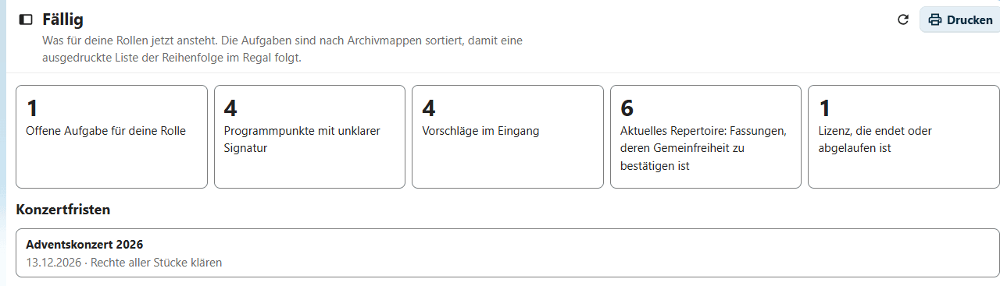
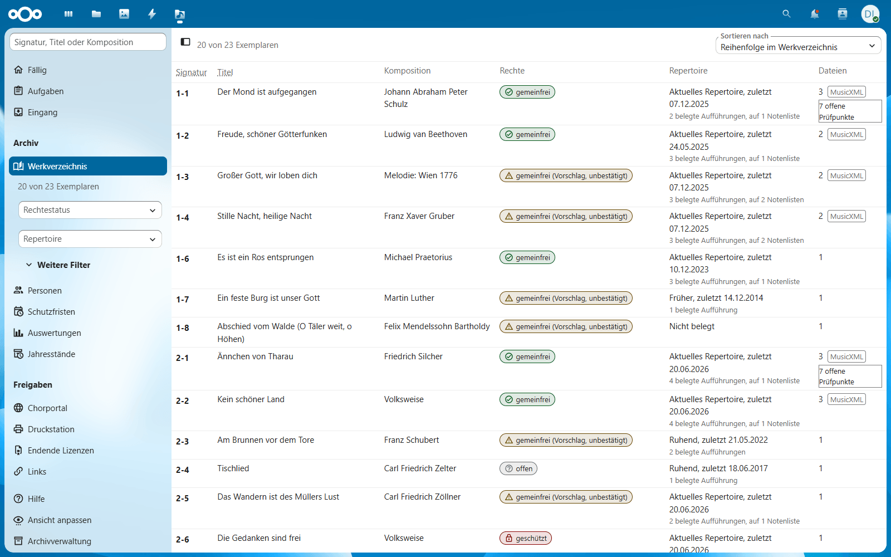
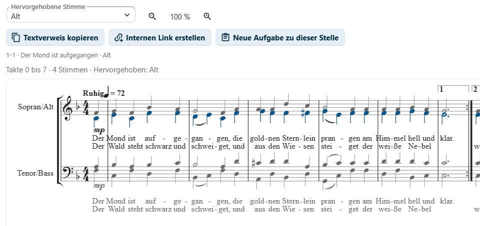
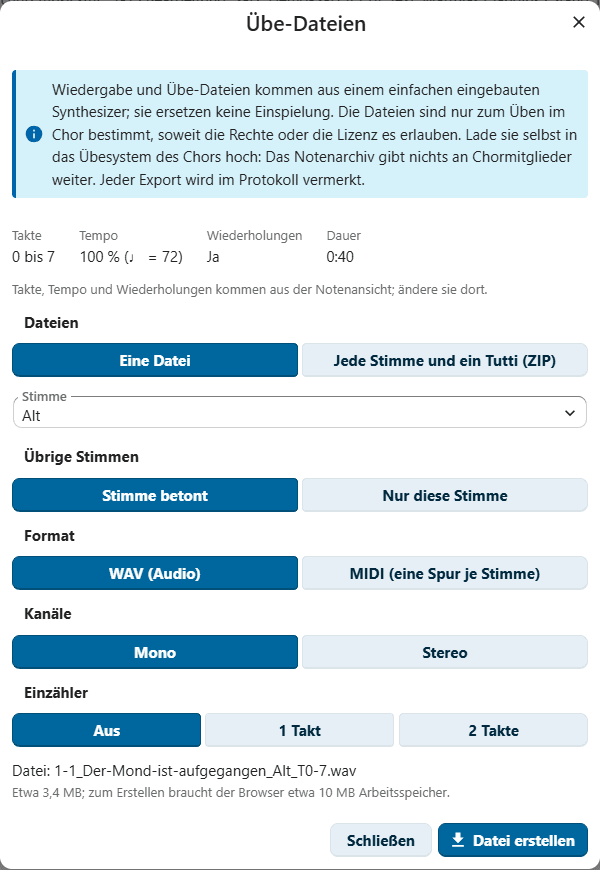
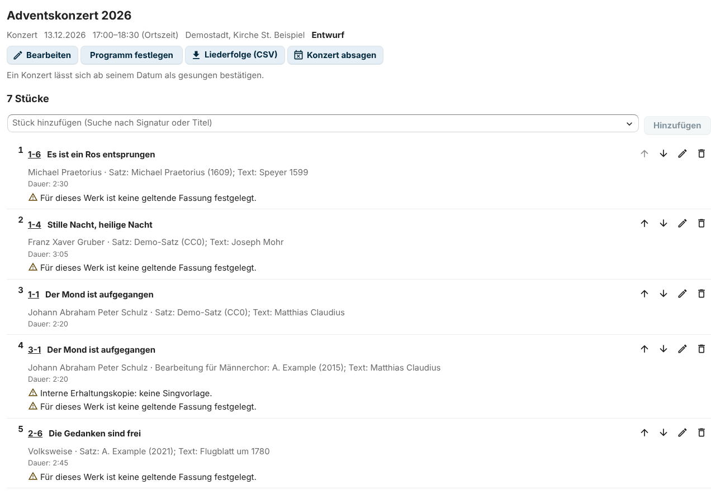

<!--
  - SPDX-FileCopyrightText: 2026 Thomas Scheel and Notenarchiv contributors
  - SPDX-License-Identifier: AGPL-3.0-or-later
-->
# Benutzerhandbuch

[English](../user-guide.md) | **Deutsch**

Dieses Handbuch ist für alle, die sich um die Noten eines Chors kümmern: die
Archivverwaltung, die Chorleitung, den Vorstand und die Revision.
Chormitglieder finden ihren Teil unter
[Für mich freigegeben](#für-mich-freigegeben). Zuerst erklärt das Handbuch
einige Begriffe und wie du dich zurechtfindest, dann Aufgabe für Aufgabe, was
jede Rolle tut, und am Ende, was bei häufigen Problemen hilft. Die Oberfläche
gibt es auf Englisch und Deutsch (Du- und Sie-Form) sowie auf Französisch,
Spanisch, Italienisch, Niederländisch und Polnisch (mit Hilfe von KI
erstellt, noch nicht muttersprachlich geprüft).

Was du siehst, hängt von deinen Rollen ab. Rollen hängen an
Nextcloud-Gruppen; die Administration ordnet sie zu (siehe
[Administrationshandbuch](administrationshandbuch.md)). Der Server prüft jede
Anfrage. Eine Schaltfläche, die du nicht siehst, gehört also zu einem Schritt,
den deine Rolle nicht umfasst.

**Inhalt**

- [Begriffe](#begriffe)
- [Zurechtfinden](#zurechtfinden)
- [Für die Chorleitung](#für-die-chorleitung)
- [Für die Archivverwaltung](#für-die-archivverwaltung)
- [Für den Betrieb](#für-den-betrieb)
- [Für Vorstand und Revision](#für-vorstand-und-revision)
- [Für Chormitglieder](#für-chormitglieder)
- [Für Mitwirkende und Werkzeuge](#für-mitwirkende-und-werkzeuge)
- [Häufige Probleme](#häufige-probleme)
- [Papier](#papier)

## Begriffe

Die App verwendet einige Wörter in einem festen Sinn. In der App erklärt ein
kleines **?** neben diesen Wörtern sie kurz und verweist hierher (siehe
[Hilfe neben einem Begriff](#hilfe-neben-einem-begriff)).

### Werk, Fassung und Exemplar

Ein **Werk** ist das Stück selbst mit Titel und Komposition, zum Beispiel
„Der Mond ist aufgegangen“. Eine **Fassung** (englisch *version*) ist eine
Ausgabe oder Bearbeitung des Werks, zum Beispiel ein Satz für Männerchor aus
einem Verlag; die Rechte gehören zur Fassung, nicht zum Werk. Ein
**Exemplar** (englisch *copy*) ist ein gedrucktes oder digitales Exemplar
einer Fassung mit eigener Signatur, zum Beispiel die gedruckten Blätter in
einer Archivmappe oder ein Scan. Ein Werk kann mehrere Fassungen haben und
eine Fassung mehrere Exemplare (siehe
[Die Angaben zu einem Exemplar](#die-angaben-zu-einem-exemplar)).

### Signatur

Die Signatur sagt, wohin ein Exemplar gehört: die Nummer der Archivmappe und
die Nummer in der Mappe, zum Beispiel `5-12` für Exemplar 12 in Archivmappe 5.
Jedes Exemplar hat seine eigene Signatur, und eine Nummer wird nie zweimal
vergeben. Die Namen der Dateien im Archivordner beginnen mit der Signatur.
Daran ordnet der Dateiabgleich jede Datei ihrem Exemplar zu (siehe
[Importe, Dateiabgleich und Exporte](#importe-dateiabgleich-und-exporte)).

### Rechtestatus und Bestätigung

Der Rechtestatus einer Fassung ist *gemeinfrei*, *geschützt* oder *offen*
(nicht geklärt). Die App schlägt einen Status aus den Daten vor, zum Beispiel
aus den Lebensdaten der beteiligten Personen; ein Vorschlag bleibt aber eine
Empfehlung. Die Archivverwaltung bestätigt den Status mit Begründung und
Beleg, und nur ein bestätigter Status zählt für Freigaben (siehe
[Rechte bestätigen](#rechte-bestätigen)). Die App unterstützt die
Entscheidung; sie ist keine Rechtsberatung.

### Freigabe

Eine Freigabe sagt, ob eine Fassung auf einem bestimmten Weg weitergegeben
werden darf: im Chorportal, an der Druckstation oder als Veröffentlichung.
Sie folgt aus den bestätigten Rechten oder aus einer gültigen Lizenz für
diese Nutzung. Interne Erhaltungskopien werden nie freigegeben (siehe
[Freigaben: Chorportal und Druckstation](#freigaben-chorportal-und-druckstation)).

### Geltende Fassung

Die geltende Fassung ist die Fassung, die der Chor singt; die Chorleitung
wählt sie aus. Ein Werk hat höchstens eine geltende Fassung, und
nur die Chorleitung legt sie fest. Über die Rechte sagt sie nichts aus: Auch
eine geltende Fassung kann geschützt oder offen sein (siehe
[Die geltende Fassung festlegen](#die-geltende-fassung-festlegen)).

### Interne Erhaltungskopie

Eine interne Erhaltungskopie wird nur für das Archiv aufbewahrt, zum Beispiel
der Scan eines geschützten Drucks. Sie wird nie geteilt, abgespielt oder
exportiert. Nur die Rolle „Bestand“ der Archivverwaltung und die Chorleitung
sehen sie; das Werkverzeichnis kennzeichnet sie mit *Interne Erhaltungskopie
– keine Weitergabe* (siehe [Ein Exemplar finden](#ein-exemplar-finden)).

## Zurechtfinden

### Navigation

Die Navigation links zeigt die Ansichten der App in Gruppen:

- **Fällig**, **Aufgaben** und **Eingang** (der Eingang nur für die Rollen,
  die Vorschläge sehen: Bestand, Vorschläge und Lesen)
- **Archiv:** **Werkverzeichnis** mit seinen Filtern, **Personen**,
  **Schutzfristen** und **Auswertungen**
- **Freigaben:** **Chorportal**, **Druckstation**, **Endende Lizenzen** und
  **Links**
- **Programme:** **Konzerte**, **Notenlisten** und **Unklare
  Programmpunkte**
- **Bestandspflege:** **Neuzugang** (für die anderen Rollen **Etiketten**),
  **Zusammenführen**, **Inventur**, **Mappenbuch** (für die Rollen, die es
  lesen) und **Prüfsummen**

Die Chorleitung findet außerdem **Geltende Fassungen festlegen** (siehe
[Die geltende Fassung festlegen](#die-geltende-fassung-festlegen)).

Unten finden alle **Hilfe** (dieses Handbuch) und **Ansicht anpassen**, die
Archivverwaltung außerdem **Archivverwaltung** (Importe, Dateiabgleich,
Exporte, Sicherungen). **Einstellungen** (für die Administration und die
Gruppen, denen sie die Einstellungen übertragen hat) führt zu
**Verwaltungseinstellungen → Notenarchiv**, der Einstellungsseite der App in
der Nextcloud-Verwaltung.

Jede Ansicht hat ihre eigene Adresse. Die Zurück-Schaltfläche des Browsers
funktioniert also, und du kannst eine Ansicht als Lesezeichen speichern.

### Ansicht anpassen

**Ansicht anpassen** unten in der Navigation blendet die Bereiche der
Navigation und die Teile der Startseite aus, die du nicht brauchst, zum
Beispiel die Auswertungen oder die Konzertfristen. Die Wahl wird mit deinem
Konto auf dem Server gespeichert und gilt so auf jedem Gerät. Sie ändert nur,
was du siehst: Deine Berechtigungen bleiben gleich, und ein ausgeblendeter
Bereich öffnet sich weiterhin über einen Link oder eine Benachrichtigung.
Startseite und Werkverzeichnis lassen sich nicht ausblenden.

Funktionen, die die Administration abgeschaltet hat (siehe
Administrationshandbuch, „Module und Voreinstellungen“), fehlen für alle. Ein
Link auf eine solche Funktion öffnet die Startseite mit dem Hinweis *Diese
Funktion ist abgeschaltet.*

### Startseite „Fällig“

Die App öffnet mit **Fällig**: Das braucht jetzt deine Rollen. Karten zeigen,
wie viele Dinge warten, zum Beispiel offene Aufgaben für deine Rolle,
beantwortete Aufgaben zum Übernehmen, Vorschläge im Eingang, Fassungen, die
ins Chorportal kommen oder daraus heraus müssen, gemeinfreie Fassungen des
aktuellen Repertoires zum Bestätigen, endende oder abgelaufene Lizenzen oder
Werke des aktuellen Repertoires ohne gewählte geltende Fassung. Ein Klick auf
eine Karte öffnet die passende Liste oder das Werkverzeichnis mit den
richtigen Filtern.

Für Chorleitung und Archivverwaltung zeigt **Konzertfristen** die geplanten
Konzerte, deren nächster Vorbereitungsschritt fällig ist: Programm und
geltende Fassungen festlegen (ab 10 Wochen vorher), die Rechte aller Stücke
klären (ab 8 Wochen), die Konzertmappen vorbereiten (ab 6 Wochen) und nach
dem Termin bestätigen, was gesungen wurde (nur Chorleitung). Danach folgen
die **Aufgaben für deine Rollen**, sortiert nach Archivmappe. So folgt eine
gedruckte Liste dem Regal.

### Ein Exemplar finden

Öffne **Werkverzeichnis** und tippe in das Suchfeld **Signatur, Titel oder
Komposition**:

- Eine Signatur (`2-1`, auch `2/1`, `2 - 01` oder `2.1`) findet genau dieses
  Exemplar, auch ein ausgemustertes.
- Jeder andere Text findet die Exemplare, deren Titel oder Komposition jedes
  getippte Wort enthält; Akzente spielen keine Rolle.

Das Suchfeld und die Filter **Rechtestatus** und **Repertoire** sind immer
sichtbar. **Weitere Filter** öffnet die übrigen Filter: Archivmappe, Status
(standardmäßig aktiv; ausgemusterte, vermisste und verliehene Exemplare nur,
wenn du ihren Status oder **Jeder Status** wählst), **Mit MusicXML**, **Nur
interne Erhaltungskopien**, **Gemeinfrei, nicht bestätigt**, **Keine Fassung
gilt für den Chor** und **Offene Prüfpunkte**. Ein zweiter Klick auf
**Weitere Filter** schließt sie wieder; die App merkt sich, ob sie offen
sind. Sind Filter unter **Weitere Filter** aktiv, zeigt die Schaltfläche, wie
viele. **Suche und Filter zurücksetzen** hebt sie auf. Die Liste lässt sich
nach Reihenfolge im Werkverzeichnis, Signatur oder Titel sortieren; auf dem
Smartphone zeigt sie eine Karte je Exemplar.

Das **Rechte-Kennzeichen** zeigt immer Text und Symbol, nie nur eine Farbe:

| Kennzeichen | Bedeutung |
|---|---|
| *gemeinfrei* | gemeinfrei, von der Archivverwaltung bestätigt |
| *gemeinfrei (Vorschlag, unbestätigt)* | gemeinfrei laut Import oder Vorschlag, noch nicht bestätigt |
| *geschützt* | urheberrechtlich geschützt |
| *offen* | nicht geklärt |
| *Interne Erhaltungskopie – keine Weitergabe* | interne Kopie eines geschützten Werks: wird nie geteilt oder abgespielt |
| *nicht eingeschätzt* | noch kein Rechtestatus |

### Ein Exemplar über die Nextcloud-Suche finden

Mit dem Modul **Nextcloud-Suche** findest du Exemplare, ohne die App zu
öffnen:

1. Klicke auf die Lupe in der Kopfzeile von Nextcloud und tippe eine
   Signatur (`2-1`), ein Wort aus dem Titel oder den Namen einer Person ein,
   mindestens zwei Zeichen.
2. Der Bereich **Notenarchiv** zeigt die Exemplare, aktive zuerst, mit
   Komposition, Bearbeitung und bei den übrigen Exemplaren ihrem Status.
3. Klicke auf ein Ergebnis: Die App öffnet sich mit diesem Exemplar.

Die Suche funktioniert wie das Suchfeld des Werkverzeichnisses und findet
auch Personen aus dem Personenregister. Sie zeigt nur, was deine Rollen sehen
dürfen: interne Erhaltungskopien nur der Rolle „Bestand“ und der
Chorleitung, und Konten ohne Rolle im Notenarchiv gar nichts.

### Die Angaben zu einem Exemplar

Klicke auf eine Zeile, um die Seitenleiste zu öffnen. Ihr Kopf zeigt das
Rechte-Kennzeichen, den Status, wenn das Exemplar nicht aktiv ist, und
**Noten**, wenn es MusicXML gibt, die du ansehen darfst. Die Reiter:

- **Details:** Werk, Fassung und Exemplar, das Repertoire (Klasse, belegte
  Aufführungen, zuletzt aufgeführt, Notenlisten), Zusammenführungen und die
  anderen Exemplare desselben Werks.
- **Rechte:** Bestätigung, Freigaben, die geltende Fassung, Lizenzen, offene
  Vorschläge, die beteiligten Personen mit dem Vorschlag zur Schutzfrist
  sowie die Felder zu Rechten und MusicXML.
- **Fragen:** Rückfragen und Aufgaben zum Exemplar und seine Ausschnitt-Links
  (der Reiter heißt **Links**, solange die Aufgaben abgeschaltet sind).
- **Dateien:** die verknüpften Dateien aus dem Archivordner, jede mit einem
  Symbol für ihre Dateiart und dem Ordner, in dem sie liegt (nicht dem
  vollständigen Pfad). Jede Datei öffnet sich in Nextcloud in einem neuen Tab
  (siehe
  [Dateien, die sich nicht öffnen lassen](#dateien-die-sich-nicht-öffnen-lassen)).
- **Verlauf:** das Protokoll des Exemplars: jede Änderung mit wer, wann,
  altem und neuem Wert und Begründung.

Ein Abschnitt, den du ändern darfst, zeigt **Bearbeiten**. Ändere die
Felder, trag auf Wunsch eine **Begründung der Änderung** ein, die im
Protokoll gespeichert wird, und wähle **Speichern**.

> [!NOTE]
> Es wird nie etwas gelöscht. Ein Exemplar, das das Archiv verlässt, bekommt
> den Status *ausgemustert*, *vermisst* oder *verliehen*, und der Status
> braucht eine Begründung.

### Hilfe neben einem Begriff

Neben einigen Begriffen (Fassung, Exemplar, Signatur, Rechtestatus, Freigabe,
geltende Fassung und interne Erhaltungskopie) zeigt die App eine kleine
Schaltfläche **?**. Sie öffnet eine kurze Erklärung des Begriffs mit einem
Link auf den passenden Abschnitt dieses Handbuchs (siehe
[Begriffe](#begriffe)). Escape schließt die Erklärung.

### Dateien, die sich nicht öffnen lassen

Die App öffnet Dateien nur mit den Rechten deines eigenen Kontos, genau wie
die App **Dateien**. Noten, Scans und Übe-Dateien liegen im Archivordner. Ist
dieser Ordner nicht für dich freigegeben, siehst du das Werkverzeichnis, aber
keine Datei öffnet sich. Die App sagt dir das:

- oben auf der Seite: *Der Archivordner ist für dein Konto nicht
  freigegeben, deshalb öffnen sich seine Dateien (Noten, Scans, Übe-Dateien)
  für dich nicht.*
- im Reiter **Dateien** eines Exemplars und
- in der Notenansicht: *Die Noten können nicht angezeigt werden – Die Datei
  liegt in einem Ordner, der für dein Konto nicht freigegeben ist. Bitte die
  Archivverwaltung, den Archivordner für dich oder deine Gruppe
  freizugeben.*

Mit der Datei und mit deiner Rolle ist alles in Ordnung. Bitte die
Archivverwaltung (oder die Administration), den Archivordner für dich oder,
besser, für die Gruppe deiner Rolle freizugeben; Leserechte genügen. Lade
danach die Seite neu. Darfst du die Einstellungen selbst ändern, öffnet die
Schaltfläche **Zugriff auf den Archivordner prüfen** die Zugriffsprüfung
unter Verwaltungseinstellungen → Notenarchiv. Sie zeigt alle, die den Ordner
nicht öffnen können (siehe
[Administrationshandbuch](administrationshandbuch.md#prüfen-wer-den-archivordner-öffnen-kann)).

### Benachrichtigungen

Die App benachrichtigt die Personen mit einer Rolle über die
Benachrichtigungen von Nextcloud, zum Beispiel über eine Rückfrage an deine
Rolle, eine Antwort zum Übernehmen, einen Vorschlag im Eingang oder eine
Konzertfrist. Eine Benachrichtigung verschwindet, wenn die Sache erledigt
ist. Benachrichtigungen gehen nie an Chormitglieder und enthalten keine
personenbezogenen Daten. In deinen persönlichen Nextcloud-Einstellungen
wählst du, ob sie auch per E-Mail kommen und wie oft, zum Beispiel als
wöchentliche Zusammenfassung. Das
[Administrationshandbuch](administrationshandbuch.md#6-benachrichtigungen)
nennt sie alle.

### Dashboard-Widget

Das Nextcloud-Dashboard kann das Widget **Notenarchiv – fällig** zeigen:
dasselbe wie die Startseite (Konzertfristen, die Karten mit ihren Zahlen,
Aufgaben für deine Rollen), jeder Eintrag mit einem Link in die App, dazu
**Startseite öffnen**. Jeder Eintrag hat einen kurzen Titel, die
Einzelheiten in einer zweiten Zeile und ein Symbol für seine Art (Konzert,
Karte oder Aufgabe). Füge das Widget in den Einstellungen des Dashboards
hinzu. Nur Konten mit einer Archivrolle können es hinzufügen. Es zeigt nie
den Text einer Rückfrage oder den Namen einer Person.

### Aus der Dateien-App öffnen

Der Archivordner ist ein gewöhnlicher Ordner in Nextcloud. Du findest eine
Datei also auch in der App **Dateien**. Dateien des Archivordners haben im
Aktionsmenü (⋯) die Aktion **Im Notenarchiv öffnen**:

- **MusicXML** (`.musicxml`, `.mxl`): Ein Klick auf die Datei öffnet direkt
  die Notenansicht ihres Exemplars. Öffnet schon eine andere App in deiner
  Nextcloud MusicXML, bleibt ein Klick bei dieser App, und die Aktion steht
  im Menü.
- **Scans (PDF), MuseScore, Audio und die übrigen Dateien eines Exemplars:**
  Die Aktion öffnet das Exemplar in der Seitenleiste des Notenarchivs. Ein
  Klick auf ein PDF öffnet weiterhin den Viewer von Nextcloud.

Die Aktion gibt es für Konten mit einer Archivrolle und für die
Administration, und nur für Dateien im Archivordner mit einer Dateiart, die
der Dateiabgleich kennt. Wählst du sie, fragt die App den Server, zu welchem
Exemplar die Datei gehört. Eine Datei, die nicht im Werkverzeichnis steht
(zum Beispiel eine Datei, deren Name nicht mit einer Signatur beginnt), gibt
die Meldung **Diese Datei ist im Notenarchiv nicht verzeichnet.** Eine Datei
auf diesem Weg zu öffnen, erlaubt nichts zusätzlich: Die Notenansicht prüft
die Rechte wie immer. Interne Erhaltungskopien sehen also nur die Rolle
„Bestand“ und die Chorleitung, und sie werden nie abgespielt.

Die Administration schaltet die Aktion mit dem Modul **Öffnen aus der
Dateien-App** ab (siehe [Administrationshandbuch](administrationshandbuch.md)).

## Für die Chorleitung

Die **Chorleitung** entscheidet, welche Fassung der Chor singt, beantwortet
musikalische Rückfragen und plant Konzerte mit der Archivverwaltung. Die
Chorleitung darf außerdem Tonart, Besetzung, Sprache, Dauer und die Prüfung
einer Übertragung eintragen, interne Erhaltungskopien ansehen (ohne
Abspielen) und Übe-Dateien erstellen.

Die Archivverwaltung nutzt Notenansicht, Übe-Dateien, Rückfragen, Teilen, die
Prüfung von Übertragungen und die Konzerte genauso; ihr Kapitel verweist
hierher. Siehe auch
[Auswertungen und Jahresbericht](#auswertungen-und-jahresbericht) und das
[Mappenbuch](#mappenbuch), das die Chorleitung lesen kann.

### Die geltende Fassung festlegen

Nur die Chorleitung entscheidet, welche Fassung eines Werks der Chor singt
(siehe [Geltende Fassung](#geltende-fassung)). Je Werk gibt es höchstens eine
geltende Fassung. Die Wahl ändert nichts an den Rechten.

**Mehrere Werke auf einmal.** **Geltende Fassungen festlegen** in der
Navigation (nur für die Chorleitung und nur, solange das Modul „Geltende
Fassung“ eingeschaltet ist) zeigt die Werke, die mehrere Fassungen haben und
von denen noch keine für den Chor gilt.

1. Öffne **Geltende Fassungen festlegen**. Schalte **Nur das aktuelle
   Repertoire** ein, um nur die Werke zu sehen, die der Chor gerade singt.
2. Jedes Werk zeigt seine Fassungen, jede mit ihren Exemplaren (Signaturen),
   deren Art und dem Rechtestatus.
3. Trag auf Wunsch eine Begründung ein und wähle bei der Fassung, die der
   Chor singt, **Als geltend festlegen**. Das geht direkt in der Liste; du
   musst das Exemplar nicht öffnen.

**Ein einzelnes Werk.**

1. Öffne ein Exemplar der Fassung, die der Chor singt → Reiter **Rechte** →
   Abschnitt **Gilt für den Chor**.
2. Wähle **Als geltend für den Chor festlegen**, auf Wunsch mit Begründung,
   und bestätige.

Galt vorher eine andere Fassung, sagt der Dialog das, und diese Fassung gilt
danach nicht mehr. **Festlegung als geltende Fassung aufheben** hebt die
Festlegung auf.

> [!TIP]
> Der Filter **Keine Fassung gilt für den Chor** im Werkverzeichnis und die
> Karte **Aktuelles Repertoire: keine geltende Fassung gewählt** auf der
> Startseite (sie öffnet das Werkverzeichnis mit den passenden Filtern)
> zeigen, wo eine Entscheidung fehlt.

Innerhalb der geltenden Fassung legt die Archivverwaltung den geltenden
[Stand](#stände-einer-fassung) ihrer MusicXML fest. Du siehst die Stände und
kannst
[zwei davon vergleichen](#so-vergleichst-du-zwei-stände-und-schreibst-einen-hinweis-für-chormitglieder),
mit einer kurzen Notiz für den Chor zum Kopieren.

### Eine Rückfrage beantworten

Rückfragen an die Chorleitung erscheinen auf der Startseite, unter
**Aufgaben** und als Benachrichtigung.

1. Öffne die Rückfrage; **In den Noten zeigen** zeigt dir die Stelle.
2. Wähle **Antworten**, schreib die Antwort und wähle **Antwort speichern**.

Die Archivverwaltung übernimmt die Antwort danach ins Werkverzeichnis oder
verwirft sie.

### Notenansicht

**Noten** öffnet die MusicXML eines Exemplars im Browser. Notensatz,
Schriften und Klänge sind Teil der App; nichts wird von anderen Servern
geladen.

1. Trage **Von Takt** und **Bis Takt** ein und wähle **Anzeigen**. Es gelten
   die gedruckten Taktnummern; der Auftakt ist Takt 0. **Alle Takte** zeigt
   wieder das ganze Stück.
2. Wähle eine **Hervorgehobene Stimme**, auch eine, die sich ein
   Notensystem mit einer anderen Stimme teilt (zum Beispiel Tenor II im
   System „Tenor I/II“). Die hervorgehobene Stimme erscheint farbig mit
   kräftigeren Notenköpfen und Hälsen, die übrigen Stimmen in hellerem Grau;
   der Liedtext ihres Systems bleibt dunkel.
3. Wähle unter **Stimmen beim Abspielen** **Alle gleich**, **Stimme betont**
   oder **Nur diese Stimme**. **Tempo und Lautstärke** öffnet die Regler für
   Tempo und Lautstärke und die Schalter **Wiederholungen spielen** und
   **Mitscrollen**.
4. **Abspielen**, **Pause** und **Stopp** steuern die Wiedergabe.

Tastatur: Die Leertaste spielt ab und hält an, außer ein Bedienelement hat
den Fokus. `+` und `-` ändern die Größe, solange die Noten den Fokus haben;
Escape schließt die Notenansicht. Beim Abspielen wird Screenreadern der
aktuelle Takt angesagt, und die Noten haben eine Textbeschreibung (Takte,
Stimmen, hervorgehobene Stimme, Tonart und Taktart).

#### So übst du eine Stelle in Schleife

1. Trage die Stelle in **Von Takt** und **Bis Takt** ein.
2. Schalte daneben **Wiederholen** ein. Die Stelle wird gezeigt und beim
   Abspielen immer wieder gespielt, bis du **Pause** oder **Stopp** wählst.
   Screenreader hören „Wiederholen an“ mit den Takten.
3. Schalte **Wiederholen** aus, um wieder bis zum Ende zu spielen.

#### So zählst du vor dem Abspielen ein

Wähle unter **Tempo und Lautstärke** einen **Einzähler**: **Aus**, **1 Takt**
oder **2 Takte**. Bevor die Musik beginnt, hörst du Klicks in Taktart und
Tempo der Stelle, an der die Wiedergabe beginnt, die erste Zählzeit jedes
Takts höher. Ein Auftakt setzt auf den letzten Zählzeiten des Einzählers ein.
Die Wahl merkt sich dein Browser, auch für geteilte Ausschnitte.

#### So startest du an einer bestimmten Note

- **Maus oder Touch:** Klicke auf eine Note in den Noten (oder auf einen
  Takt). Die Wiedergabe beginnt dort, mit Einzähler. Läuft sie schon,
  springt sie dorthin. In einer wiederholten Stelle nimmt sie den nächsten
  Durchgang ab der aktuellen Position.
- **Tastatur:** Bring den Fokus in die Noten (Tab) und nutze die Pfeiltasten
  **links** und **rechts**: Sie gehen in Spielreihenfolge zum vorigen oder
  nächsten Takt, und der Takt wird angesagt. Die Leertaste spielt dann ab
  dort. Du kannst den Takt auch in **Von Takt** eintragen und **Anzeigen**
  wählen.

> [!IMPORTANT]
> Abspielen gibt es für gemeinfreie Fassungen und für Fassungen mit einer
> gültigen Lizenz für Übe-Audio. Interne Erhaltungskopien werden nie
> abgespielt; nur die Rolle „Bestand“ und die Chorleitung dürfen sie
> ansehen. Ohne das Recht zeigt die Notenansicht stattdessen den Grund.

### Übe-Dateien

Archivverwaltung und Chorleitung erstellen in der Notenansicht Übe-Dateien
für das Übe-System des Chors:

1. Wähle in der Notenansicht Takte, Tempo, Wiederholungen und Einzähler.
2. Öffne **Übe-Dateien …**. **Einzähler** beginnt jede Datei mit ein oder
   zwei Takten Klicks (in MIDI-Dateien auf einer eigenen Schlagzeugspur).
3. Wähle **Eine Datei** (eine Stimme, die übrigen Stimmen leiser oder stumm,
   oder alle Stimmen gleich) oder **Jede Stimme und ein Tutti (ZIP)**.
4. Wähle das Format: **WAV (Audio)**, 16 Bit, mono oder stereo, erzeugt mit
   demselben Synthesizer und derselben Spielreihenfolge wie beim Abspielen;
   oder **MIDI (eine Spur je Stimme)**, jede Spur nach ihrer Stimme benannt,
   das Verhältnis der Stimmen in der Lautstärke jeder Spur.
5. Wähle **Datei erstellen** oder **ZIP-Archiv erstellen**. Ein
   Fortschrittsbalken zeigt, wie weit es ist; **Abbrechen** hält an. Der
   Browser legt das Ergebnis in deine Downloads.

Die Dateinamen folgen dem Muster `<shelf mark>_<title>_<voice>_T<from>-<to>`,
zum Beispiel `2-2_Kein-schoener-Land_Tenor-1_T0-10.wav`. Der Dialog zeigt die
Länge und ungefähr, wie groß die Dateien werden; Ausschnitte über 10 Minuten
bekommen eine Warnung.

> [!IMPORTANT]
> Der Server prüft vor jedem Export die Rechte: Übe-Dateien gibt es nur für
> bestätigt gemeinfreie Fassungen und für Fassungen mit einer gültigen Lizenz
> für Übe-Audio, nie für interne Erhaltungskopien. Ohne das Recht steht
> statt der Schaltfläche der Grund da. Jeder Export steht im Protokoll der
> Fassung (Takte, Stimme, Modus, Format).

Der Klang ist synthetisch und ersetzt keine Einspielung. Die Dateien sind nur
zum Üben im Chor, soweit die Rechte oder die Lizenz es erlauben. Lade sie
selbst in das Übe-System hoch. Hat die Administration Übe-Audio für
Chormitglieder eingeschaltet, können diese auch selbst eine Datei ihrer
Stimme aus einem mit ihnen geteilten Stück oder Ausschnitt erstellen (siehe
[Mit Chormitgliedern und der Öffentlichkeit teilen](#mit-chormitgliedern-und-der-öffentlichkeit-teilen)).

### Eine Rückfrage stellen oder eine Aufgabe geben

Eine Rückfrage oder Aufgabe gehört immer zu einem Exemplar und kann eine
Stelle in den Noten nennen: Seite, Takte, Stimme und Strophe.

1. Wähle in der Notenansicht die Stelle, dann **Diese Stelle** und **Neue
   Aufgabe zu dieser Stelle**, oder
   wähle in der Seitenleiste im Reiter **Fragen** **Neue Aufgabe**.
2. Wähle die Art (**Rückfrage**, **Prüfung** oder **Meldung**) und die Rolle,
   **Für** die sie ist (Chorleitung, Bestand, Betrieb oder Lesen).
3. Beschreibe sie, füge die Stelle hinzu und auf Wunsch eine Kategorie, ein
   Fälligkeitsdatum und ihre Herkunft (zum Beispiel eine Übertragungsrunde).
   Wähle **Aufgabe anlegen**.

Die angesprochene Rolle wird benachrichtigt und antwortet mit **Antworten**.
Die Archivverwaltung wird über die Antwort benachrichtigt und schließt die
Aufgabe als **Übernommen** (Werkverzeichnis oder Datei wurden berichtigt)
oder **Verworfen** (nichts zu ändern); eine Prüfung kann auch die Rolle
schließen, an die sie geht. **In den Noten zeigen** öffnet die Stelle.
**Aufgaben** in der Navigation zeigt die Aufgaben für deine Rollen oder alle
Aufgaben, auch die abgeschlossenen, und lässt sich drucken.

Wartet nichts, sagt **Aufgaben** das und bietet **Werkverzeichnis öffnen**
an: Eine Aufgabe legst du immer in der Seitenleiste eines Exemplars (Reiter
**Fragen**) oder in der Notenansicht an.

### Eine Stelle in den Noten teilen

Eine Stelle teilst du auf zwei Wegen, beide unter **Diese Stelle** in der
Notenansicht:

- **Textverweis kopieren** kopiert einen reinen Text wie
  `2-1 · Ännchen von Tharau · T. 5–8 · Tenor II`. Er enthält keine Noten und
  lässt sich überall weitergeben.
- **Internen Link erstellen** (Archivverwaltung, Betrieb und Chorleitung)
  erstellt einen Link für Personen mit einer Rolle im Notenarchiv. Er zeigt
  das ganze Stück oder die Takte mit allen Stimmen und hebt die gewählte
  Stimme hervor. Ein Link gilt höchstens sechs Monate, lässt sich jederzeit
  von der Person, die ihn erstellt hat, oder von der Archivverwaltung
  widerrufen und sagt, wenn sich die Noten seitdem geändert haben. Der
  Server prüft bei jedem Aufruf die Rechte; Aufrufe werden ohne Namen
  gezählt. **Links** in der Navigation zeigt alle aktiven Links und sagt bei
  jedem, wer ihn öffnen kann und was er teilt. Sind Links für Chormitglieder
  oder öffentliche Links eingeschaltet, heißt die Schaltfläche **Teilen …**,
  und derselbe Dialog fragt, wer den Link öffnen kann (siehe
  [Mit Chormitgliedern und der Öffentlichkeit teilen](#mit-chormitgliedern-und-der-öffentlichkeit-teilen)).

### Mit Chormitgliedern und der Öffentlichkeit teilen

Hat die Administration es eingeschaltet, lässt sich ein ganzes Stück oder ein
Ausschnitt über die Archivrollen hinaus teilen: mit den **Chormitgliedern**
(sie melden sich an und sehen es unter „Für mich freigegeben“) oder mit
**allen** über einen öffentlichen Link ohne Anmeldung. Beide bekommen nur,
was du teilst, das ganze Stück oder die gewählten Takte, nie die Notendatei;
der Server sendet nur das und prüft bei jedem Aufruf die Rechte. Auf Wunsch
gibt der Link auch den **Scan (PDF)** des Exemplars mit.

#### So teilst du ein ganzes Stück mit dem Chor

Archivverwaltung, Betrieb und Chorleitung teilen aus der Notenansicht (oder
mit **Neuer Link** im Reiter für Aufgaben und Links eines Exemplars):

1. Öffne die Noten und wähle die **Hervorgehobene Stimme**; stelle bei Bedarf
   das Tempo ein.
2. Wähle **Teilen …**.
3. Wähle unter **Wer kann den Link öffnen?** **Chormitglieder**
   (oder **Archivrollen (intern)**, **Öffentlich (ohne Anmeldung)**).
4. Lass unter **Was wird geteilt?** **Ganzes Stück** gewählt: alle Seiten des
   Stücks, mit Wiederholungen und Sprüngen wie in den Noten. Für eine Stelle
   wähle **Ausschnitt (Takte)** und gib **Von Takt** und **Bis Takt** an.
   Zeigt die Notenansicht einen Bereich von Takten, beginnt der Dialog mit
   dem Ausschnitt.
5. Prüfe Stimme, Strophe und Tempo sowie das Datum **Gültig bis** (höchstens
   sechs Monate). **Notiz (optional)**: Die Chormitglieder sehen diese Notiz,
   zum Beispiel „Bitte bis Donnerstag üben“.
6. Hat das Exemplar einen Scan, gibt **Scan (PDF) mitgeben** ihn ebenfalls
   mit (bei mehreren Scans wählst du einen unter **Welcher Scan?**). Wer den
   Link hat, öffnet ihn im PDF-Betrachter des Browsers. Wer den Scan sieht,
   kann ihn auch speichern; gib ihn nur mit, wo das in Ordnung ist.
7. **Das ist beim Öffnen des Links zu sehen** nennt, was geteilt wird
   (**Ganzes Stück** oder die Takte), die hervorgehobene Stimme, Strophe,
   Tempo, ob es sich abspielen lässt, ob sich Übe-Dateien erstellen lassen,
   ob der Scan dabei ist und wie lange der Link gilt.
8. Wähle **Link erstellen** und dann **Link kopieren**, wenn du ihn
   verschicken willst. Chormitglieder finden es ohnehin unter „Für mich
   freigegeben“, bis der Link abläuft.

Ein Link für Chormitglieder ist nur für eine Fassung möglich, die **für das
Chorportal freigegeben** ist: bestätigt gemeinfrei oder mit einer gültigen
Lizenz für die Nutzung „Chorportal“; nie für eine interne Erhaltungskopie.
Das gilt für das ganze Stück, einen Ausschnitt und den Scan gleichermaßen:
Rechtlich zählt ein Ausschnitt so viel wie das Ganze. Geht es nicht, sagt
der Dialog statt **Link erstellen**, warum und was zu tun ist, zum Beispiel
*Die Gemeinfreiheit ist noch nicht bestätigt. Die Archivverwaltung bestätigt
sie im Reiter „Rechte“; danach lässt sich die Fassung mit den
Chormitgliedern teilen.* Ein Ausschnitt braucht beide Takte, und sie müssen
in den Noten vorkommen.

Für das Abspielen gelten dieselben Regeln wie im Archiv (gemeinfrei oder
eine Lizenz für Übe-Audio). Übe-Dateien für Chormitglieder brauchen
zusätzlich das Modul „Übe-Audio für Chormitglieder“ und einen bestätigten
Status oder eine Lizenz für Übe-Audio; sie gehen für das ganze Stück wie für
einen Ausschnitt.

**Links** in der Navigation zeigt jeden aktiven Link mit seinem Kreis
(**Intern**, **Für Chormitglieder**, **Öffentlich**), mit dem, was er teilt
(**Ganzes Stück** oder die Takte, dazu **mit Scan (PDF)**), seiner
Gültigkeit und der Zahl der Aufrufe; **Link widerrufen** sperrt einen Link
sofort für alle.

> [!NOTE]
> Das ganze Stück spielt in der vollen Reihenfolge der Noten, mit allen
> Wiederholungen, Klammern und Sprüngen. In einem Ausschnitt entfallen
> Wiederholungen und Sprünge, die aus ihm herausführen, damit er vom ersten
> bis zum letzten Takt spielt. Eine Wiederholung zurück zu einem Takt vor dem
> Ausschnitt, ihre erste und zweite Klammer und ein D.C. in einem Ausschnitt,
> der nicht am Anfang beginnt, werden deshalb nicht gespielt. Die
> Notenansicht im Archiv und die Ansicht eines geteilten ganzen Stücks
> spielen einen Bereich von Takten als Teil des ganzen Stücks: Die Takte 1
> bis 7 von „Der Mond ist aufgegangen“ (1-1) klingen dort als 1–6, 1–5, 7,
> in einem geteilten Ausschnitt dieser Takte als 1–7.

#### Öffentliche Links

Ein öffentlicher Link zeigt ein ganzes Stück oder einen Ausschnitt allen, die
den Link haben, und spielt es ab, ohne Anmeldung: ohne die Notendatei, ohne
Namen und ohne Notiz. Wähle im selben Dialog **Öffentlich (ohne Anmeldung)**.
Das geht nur, wenn

- die Fassung **zur Veröffentlichung freigegeben** ist: Die Rolle „Bestand“
  setzt den Veröffentlichungsstatus der Fassung auf „Zur Veröffentlichung
  freigegeben“, und
- sie bestätigt gemeinfrei ist oder eine gültige Lizenz für die Nutzung
  „Online-Veröffentlichung (öffentliche Links)“ hat (eine Lizenz nur für
  „Veröffentlichung“ genügt nicht),
- und sie keine interne Erhaltungskopie ist.

Unter denselben Bedingungen lässt sich der Scan (PDF) mitgeben. Die Seite
zeigt Titel, Komposition, das ganze Stück oder die Takte, die hervorgehobene
Stimme und eine Textbeschreibung, spielt es mit betonter Stimme ab und
verlinkt, falls mitgegeben, den Scan. Läuft der Link ab, wird er widerrufen
oder ist die Fassung nicht mehr freigegeben, zeigen die Seite und der Scan
„nicht gefunden“ ohne Grund.

### Übertragungen prüfen

Wird ein Scan in MusicXML übertragen (von einer Person oder mit einem
Werkzeug), endet die Übertragung mit einem **Bericht** (`… - Bericht.json`,
Format `bericht/1`). Er sagt Takt für Takt, was unsicher war, was weggelassen
wurde und was auf der Vorlage gefunden wurde. Die App macht aus diesen
Befunden **Prüfpunkte**, über die Chorleitung und Archivverwaltung in der
Notenansicht entscheiden. Die App schlägt vor, Menschen entscheiden: Im
Werkverzeichnis ändert sich nichts von selbst.

Als Chorleitung gehören dir die musikalischen Prüfpunkte eines
Übertragungsberichts: unsichere Lesarten, Zeichen, die nicht übertragen
wurden, und Rückfragen zu einem Takt. Bringt ein Bericht neue, wirst du
benachrichtigt. In der Notenansicht zeigt jeder Punkt seine Takte mit
hervorgehobener Stimme und spielt sie ab. Bestätige die Lesart, gib eine
Korrektur in Auftrag, stelle eine Rückfrage oder verwirf den Punkt, oder
berichtige eine falsche Note oder Silbe selbst in der App (siehe
[In der Notenansicht prüfen](#in-der-notenansicht-prüfen) und
[Kleine Korrekturen in der App](#kleine-korrekturen-in-der-app)).

#### Woher Prüfpunkte kommen

- **Dateiabgleich.** Leg den Bericht neben die MusicXML in den Archivordner,
  benannt wie die Notendatei mit ` - Bericht.json` am Ende (zum Beispiel
  `5-01_Title - Bericht.json`), und starte den Dateiabgleich. Der Abgleich
  führt den Bericht als Bericht, nicht als Notendatei, und liest ihn.
- **Werkzeuge.** Ein Werkzeug mit der Rolle „Vorschläge (Werkzeuge)“ schickt
  den Bericht über die Schnittstelle der App (siehe die
  [API](../api.md) (englisch)).

Liest die App denselben Bericht noch einmal, entsteht nichts doppelt. Jeder
Bericht ergibt:

| Im Bericht | Prüfpunkt | Entscheidet |
|---|---|---|
| unsichere Lesarten, mit Takt und Stimme | **Unsichere Lesart** | Chorleitung |
| weggelassene Zeichen (zum Beispiel ein Atemzeichen) | **Nicht übertragen** | Chorleitung |
| Befunde auf der Vorlage (eine fehlende Seite, Bleistiftnotizen) | **Material** | Archivverwaltung |
| Rückfragen | **Rückfrage** | Chorleitung, wenn ein Takt genannt ist, sonst Archivverwaltung |

Die **Rolle „Bestand“ darf über jeden Punkt entscheiden**; die Chorleitung
entscheidet über die musikalischen. Die Rechte-Einschätzung und die Felder
des Werkverzeichnisses aus dem Bericht (zum Beispiel „Verlag /
Bestellnummer“) gehen als Vorschläge in den
[Eingang](#vorschläge-im-eingang-entscheiden), solange der Vorschlagseingang
eingeschaltet ist; sonst werden sie nur mit dem Bericht gezeigt. Herkunft des
Berichts und Prüfstand der Übertragung stehen bei der Fassung.

Kommt ein neuer Bericht zum selben Exemplar (eine neue Runde der Übertragung
mit einer neuen MusicXML-Datei), werden die Punkte, die er nicht mehr nennt,
auf **Korrigiert** gesetzt („in einer neuen Fassung erledigt“). Hat sich die
MusicXML nicht geändert, bleiben sie offen.

#### In der Notenansicht prüfen

1. Öffne das Exemplar und seine **Noten**, dann **Prüfung** (die
   Seitenleiste des Exemplars bietet auch eine Schaltfläche mit der Zahl der
   offenen Prüfpunkte, und eine Benachrichtigung öffnet die Prüfung direkt).
   Der Bereich **Prüfung der Übertragung** zeigt die Prüfpunkte, die Runde
   und den Prüfstand; **Prüfpunkte anzeigen** wechselt zwischen **Zu
   erledigen** und **Alle**.
2. Wähle einen Punkt. Die Noten springen zu seinen Takten und heben seine
   Stimme als hervorgehobene Stimme hervor. **Diese Stelle abspielen** spielt
   genau diese Takte (nur wo Abspielen erlaubt ist; die Rechteprüfung ist
   dieselbe wie immer).
3. **Scan**: Ist ein PDF-Scan mit dem Exemplar verknüpft, zeigt **Scan neben
   den Noten zeigen** ihn neben den Noten, und **Scan in neuem Fenster
   öffnen** öffnet ihn in einem zweiten Fenster, beide auf der **Seite im
   Scan** (der Seite des Punkts oder der Seite, die du zuletzt angesehen
   hast). Beide nutzen den PDF-Viewer des Browsers; nichts geht an einen
   anderen Server. Das zweite Fenster hilft auf kleinen Bildschirmen und mit
   einer Bildschirmlupe.
4. Entscheide:
   - **Lesart richtig** – die Übertragung bleibt, wie sie ist.
   - **In der App korrigieren …** – für eine falsche Tonhöhe, ein falsches
     Vorzeichen oder eine falsche Silbe, siehe
     [Kleine Korrekturen](#kleine-korrekturen-in-der-app).
   - **Korrekturauftrag** – für alles Größere: Beschreibe, was geändert
     werden soll; die Werkzeugkette holt den Auftrag ab und schließt ihn mit
     ihrem nächsten Bericht.
   - **Rückfrage stellen** – wird eine Rückfrage (Aufgabe) mit den Takten und
     der Stimme des Punkts, an die Chorleitung oder die Archivverwaltung.
   - **Verwerfen** – nicht relevant; eine Begründung ist Pflicht.

   **Wieder öffnen** setzt einen entschiedenen Punkt zurück auf offen. Wer
   wann und warum entschieden hat, wird gespeichert; nichts wird gelöscht.

Alles geht mit der Tastatur; eine Änderung des Status wird Screenreadern
angesagt. Das Werkverzeichnis zeigt die Zahl der offenen Prüfpunkte je
Exemplar, und der Filter **Offene Prüfpunkte** zeigt die Exemplare, die noch
eine Entscheidung brauchen. Die zuständigen Rollen werden über neue
Prüfpunkte benachrichtigt (eine Benachrichtigung je Bericht).

#### Kleine Korrekturen in der App

Kleine Fehler werden in der App selbst berichtigt (Archivverwaltung und
Chorleitung). Nur das lässt sich ändern:

- die Tonhöhe einer Note (Stammton, Kreuz oder b, Oktave) und ihr sichtbares
  Vorzeichen,
- die Silbe einer Strophe unter einer Note.

Notenwerte, Pausen, Takte und alles andere bleiben, wie sie sind; die Takte
behalten ihre Länge.

1. Zeige in der Notenansicht einen Takt (oder bis zu acht), wähle die
   hervorgehobene Stimme und **Noten korrigieren …**; oder wähle einen
   Prüfpunkt und **In der App korrigieren …**.
2. Die Noten der Stimme stehen einzeln mit ihrer Dauer in einer Liste; ändere
   Tonhöhe, Vorzeichen oder Silbe.
3. Die **Vorschau** zeigt die Takte mit den geänderten Noten hervorgehoben
   und die Liste der Änderungen in Worten (zum Beispiel „Takt 12, Bass: C3 →
   D3“).
4. Speichere, auf Wunsch mit Begründung, und wähle die Prüfpunkte, die die
   Korrektur erledigt.

Die App speichert die Korrektur als **neue Datei neben der alten**, mit
deinen Nextcloud-Rechten, zum Beispiel
`5-01_Title (korrigiert 2026-10-22).mxl`. Die alte Datei bleibt unverändert
und mit dem Exemplar verknüpft; die neue wird die MusicXML, die die
Notenansicht zeigt. Das Protokoll nennt jede Änderung (Takt, Stimme, alt →
neu), und die gewählten Prüfpunkte werden auf **Korrigiert** gesetzt. Die
Archivverwaltung wird über die Korrektur benachrichtigt. Ohne Schreibrecht im
Ordner der Noten sagt die App das und speichert nichts. Interne
Erhaltungskopien werden nicht in der App korrigiert. Mit dem Modul „Stände
einer Fassung“ wird die neue Datei der nächste
[Stand](#stände-einer-fassung) der Fassung.

### Stände einer Fassung

Eine Fassung (eine Bearbeitung, eine Ausgabe) ändert sich mit der Zeit: Eine
falsche Note wird berichtigt, eine Silbe korrigiert, die Werkzeugkette
liefert eine bessere Übertragung. Jede solche Änderung der MusicXML ist ein
**Stand** der Fassung (Modul „Stände einer Fassung“; eingeschaltet in den
Voreinstellungen „Standard“ und „Vollständig“). Ein Stand ist ein Eintrag im
Werkverzeichnis: welche Datei, ihre Prüfsumme, welche Takte und Stimmen sich
geändert haben, eine Notiz, wer und wann. Die App macht keine Kopien von
Dateien und ändert keine.

Stände werden von selbst erfasst:

- **Eine Korrektur in der App** wird der nächste Stand, mit den Takten,
  Stimmen und Änderungen der Korrektur, ihrer Begründung und den Prüfpunkten,
  die sie erledigt hat.
- **Der Dateiabgleich** erfasst eine neue oder geänderte MusicXML eines
  Exemplars, mit der Notiz „Änderung durch Dateiabgleich“ (oder der Runde
  des Übertragungsberichts, der im selben Abgleich gelesen wurde). Eine
  unveränderte Datei ergibt keinen neuen Stand.
- **Den ersten Stand** einer Fassung erfasst der erste Dateiabgleich, nachdem
  das Modul eingeschaltet wurde (Stand 1, „Erster erfasster Stand“).

Niemand muss etwas nummerieren; die Stände zählen je Fassung 1, 2, 3 …

#### So siehst du die Stände einer Fassung

1. Öffne das Exemplar und wähle den Reiter **Dateien**.
2. Unter **Stände dieser Fassung** steht der neueste Stand zuerst: Nummer,
   Herkunft, Datum und Person, geänderte Takte und Stimmen, die Notiz, die
   Datei und der Anfang ihrer Prüfsumme.
3. Die Zeile über der Liste ist die **Fassungszeile**, wie Ausgaben sie
   drucken: Signatur · Fassung · Stand · gültig seit.

Jede Archivrolle sieht die Stände, Chormitglieder nicht.

#### So legst du den geltenden Stand fest

Nur die Archivverwaltung (Rolle „Bestand“) legt den geltenden Stand fest. Er
ist der Stand, der innerhalb der Fassung für den Chor gilt; die geltende
Fassung selbst wählt die Chorleitung
([Die geltende Fassung festlegen](#die-geltende-fassung-festlegen)). Die App
legt nie von selbst einen geltenden Stand fest.

1. Öffne das Exemplar, Reiter **Dateien**, **Stände dieser Fassung**.
2. Vergleiche den neuesten Stand mit dem geltenden (siehe unten) oder öffne
   die Noten.
3. Wähle beim Stand, der gilt, **Als geltend festlegen**, auf Wunsch mit
   Begründung, und bestätige. Ab heute ist er „geltend seit“ heute; der
   Stand, der vorher galt, verliert die Kennzeichnung. Beides steht im
   Protokoll.

Gibt es einen neueren Stand als den geltenden, sagt die Liste das.

#### So vergleichst du zwei Stände und schreibst einen Hinweis für Chormitglieder

1. Wähle unter **Zwei Stände vergleichen** den **Älteren Stand** und den
   **Neueren Stand** (der neueste und der geltende sind vorgewählt) und dann
   **Vergleichen**.
2. Die App liest beide Dateien und listet die Unterschiede Takt für Takt und
   Stimme für Stimme, zum Beispiel „T. 12, Tenor II: D4 → E4“, „T. 14, Bass,
   Strophe 1: Silbe „Lie-“ → „Lieb-““, „T. 20: Takt hinzugefügt“. In der
   deutschen Oberfläche stehen deutsche Tonnamen (H und B; englisch B und
   B flat).
3. Unter der Liste steht die **Notiz für Chormitglieder**: eine Überschrift
   mit Titel, Signatur und beiden Ständen, dann eine Zeile je Unterschied,
   als reiner Text ohne Noten. Wähle **Notiz kopieren** und füge sie in eine
   E-Mail oder eine Nachricht ein.

Verglichen werden Noten, Pausen, Notenwerte, Vorzeichen und Text; Layout,
Dynamik und Bögen nicht. Die Chorleitung und jede andere Archivrolle können
vergleichen; die Dateien werden mit deinen eigenen Nextcloud-Rechten
gelesen, wie in der Notenansicht.

#### Wo der Stand angezeigt wird

- Oben in der Notenansicht neben dem Namen der Datei und im Textverweis, den
  du in der Notenansicht kopierst („2-35 · Titel · Stand 3 · T. 12 ·
  Tenor II“).
- In Übe-Dateien (WAV und MIDI) als Kommentar, damit eine Datei zeigt, aus
  welchem Stand sie erstellt wurde.
- Im Programm eines Konzerts und seinen gedruckten Listen (Spalte „Stand“)
  und in der Liederfolge (CSV, Spalten „Revision“ und „Revision valid
  since“).
- Wird ein Konzert als gesungen bestätigt, behält jedes Stück den Stand, der
  gesungen wurde: den geltenden Stand oder den neuesten, wenn keiner
  festgelegt ist. Ein späterer Stand ändert daran nichts.

Etiketten zeigen keinen Stand: Sie gehören zum Exemplar, nicht zum Stand
seiner MusicXML.

#### Häufige Probleme mit Ständen

- **„Noch kein Stand erfasst.“** Das Modul wurde gerade eingeschaltet, oder
  das Exemplar hat keine MusicXML. Starte den Dateiabgleich
  (**Archivverwaltung** → **Dateiabgleich starten**, Archivverwaltung); er
  erfasst die MusicXML jedes Exemplars als Stand 1.
- **„Die Datei von Stand … wurde seit der Erfassung geändert.“** Die Datei
  wurde an Ort und Stelle überschrieben (zum Beispiel von der
  Werkzeugkette), daher ist ihr früherer Inhalt nicht mehr im Archivordner;
  die App bewahrt keine Kopien auf. Vergleiche neuere Stände oder schau in
  der Dateien-App von Nextcloud unter **Versionen** der Datei nach; dort
  bleiben frühere Inhalte eine Weile erhalten. Damit es nicht passiert, lass
  die Werkzeugkette eine berichtigte MusicXML als neue Datei schreiben.
- **„Keine Unterschiede in Noten und Text.“** Die beiden Stände
  unterscheiden sich nur in dem, was nicht verglichen wird (Layout, Dynamik,
  Bögen, Metadaten).
- **Es gibt keine Schaltfläche „Als geltend festlegen“.** Nur die
  Archivverwaltung (Rolle „Bestand“) legt den geltenden Stand fest; bitte
  sie darum.
- **Eine Notendatei ließ sich beim Dateiabgleich nicht lesen.** Der
  Archivordner ist nicht für das Konto freigegeben, das den Dateiabgleich
  startet, oder die Datei ist beschädigt. Der nächste Dateiabgleich versucht
  es erneut.

### Ein Konzert planen

Chorleitung und Archivverwaltung planen Konzerte:

1. **Konzerte** → **Neues Konzert**: Titel, Datum, auf Wunsch Beginn und Ende
   (Ortszeit am Veranstaltungsort), Ort, ob es öffentlich ist und ob der
   Vorstand zugestimmt hat.
2. **Stück hinzufügen (Suche nach Signatur oder Titel)** → **Hinzufügen**.
   Bring die Stücke mit den Schaltflächen zum Verschieben in die richtige
   Reihenfolge und trage je Stück Dauer, Zugabe und eine Notiz ein. Die
   Gesamtdauer wird zusammengezählt.
3. Prüfe die Warnungen jedes Stücks: interne Erhaltungskopie, ungeklärte
   Rechte, keine oder eine andere geltende Fassung, geschützt ohne Lizenz für
   die Konzertmappen und ohne erfasste Zahl der Originale.
4. Wähle **Programm festlegen**, wenn es steht; ändern lässt es sich noch,
   bis das Konzert als gesungen bestätigt ist.

Benachrichtigungen zu den Fristen gehen 10, 8 und 6 Wochen vor dem Konzert an
Chorleitung und Archivverwaltung. Findet ein Konzert nicht statt, wähle
**Konzert absagen**: Es bleibt mit seinem Programm in der Liste, die
Benachrichtigungen zu den Fristen hören auf, und **Absage zurücknehmen**
nimmt die Absage zurück.

### Nach dem Konzert

Wähle am Konzerttag oder danach **Als gesungen bestätigen** und hake die
Stücke an, die nicht gesungen wurden. Alle übrigen Stücke zählen als belegte
Aufführungen; die Zahlen zum Repertoire aktualisieren sich von selbst, und
das Programm lässt sich nicht mehr ändern. **Liederfolge (CSV)** exportiert
Position, Signatur, Titel, Komposition, Bearbeitung/Text, Verlag und Dauer
für die Verwertungsgesellschaft und das Programmheft. **Drucken** bietet das
Programm, die Liste für die Konzertmappen mit Spalten zum Abhaken und die
Notenliste, auch in Großdruck. Mit dem Modul „Stände einer Fassung“ behält
jedes Stück den [Stand](#stände-einer-fassung), der gesungen wurde, und das
Programm, die gedruckten Listen und die Liederfolge nennen ihn.

### Konzerte im eigenen Kalender

In einem Konzert und für alle kommenden Konzerte in der Konzertliste:

- **In meinen Kalender eintragen** trägt das Konzert in einen deiner
  Nextcloud-Kalender ein; wähle den Kalender im Dialog. Steht das Konzert
  schon in einem deiner Kalender (auch nach einer Änderung oder einer
  Absage), wird der Eintrag dort aktualisiert statt ein zweites Mal angelegt,
  und Änderungen, die du im Kalender daran gemacht hast, werden ersetzt. Ein
  abgesagtes Konzert wird als abgesagt gekennzeichnet, aber nicht neu
  eingetragen.
- **Kalenderdatei (.ics)** lädt das Konzert für jedes Kalenderprogramm
  herunter. Jedes Konzert behält seine Kennung. Die meisten Programme
  aktualisieren den Eintrag also, wenn du die Datei erneut importierst.
- **Mit den Vorbereitungsfristen (10, 8 und 6 Wochen vorher)** fügt drei
  ganztägige Einträge hinzu: Programm und geltende Fassungen, Rechte,
  Konzertmappen. Sie sind als frei gekennzeichnet und blockieren also keine
  Zeit.

Ein Konzert ohne Uhrzeit wird ein ganztägiger Eintrag. Die Einträge enthalten
Titel, Datum, Uhrzeit, Ort, Status und einen Link zurück zum Konzert, sonst
nichts.

> [!NOTE]
> Es gibt keinen Abo-Link, der sich von selbst aktualisiert: Ein Feed, der
> ohne Anmeldung erreichbar ist, würde Konzertdaten öffentlich machen. Trag
> die Konzerte nach Änderungen erneut ein.

### Notenlisten und frühere Aufführungen

**Notenlisten** enthalten die Stücke eines Zeitraums (zum Beispiel `2025/1`);
sie sind kein Aufführungsnachweis. Konzerte und Notenlisten früherer Jahre
kommen aus dem Import in der Archivverwaltung (siehe
[Administrationshandbuch](administrationshandbuch.md#4-erster-import));
**Auch importierte Einträge zeigen** zeigt sie. Importierte Zeilen mit
unklarer Signatur warten unter **Unklare Programmpunkte**: Wähle einen der
Kandidaten oder ein anderes Exemplar oder **Nicht im Archiv** und dann
**Zuordnen**.

## Für die Archivverwaltung

Die Rolle **Bestand (Archivverwaltung)** pflegt das Werkverzeichnis: Werke,
Fassungen und Rechte, Importe, den Dateiabgleich, Vorschläge und das
Abschließen von Aufgaben. Sie darf außerdem alles, was der Betrieb mit
Exemplaren tut.

Die Archivverwaltung nutzt auch die Funktionen, die für die Chorleitung
beschrieben sind: die [Notenansicht](#notenansicht), die
[Übe-Dateien](#übe-dateien),
[Rückfragen und Aufgaben](#eine-rückfrage-stellen-oder-eine-aufgabe-geben),
das [Teilen](#mit-chormitgliedern-und-der-öffentlichkeit-teilen),
[Übertragungen prüfen](#übertragungen-prüfen) und
[Konzerte](#ein-konzert-planen). Das [Mappenbuch](#mappenbuch) ist beim
Betrieb beschrieben.

### Rechte bestätigen

Die Rechte gehören zur Fassung, nicht zum Werk. Ein importierter oder
vorgeschlagener Status bleibt eine Empfehlung, bis die Archivverwaltung ihn
bestätigt:

1. Öffne das Exemplar → Reiter **Rechte** → **Bestätigen**.
2. Wähle den bestätigten Status: gemeinfrei oder geschützt.
3. Trage die **Begründung** und den **Beleg** ein, zum Beispiel „Alle
   Beteiligten sind vor mehr als 70 Jahren gestorben“ und „Lebensdaten aus
   dem Personenregister“. Beides ist Pflicht.
4. Vor dem Bestätigen sagt der Dialog, was danach möglich wird, je nach
   eingeschalteten Modulen: Chorportal und Druckstation, Übe-Dateien, Teilen
   mit Chormitgliedern und, sobald die Fassung zur Veröffentlichung
   freigegeben ist, öffentliche Links. Bei *geschützt* sagt er, dass
   Freigaben dann eine gültige Lizenz brauchen.
5. **Bestätigen**. Name und Datum werden festgehalten.

Änderst du den Rechtestatus später, entfällt die Bestätigung. **Im Zweifel:
auf offen setzen** setzt den Status mit Begründung auf *offen* und hebt eine
vorhandene Bestätigung auf.

> [!NOTE]
> Die Rechte-Hilfen bilden deutsches Urheberrecht ab. Sie unterstützen eine
> Entscheidung, sind aber keine Rechtsberatung.

### Eine Lizenz erfassen

**Lizenz hinzufügen** im Reiter „Rechte“ erfasst, wer die Lizenz erteilt
(zum Beispiel ein Verlag), die Nutzungen (mindestens eine), die Anzahl der Kopien, die Gültigkeit, den
Beleg und Notizen. Jede Nutzung zählt für sich: Kopien für die Chormappen,
Chorportal, Selbstausdruck durch Chormitglieder, Druckstation, Übe-Audio,
Aufnahme, Veröffentlichung, Online-Veröffentlichung (öffentliche Links) und
**Weitergabe an die Rechtsnachfolge**. Die letzte hält fest, dass die Lizenz
mit dem Archiv an eine Rechtsnachfolge übergehen darf, zum Beispiel wenn
Chöre fusionieren oder ein anderer Träger das Archiv übernimmt. Hake sie nur
an, wenn die Lizenz das sagt. Eine Lizenz zum Drucken erlaubt nicht das
Chorportal. Lizenzen werden nie gelöscht; eine beendete Lizenz bleibt als
Nachweis. **Endende Lizenzen** listet die Lizenzen, die im gewählten Zeitraum
enden oder schon geendet haben.

### Freigaben: Chorportal und Druckstation

Die Chormitglieder üben im eigenen System des Chors; die App hält nur fest,
was dort sein darf. Eine Fassung ist für das **Chorportal** oder die
**Druckstation** freigegeben, wenn sie bestätigt gemeinfrei ist oder eine
gültige Lizenz für diese Nutzung hat, und nie, wenn sie eine interne
Erhaltungskopie ist.

- **Im Chorportal bereitstellen** hält fest, seit wann eine Fassung dort ist;
  die Schaltfläche gibt es nur für freigegebene Fassungen.
- **Aus dem Chorportal nehmen** hält das Herausnehmen mit Begründung fest.
- Die Listen **Chorportal** und **Druckstation** vergleichen Soll und Ist:
  was herauszunehmen ist, was hinzuzufügen ist (freigegeben und für den Chor
  geltend) und was auf eine geltende Fassung wartet.

### Spiegelordner für die Druckstation

Betreibt der Chor eine Druckstation, kann die App einen Ordner der
Druckstation mit den Scans (PDF) der Fassungen auf der Liste
**Druckstation** aktuell halten (Modul „Spiegelordner für die
Druckstation“; die Administration wählt den Ordner in den Einstellungen).
Interne Erhaltungskopien werden nie kopiert. Die Dateien heißen
`<shelf mark> <title>.pdf`; eine Datei `LIESMICH.txt` im Ordner sagt, wann
er zuletzt geändert wurde und dass die Noten nur für den Chor sind.

**So startest du den ersten Abgleich** (Rolle „Bestand“):

1. **Druckstation** → Abschnitt **Spiegelordner für die Druckstation** →
   **Vorschau und erster Abgleich …**.
2. Die Vorschau listet, was kopiert, ersetzt, entfernt oder übersprungen
   würde, jeweils mit Grund. Noch ist nichts geschrieben.
3. **Jetzt abgleichen**. Ab dann gleicht die App täglich im Hintergrund ab.

Später gleicht **Jetzt abgleichen …** sofort ab, wieder nach der Vorschau.
Der Bericht des letzten Abgleichs bleibt unter der Schaltfläche stehen.

Was der Abgleich tut:

- Ein freigegebener Scan, der im Ordner fehlt, wird **kopiert**; ein Scan,
  der sich im Archiv geändert hat, wird **ersetzt**; ein Scan, der nicht mehr
  freigegeben ist, wird **entfernt**.
- Die App ersetzt oder entfernt nur Dateien, die sie selbst geschrieben hat
  und die seitdem niemand geändert hat. Andere Dateien im Ordner bleiben, wie
  sie sind; der Bericht führt sie mit Grund als **übersprungen** auf.
- Jedes Kopieren, Ersetzen und Entfernen steht im Protokoll.

Führt der Bericht übersprungene Dateien auf oder schlägt der Abgleich fehl,
sieh unter [Häufige Probleme](#häufige-probleme) nach.

### Die öffentliche Repertoireseite

Die Archivverwaltung kann Werke auf einer öffentlichen Seite des Chors
(`/apps/notenarchiv/repertoire`) zeigen, mit Titel, Komposition und Text,
Lebensdaten, Besetzung und Links zu CPDL und IMSLP:

1. Bestätige eine Fassung des Werks als gemeinfrei (Reiter **Rechte**).
2. Hake in den Feldern des Werks **Auf der öffentlichen Repertoireseite** an.
3. Trage auf Wunsch **Link zu CPDL** und **Link zu IMSLP** ein: die
   https-Adresse der Seite des Werks dort, zum Beispiel
   `https://www.cpdl.org/wiki/index.php/…` oder `https://imslp.org/wiki/…`.

Die Seite lädt nichts von CPDL oder IMSLP; sie verlinkt nur dorthin. Die
Lebensdaten kommen aus dem Personenregister. Ein Werk verschwindet von der
Seite, sobald keine Fassung mehr als gemeinfrei bestätigt ist.

### Vorschläge im Eingang entscheiden

Werkzeuge und Übertragungsrunden ändern das Werkverzeichnis nicht. Ihre
Vorschläge warten im **Eingang**, gruppiert nach dem Werk, der Fassung oder
dem Exemplar, um das es geht, mit dem aktuellen und dem vorgeschlagenen
Wert, der Quelle und der Begründung. **Annehmen** übernimmt den Wert mit
deinen Rechten und hält ihn im Protokoll fest; **Ablehnen** verwirft ihn.
Beides nimmt auf Wunsch eine Begründung auf.

Ist der Eingang leer, sagt er das, erklärt, dass Werkzeuge und
Übertragungsrunden ihre Vorschläge dort ablegen (siehe
[Für Mitwirkende und Werkzeuge](#für-mitwirkende-und-werkzeuge)), und bietet
**Startseite öffnen** an.

### Antworten übernehmen

Beantwortete Rückfragen erscheinen auf der Startseite als **Beantwortete
Aufgaben zum Übernehmen**. Berichtige, wenn nötig, das Werkverzeichnis oder
die Datei und schließe die Aufgabe dann als **Übernommen** oder
**Verworfen** ab (siehe
[Eine Rückfrage stellen oder eine Aufgabe geben](#eine-rückfrage-stellen-oder-eine-aufgabe-geben)).

### Übertragungen und Korrekturaufträge

Inhaltliche Befunde und Fragen ohne Takt aus dem Bericht einer Übertragung
sind deine Sache, und du darfst auch über jeden anderen Prüfpunkt
entscheiden (siehe [Übertragungen prüfen](#übertragungen-prüfen)).
Korrekturaufträge warten auf die Werkzeugkette, bis ihr nächster Bericht sie
abschließt. Du wirst benachrichtigt, wenn eine Korrektur eintrifft, aus der
App oder mit einer neuen Runde. Jede Korrektur ist ein neuer Stand der
Fassung; prüfe ihn und
[lege ihn als geltend fest](#so-legst-du-den-geltenden-stand-fest), wenn er
gilt.

### Importe, Dateiabgleich und Exporte

**Archivverwaltung** unten in der Navigation enthält die Importe des
Werkverzeichnisses, der Aufführungen und Notenlisten und des
Personenregisters, den **Dateiabgleich** des Archivordners, die Exporte und
die Sicherungen. Jeder Import läuft zuerst als Probelauf mit Bericht. Das
[Administrationshandbuch](administrationshandbuch.md#4-erster-import)
beschreibt den ersten Import und den Dateiabgleich.

Eine Datei wird über die Signatur am Anfang ihres Namens mit einem Exemplar
verknüpft. Eine Datei, deren Name nicht passt, verknüpfst du von Hand im
Reiter **Dateien** mit **Datei verknüpfen …**; eine solche Verknüpfung
bleibt, wie auch immer die Datei heißt. Eine Datei, deren Name auf
`bericht.json` endet, ist der Bericht einer Übertragung: Der Abgleich liest
ihn als Prüfpunkte ein, statt ihn als Notendatei zu verknüpfen.

### Neuzugänge und Etiketten

1. **Neuzugang** → **Neues Stück erfassen**.
2. Wähle die Archivmappe. Die App schlägt die nächste freie Nummer vor;
   Nummern werden nie wiederverwendet, auch nicht die von ausgemusterten
   Exemplaren.
3. Trage Titel, Komposition, Titelquelle, Zugangsdatum und Herkunft ein;
   unter **Weitere Angaben (Bearbeitung, Verlag, Rechte, Anzahl)** stehen
   Bearbeitung, Verlag, Rechte und Anzahl.
4. Wähle auf Wunsch mit **Datei verknüpfen (optional) …** eine Datei aus dem
   Archivordner.
5. **Zugang erfassen**. Werk, Fassung und Exemplar werden angelegt, und das
   Etikett kommt auf den Etikettenbogen darunter.

Bestätige danach im Reiter „Rechte“ die Rechte und füge die beteiligten
Personen hinzu. Neue Exemplare kommen nur in die **Offenen Archivmappen für
neue Exemplare**; eröffne eine neue Archivmappe, wenn die aktuelle voll ist.

**Etiketten:** Trage Signaturen ein (durch Kommas oder Zeilenumbrüche
getrennt; `10-70..75` steht für 10-70 bis 10-75) und wähle **Etiketten
hinzufügen**. Ist ein Bogen schon zum Teil benutzt, wähle den ersten freien
Platz, dann **Etiketten drucken**.

> [!TIP]
> Die Etiketten passen auf Avery 3653 und kompatible Bögen (2 × 7 Etiketten
> von 105 × 42,3 mm auf A4). Drucke in Originalgröße (100 %), ohne Anpassen
> an die Seite und ohne Kopf- und Fußzeilen des Browsers; Firefox fügt sie
> standardmäßig hinzu.

### Personen und Schutzfristen

**Personen** ist das Register der Personen aus Komposition, Text,
Bearbeitung, Übersetzung und Herausgabe mit ihren Lebensdaten, der
Genauigkeit und Quelle der Daten und der Sicherheit der Zuordnung. **Als
geprüft markieren** hält fest, wer eine Person wann geprüft hat. Eine Person
lässt sich nur löschen, solange keine Fassung sie nennt.

Im Reiter „Rechte“ verknüpft **Beteiligte Personen und Schutzfrist** →
**Person hinzufügen** eine Person mit einer Rolle mit der Fassung. Aus den
Lebensdaten schlägt die App die Schutzfrist mit Begründung vor: Der Schutz
endet mit Ablauf des 70. Jahres nach dem Tod der zuletzt verstorbenen
Person. Unbekannte oder ungefähre Todesjahre, lebende Personen und unsichere
Zuordnungen gelten als geschützt.

**Schutzfristen** listet, was zu prüfen ist: als geschützt eingetragene
Fassungen, die nach den Lebensdaten gemeinfrei sind, als gemeinfrei
eingetragene Fassungen, die die erfassten Personen nicht erlauben, und
geschützte Fassungen mit bekanntem Schutzende.

> [!IMPORTANT]
> Der Vorschlag ändert nie den Rechtestatus. Die Archivverwaltung prüft ihn
> und bestätigt die Rechte.

#### Sonderfälle: wissenschaftliche Ausgaben und nachgelassene Werke

Zwei Sonderfälle des deutschen Rechts schützen eine Ausgabe 25 Jahre lang
nach Ablauf des Jahres, in dem sie erschienen ist, unabhängig von den
Lebensdaten:

- **Wissenschaftliche Ausgabe (§ 70 UrhG):** eine Ausgabe nicht mehr
  geschützter Werke, die auf wissenschaftlicher Arbeit beruht und sich
  deutlich von früheren Ausgaben unterscheidet, zum Beispiel eine Urtext-
  oder kritische Ausgabe.
- **Nachgelassenes Werk (§ 71 UrhG):** ein Werk, dessen Schutz schon
  abgelaufen war, als es zum ersten Mal erschien oder öffentlich aufgeführt
  wurde, zum Beispiel eine wiederentdeckte Handschrift.

So nutzt du einen Sonderfall:

1. Öffne das Exemplar → Reiter **Rechte** → **Bearbeiten** im Abschnitt
   **Rechte**.
2. Schalte **Wissenschaftliche Ausgabe (§ 70 UrhG)** oder **Nachgelassenes
   Werk (§ 71 UrhG)** ein; der Hinweis unter jedem Schalter sagt, wann er
   zutrifft.
3. Trage das **Jahr des ersten Erscheinens** ein: das Jahr, in dem die
   Ausgabe erschien, oder das Jahr, in dem das Werk zum ersten Mal erschien
   oder öffentlich aufgeführt wurde.
4. **Speichern**. Der Kasten **Beteiligte Personen und Schutzfrist** zeigt
   den neuen Vorschlag und eine Zeile je Sonderfall.

Bei einem Sonderfall zählen Personen, die nur mit **Herausgabe** erfasst
sind, mit den 25 Jahren statt mit 70 Jahren nach ihrem Tod; alle anderen
Personen zählen weiter wie gewohnt, und das spätere Ende entscheidet. Der
Vorschlag bleibt ein Vorschlag: Die Archivverwaltung entscheidet, ob ein
Sonderfall vorliegt, und bestätigt die Rechte.

### Rechtevermerke in MusicXML-Dateien

Viele MusicXML-Dateien tragen einen Rechtevermerk, z. B. „Public domain“
oder „CC BY 4.0“. Der Dateiabgleich liest ihn, und der Reiter **Dateien** des
Exemplars zeigt ihn unter der Datei, markiert als **Nicht geprüft**. Der
Vermerk ist eine Angabe aus der Datei, keine Entscheidung:

- Er ändert nie den Rechtestatus (Leitlinie 1).
- Nennt er die Gemeinfreiheit oder eine Lizenz und ist der Vorschlagseingang
  eingeschaltet, legt der Dateiabgleich höchstens einen Vorschlag in den
  **Eingang**: den Rechtestatus „gemeinfrei“ oder den Lizenztext für ein
  leeres Feld **Lizenz**. Nimm ihn erst an, nachdem du die Rechte selbst
  geprüft hast.

### Werke zusammenführen und Exemplare verschieben

Führt das Werkverzeichnis dasselbe Werk zweimal, schlägt **Zusammenführen**
die Werke mit gleichem Titel und gleichem Nachnamen in der Komposition vor:

1. Prüfe die Exemplare; verschiedene Bearbeitungen bleiben verschiedene
   Fassungen eines Werks.
2. Wähle das **Werk, das bleibt**, und **Mit dem bleibenden Werk
   zusammenführen**.

**Nach Signatur zusammenführen** führt zwei beliebige Werke zusammen oder
verschiebt ein Exemplar in eine andere Fassung, zum Beispiel ein zweites
Exemplar desselben Drucks. Nichts wird gelöscht: Das zusammengeführte Werk
verschwindet aus den Listen, Programmpunkte ziehen mit um, und ein
Zusammenführen ändert nie einen Rechtestatus. Ein Zusammenführen wird
abgelehnt, wenn beide Werke eine für den Chor geltende Fassung haben.
**Rückgängig machen** geht, solange die verschobenen Daten nicht geändert
wurden.

### Prüfsummen

Ein Hintergrundjob liest die Archivdateien Stunde für Stunde und speichert
ihre Prüfsumme. **Prüfsummen** listet Dateien, deren Inhalt sich geändert
hat, obwohl Größe und Änderungszeit gleich geblieben sind; sie können
beschädigt sein. Stelle eine solche Datei aus einer Sicherung oder aus der
Versionsgeschichte wieder her, dann verschwindet die Markierung. Wähle
**Neuen Inhalt übernehmen** nur, wenn die Änderung gewollt war.

### Sicherungen

**Archivverwaltung** → **Sicherung** → **Vollständige Sicherung jetzt
ablegen** schreibt das Werkverzeichnis als CSV, eine Tabelle mit dem
Protokoll und die vollständige JSON-Sicherung in den Archivordner; das macht
die App jede Woche von selbst. **Vollständige Sicherung und
Wiederherstellung** lädt die vollständige Sicherung herunter und stellt sie
in einem leeren Werkverzeichnis wieder her. Siehe das
[Administrationshandbuch](administrationshandbuch.md#5-sicherung-und-wiederherstellung).

### Jahresstände

Mit dem Modul **Jahresstände** friert die App den Stand des Archivs einmal
im Jahr ein, für die Unterlagen von Vorstand und Revision. Ein Jahresstand
ist ein datierter Ordner
(`annual-snapshots/<year>_<date-time>/` im Sicherungsordner des Kontos, das
den Archivordner festgelegt hat, außerhalb des Archivordners) mit drei
Dateien. Ein Jahresstand bleibt über Jahre und nennt deshalb niemanden:
keine Konten, kein Mappenbuch, kein Protokoll.

| Datei | Inhalt |
|---|---|
| `catalog.csv` | das Werkverzeichnis mit allen Feldern, wie in der wöchentlichen Sicherung, ohne Konten |
| `catalog.json` | die Tabellen des Werkverzeichnisses: Werke, Fassungen, Exemplare, Dateien, Lizenzen, Personen, Konzerte, Mappen |
| `manifest.csv` | SHA-256-Prüfsumme, Größe und Pfad jeder Archivdatei, die der Dateiabgleich kennt |

Die App ändert oder löscht einen Jahresstand nie.

**So frierst du den Jahresstand ein**

1. Öffne **Jahresstände**. Der Abschnitt **Stand einfrieren** sagt, für
   welches Jahr und in welchen Ordner der Jahresstand angelegt wird.
2. Wähle **Stand jetzt einfrieren …**. Der Dialog listet die drei Dateien
   und wie viele Archivdateien für die Prüfsummen gelesen werden.
3. Wähle **Einfrieren** und lass die Seite offen; bei vielen Dateien dauert
   das einige Minuten. Eine Meldung nennt den Ordner des neuen Jahresstands.

**Zum Jahreswechsel:** Ist **Zum Jahreswechsel automatisch einfrieren**
eingeschaltet (die Voreinstellung), legt die App den Jahresstand des
vergangenen Jahres im Januar selbst an, mit dem Konto, das den Archivordner
festgelegt hat.

**So vergleichst du zwei Jahre**

1. Unter **Zwei Jahresstände vergleichen** sind der neueste Jahresstand und
   der neueste des Vorjahres schon gewählt; ändere die Wahl, wenn du willst.
2. Wähle **Vergleichen**. Die Liste zeigt neue Exemplare, Exemplare, die
   nicht mehr im Werkverzeichnis stehen, geänderte Exemplare (Status, Art,
   Anzahl, Titel), Fassungen mit geänderten Rechten (Status, Bestätigung,
   Veröffentlichung, Sonderfälle, geltende Fassung), Änderungen an Lizenzen
   und Archivdateien, die neu sind, fehlen oder sich nach ihrer Prüfsumme
   geändert haben.
3. **Drucken** druckt den Vergleich auf A4.

## Für den Betrieb

Die Rolle **Betrieb (Archivverwaltung)** kümmert sich um die Exemplare im
Regal. Sie ändert Status, Art und Anzahl der Exemplare, zählt die
Archivmappen und beantwortet und schließt die Prüfaufträge, die an sie
gerichtet sind. Wo das Mappenbuch eingeschaltet ist, gibt sie die Chormappen
aus und nimmt sie zurück (siehe [Mappenbuch](#mappenbuch)).

Der Betrieb teilt auch Stücke und Ausschnitte (siehe
[Mit Chormitgliedern und der Öffentlichkeit teilen](#mit-chormitgliedern-und-der-öffentlichkeit-teilen))
und beantwortet Prüfaufträge (siehe
[Eine Rückfrage beantworten](#eine-rückfrage-beantworten)).

### Den Status eines Exemplars ändern

1. Öffne das Exemplar → Reiter **Details** → **Bearbeiten** im Abschnitt
   **Exemplar**.
2. Wähle den Status *ausgemustert*, *vermisst* oder *verliehen* und trage den
   **Grund für den Status** ein, oder *aktiv*, wenn das Exemplar zurück ist.
3. **Speichern**.

### Inventur

1. **Inventur** → wähle die Archivmappe und drucke die Liste in
   Regalreihenfolge mit **Drucken**.
2. Hake auf Papier ab, was da ist.
3. Zurück in der App: Hake für jedes vorhandene Exemplar **Gezählt** an und
   trage eine Zahl nur dort ein, wo sie abweicht; ein leeres Feld behält die
   aufgeführte.
4. Prüfe das **Datum der Zählung** und trage die Zählung ein.

Die Liste zeigt, wann jedes Exemplar zuletzt gezählt wurde und wie viele
Exemplare der Archivmappe nie gezählt wurden.

### Signaturlücken

**Signaturlücken** listet für jede Archivmappe die Nummern zwischen 1 und
der höchsten vergebenen Nummer, die kein Exemplar hat, z. B.
`5-3 – 5-6, 5-12`. Nutze die Liste bei der Inventur oder vor einem
Neuzugang, um Exemplare zu finden, die nie erfasst wurden oder verloren
gegangen sind.

1. Öffne **Signaturlücken** (bei der Inventur unter **Bestandspflege**).
2. Prüfe jede Lücke am Regal. Ein Hinweis unter den Lücken nennt Nummern,
   die eine Datei im Archivordner verwendet: vermutlich ein Exemplar, das
   noch nicht im Werkverzeichnis steht; erfasse es mit **Neuzugang**, der den
   Dateinamen berücksichtigt.
3. **Drucken** druckt die Liste auf A4.

Die Liste dient nur zur Information. Lücken werden nie aufgefüllt: Ein
Neuzugang bekommt immer die nächste Nummer nach der höchsten, damit eine
Signatur immer dasselbe Exemplar meint.

### Mappenbuch

Das **Mappenbuch** hält fest, welche Chormappe seit wann bei wem ist, was
sie enthält und was fehlt. Die Archivverwaltung (Bestand und Betrieb) führt
es; Chorleitung und Vorstand lesen es. Chormitglieder und Werkzeuge sehen es
nie. Die Administration schaltet es ein (Modul „Mappenbuch“); es gehört zur
Voreinstellung „Vollständig“.

Das Mappenbuch hält nur fest, wer welche Mappe hat. Anwesenheit und die
Ausgabe am Eingang an Probenabenden gehören nicht zur App.

#### So legst du eine Mappe an

1. **Mappenbuch** → **Neue Mappe**.
2. Trage die **Nummer oder Bezeichnung** ein (zum Beispiel `12` oder
   `Tenor 3`) und die **Stimme oder das Register**.
3. Wähle unter **Inhalt** für jedes Stück in der Mappe **Exemplar
   hinzufügen**: Tippe die Signatur oder den Titel, wähle das Exemplar und
   dann die **Anzahl** der Blätter oder Kopien davon.
4. Wähle den **Zustand** und trage **Derzeit fehlende Blätter** ein, wenn
   etwas fehlt.
5. **Speichern**.

Zwei Mappen im Dienst können nicht dieselbe Nummer oder Bezeichnung haben.

#### So gibst du eine Mappe aus

1. Wähle in der Zeile der Mappe **Ausgeben**. Das bieten nur verfügbare
   Mappen an: Eine ausgegebene Mappe zeigt stattdessen **Zurücknehmen**.
2. **An wen?** Trage den **Namen der Person** ein, oder wähle
   **Nextcloud-Konto** und tippe mindestens zwei Buchstaben des Namens, um
   das Konto auszuwählen.
3. Prüfe den Tag (**Ausgegeben am**, standardmäßig heute) und füge bei
   Bedarf eine Notiz hinzu.
4. **Ausgeben**.

#### So nimmst du eine Mappe zurück

1. Wähle in der Zeile der Mappe **Zurücknehmen**.
2. Der Tag (heute), der Zustand und die bisher bekannten fehlenden Blätter
   sind schon ausgefüllt. Berichtige, was abweicht: Hake den Zustand an,
   füge fehlende Blätter hinzu oder entferne sie.
3. **Zurücknehmen**. Zustand und fehlende Blätter gelten nun für die Mappe;
   die Mappe ist wieder verfügbar.

#### Eine Mappe außer Dienst stellen

Mappen werden nie gelöscht. **Bearbeiten** → **Diese Mappe außer Dienst
stellen** mit einer Begründung. Das geht nur, wenn die Mappe zurück ist.
**Außer Dienst** unter **Anzeigen** listet diese Mappen mit ihren Ausgaben;
**Bearbeiten** → **Diese Mappe wieder in Dienst stellen** macht es
rückgängig.

#### Übersicht und Papier

Die Zeile über der Liste zählt die Mappen im Dienst, die ausgegebenen und
die verfügbaren. **Anzeigen** grenzt die Liste ein auf ausgegebene,
verfügbare, Mappen mit fehlenden Blättern oder Hinweis oder Mappen außer
Dienst; die Suche findet eine Nummer oder Bezeichnung, eine Stimme oder eine
Person. **Drucken** druckt die Liste wie angezeigt auf A4 in Schwarzweiß:
Mappe, Stimme, ausgegeben an, seit, Inhalt, Zustand und fehlende Blätter.
Die Schaltfläche mit der Zahl der Ausgaben zeigt den Verlauf einer Mappe.

#### Hinweis „Die Mappe enthält eine nicht mehr geltende Fassung“

Das Mappenbuch zeigt diesen Hinweis, wenn ein Exemplar in der Mappe im
Werkverzeichnis ausgemustert wurde oder wenn die Chorleitung eine andere
Fassung seines Werks als geltend für den Chor festgelegt hat. Es ist nur ein
Hinweis: Die App ändert nichts an der Mappe. Tausche die Blätter aus und
passe dann mit **Bearbeiten** den Inhalt an.

#### Wenn Namen gelöscht werden

Eine Ausgabe enthält personenbezogene Daten: den Namen oder das
Nextcloud-Konto und die Notizen. Einige Monate nach der Rückgabe der Mappe
(die **Löschfrist**, 12 Monate, wenn die Administration keine andere
festgelegt hat) entfernt die App sie automatisch:

- Die Ausgabe bleibt als **Ehemalige Ausgabe** mit ihren Tagen, dem Zustand
  und den fehlenden Blättern erhalten.
- Auch die Einträge der Ausgabe im Protokoll verlieren den Namen; das
  Protokoll vermerkt ohne Namen, dass er entfernt wurde.
- Eine Mappe, die noch ausgegeben ist, behält den Namen, bis sie zurückkommt.

Der Infokasten über der Liste sagt, welche Frist gilt.

Zu Meldungen des Mappenbuchs siehe [Häufige Probleme](#häufige-probleme).

## Für Vorstand und Revision

Die Rolle **Lesen (Vorstand, Revision)** liest alles, auch das Protokoll
jedes Exemplars, den Eingang, die Ausschnitt-Links und die Auswertungen, und
beantwortet die Aufgaben, die an sie gerichtet sind. Sie ändert nichts.

- Der [Jahresbericht](#auswertungen-und-jahresbericht) fasst ein Jahr für
  die Mitgliederversammlung zusammen.
- **Links** zeigt jeden aktiven Ausschnitt-Link mit seinem Kreis, seinem
  Ablauf und der Zahl der Aufrufe.
- Der Reiter **Verlauf** eines Exemplars zeigt sein Protokoll: wer was wann
  und warum geändert hat.
- **Jahresstände** vergleicht den eingefrorenen Stand zweier Jahre (siehe
  [Jahresstände](#jahresstände)); der Vergleich braucht Zugriff auf den
  Archivordner.

### Auswertungen und Jahresbericht

**Auswertungen** (unter *Archiv*) steht jeder Archivrolle offen. Wähle den
Zeitraum mit **Ab Jahr** und **Bis Jahr** (Voreinstellung: die letzten zehn
Jahre); Zahlen ohne Jahr gelten für heute. Jede Zahl steht als Zahl in einer
Tabelle; die Balken daneben dienen nur dem schnellen Vergleich.

- **Bestand:** Werke, Fassungen und Exemplare; aktive Exemplare mit Datei
  und mit MusicXML; interne Erhaltungskopien; Exemplare je Archivmappe nach
  Status; neue Exemplare je Jahr, aus Neuzugängen und aus dem Import des
  Werkverzeichnisses.
- **Rechte:** Rechtestatus der Fassungen, bestätigt und nicht bestätigt;
  Werke mit und ohne geltende Fassung; Lizenzen gültig, endend, beendet und
  noch nicht gültig; die Stände der Listen für Chorportal und Druckstation;
  Status der Veröffentlichung.
- **Repertoire und Aufführungen:** Konzerte und gesungene Stücke je Jahr,
  die meistaufgeführten Werke und Komponierenden des Zeitraums, die
  Repertoire-Klassen und Werke, die lange nicht gesungen wurden und aus dem
  Archiv gesungen werden können.
- **Pflege:** offene Aufgaben je Rolle und Alter, Vorschläge im Eingang,
  Prüfsummen und die Schutzfristen, die im Zeitraum enden (ein Vorschlag
  nach den Lebensdaten, keine Rechtsberatung).

Die Auswertungen enthalten keine personenbezogenen Daten von
Chormitgliedern und keine Kontonamen; interne Erhaltungskopien werden
gezählt, aber nie mit Titel oder Signatur aufgeführt. **Drucken** druckt die
Übersicht, **Auswertungen als CSV** lädt alle Tabellen herunter.

Der **Jahresbericht** am Ende der Seite fasst ein Jahr für Vorstand und
Mitgliederversammlung zusammen: Konzerte mit Datum und Stücken, Neuzugänge,
begonnene oder beendete Lizenzen, offene Rechtefragen und den Bestand. In
der ersten Jahreshälfte schlägt er das vergangene Jahr vor. **Jahresbericht
drucken** druckt nur den Bericht auf A4 in Schwarzweiß, auf Wunsch in großer
Schrift; **Jahresbericht als CSV** lädt seine Tabellen herunter.

> [!NOTE]
> Offene Rechtefragen und der Bestand gelten immer für heute, weil das
> Archiv keine früheren Stände davon aufbewahrt.

## Für Chormitglieder

Chormitglieder haben keine Rolle im Notenarchiv. Wo die Administration
Links für Chormitglieder eingeschaltet hat, sehen sie nur die Seite **Für
mich freigegeben** mit den Stücken und Ausschnitten, die mit dem Chor geteilt
sind. Siehst du gar kein Notenarchiv, lies
[Kein Zugang zum Notenarchiv](#kein-zugang-zum-notenarchiv).

### Für mich freigegeben

Chormitglieder melden sich bei Nextcloud an und öffnen **Notenarchiv**. Sie
sehen **Für mich freigegeben**: die mit dem Chor geteilten Stücke und
Ausschnitte mit Titel, Komposition, **Ganzes Stück** oder den Takten,
Stimme, der Notiz und wie lange jedes gilt, ob es sich abspielen lässt
(**Abspielen: ja** oder **Abspielen: nein**) und ob der Scan dabei ist
(**mit Scan (PDF)**).

1. Wähle ein Stück in der Liste (ein Link, den du bekommen hast, öffnet es
   direkt). Die Noten erscheinen über der Liste, bei einem ganzen Stück alle
   seine Seiten.
2. **Abspielen**, **Pause** und **Stopp**, **Kleiner** und **Größer** (die
   Größe) und **Einstellungen** stehen in einer Leiste, die oben bleibt,
   während du durch die Noten scrollst. **Einstellungen** zeigt oder
   verbirgt die übrigen Einstellungen; auf dem Handy sind sie zuerst
   verborgen. Wähle unter **Stimmen beim Abspielen** **Alle gleich**,
   **Stimme betont** oder **Nur diese Stimme** und stelle das Tempo ein.
   **Hervorgehobene Stimme** wählt eine andere Stimme. Die Leertaste spielt
   und hält an. **Einzähler** klickt einen oder zwei Takte vor der Musik. Ein
   Klick oder Tipp auf eine Note startet dort; mit der Tastatur gehst du in
   den Noten mit den Pfeiltasten links und rechts zum vorigen oder nächsten
   Takt.
3. Um eine Stelle zu üben, gib **Von Takt** und **Bis Takt** an und wähle
   **Anzeigen**; **Wiederholen** spielt die gezeigten Takte immer wieder.
   **Alle Takte** zeigt wieder alles.
4. **Scan (PDF) öffnen** (wo mitgegeben) öffnet den Scan im PDF-Betrachter
   deines Browsers, in einem neuen Tab.
5. **Textverweis** und **Beschreibung des Stücks** (oder **des
   Ausschnitts**) beschreiben es in Worten.
6. Wo Übe-Dateien angeboten werden (**Übe-Dateien: ja**): Wähle die Stimme
   und „Stimme betont“ oder „Nur diese Stimme“, dann unter **Übe-Datei** das
   Format **WAV (Audio)** oder **MIDI** und **Übe-Datei erstellen**. Die
   Datei umfasst die gezeigten Takte; sie entsteht in deinem Browser, und
   jede Übe-Datei wird im Protokoll des Notenarchivs festgehalten.

## Für Mitwirkende und Werkzeuge

Die Rolle **Vorschläge (Werkzeuge)** ist für Übertragungsrunden und Skripte
gedacht. Sie senden Vorschläge für Felder des Werkverzeichnisses über die
Schnittstelle der App (siehe die [API](../api.md) (englisch)); nichts
ändert sich, bis die Archivverwaltung einen Vorschlag im Eingang annimmt.
Mitwirkende sehen den Eingang und können Rückfragen zu einem Exemplar
stellen. Sie senden auch Berichte von Übertragungen, aus denen Prüfpunkte
werden, und holen die Korrekturaufträge ab; der nächste Bericht einer Runde
schließt sie ab (siehe [Übertragungen prüfen](#übertragungen-prüfen)).

## Häufige Probleme

Jeder Eintrag beginnt mit der Meldung der App (kursiv oder in
Anführungszeichen) oder mit dem, was dir auffällt, und sagt, was zu tun
ist. Probleme der Einrichtung stehen im
[Administrationshandbuch](administrationshandbuch.md#häufige-probleme).

### Kein Zugang zum Notenarchiv

*„Du hast keinen Zugang zum Notenarchiv.“* Dein Konto hat keine Rolle im
Notenarchiv; die App oder die Seite „Zugriff verboten“ sagt dir das. Rollen
hängen an Nextcloud-Gruppen, nicht an Personen. Bitte die Administration,
dein Konto in die Gruppe deiner Rolle aufzunehmen (siehe das
[Administrationshandbuch](administrationshandbuch.md#2-rollen-und-gruppen)).
Chormitglieder haben keine Rolle: Sie sehen nur **Für mich freigegeben**,
und das nur, solange Links für Chormitglieder eingeschaltet sind.

### „Die Noten können nicht angezeigt werden“

*„Die Datei liegt in einem Ordner, der für dein Konto nicht freigegeben
ist.“* Mit der Datei und deiner Rolle ist alles in Ordnung: Der Archivordner
ist nicht für dich freigegeben. Siehe
[Dateien, die sich nicht öffnen lassen](#dateien-die-sich-nicht-öffnen-lassen).

### Der Bereich „Notenarchiv“ fehlt in der Nextcloud-Suche

Das Modul ist abgeschaltet, oder dein Konto hat keine Rolle im Notenarchiv.
Frag die Administration.

### Die Nextcloud-Suche findet ein Exemplar nicht

Prüfe die Schreibweise; eine Signatur muss vollständig sein (`2-1`, nicht
`2-`). Interne Erhaltungskopien sind vor Rollen verborgen, die sie nicht
ansehen dürfen.

### Meldungen beim Teilen

| Meldung oder Problem | Was zu tun ist |
|---|---|
| Die Schaltfläche heißt **Internen Link erstellen**, es gibt keine Wahl des Kreises | Links für Chormitglieder und öffentliche Links sind abgeschaltet; die Administration schaltet sie ein (Einstellungen → Module). |
| *Diese Art von Link ist abgeschaltet. …* | Dasselbe, für einen Kreis. |
| *Die Gemeinfreiheit ist noch nicht bestätigt. …* | Die Archivverwaltung bestätigt die Rechte im Reiter **Rechte**. |
| *Nicht für Chormitglieder freigegeben: …* | Bestätige die Gemeinfreiheit oder erfasse eine Lizenz mit der Nutzung „Chorportal“. |
| *Nicht zur Veröffentlichung freigegeben. …* | Setze den Status der Veröffentlichung der Fassung auf „Zur Veröffentlichung freigegeben“. |
| *Ein öffentlicher Link braucht eine bestätigte Gemeinfreiheit oder eine gültige Lizenz für die Online-Veröffentlichung. …* | Erfasse eine Lizenz mit der Nutzung „Online-Veröffentlichung (öffentliche Links)“ oder bestätige die Gemeinfreiheit. |
| *Interne Erhaltungskopie: …* | Erhaltungskopien werden nie geteilt; teile eine andere Fassung. |
| *Dieses Exemplar hat keine MusicXML-Datei. …* | Verknüpfe eine MusicXML-Datei mit dem Exemplar (Reiter **Dateien**). |
| *Bitte gib den ersten und den letzten Takt des Ausschnitts an, …* / *In diesen Noten gibt es keinen Takt ….* | Trage beide Takte so ein, wie sie in den Noten gedruckt sind, oder wähle **Ganzes Stück**. |
| **Scan (PDF) mitgeben** fehlt | Das Exemplar hat keinen PDF-Scan (Reiter **Dateien**), oder der Link ist nicht erlaubt oder intern: Die Archivrollen sehen den Scan neben den Noten. |
| *Dieser Scan gehört nicht zum Exemplar. …* | Wähle eine der PDF-Dateien des Exemplars; verknüpfe den Scan vorher im Reiter **Dateien**. |
| *Der Scan dieses Links ist gerade nicht verfügbar.* | Das PDF wurde aus dem Archivordner verschoben oder entfernt, oder das Konto des Archivordners kann es nicht lesen; verknüpfe den Scan neu und erstelle einen neuen Link. |
| *Ein öffentlicher Link hat keine Notiz, …* | Lass die Notiz leer. |
| Ein Chormitglied sieht das Stück oder den Ausschnitt nicht | Der Link ist abgelaufen oder wurde widerrufen, oder die Fassung ist nicht mehr freigegeben; erstelle einen neuen Link. Sieht das Chormitglied gar keine App, siehe das [Administrationshandbuch](administrationshandbuch.md#14-mit-chormitgliedern-und-der-öffentlichkeit-teilen). |
| *Auf die öffentliche Repertoireseite kommen nur Werke mit einer Fassung, deren Gemeinfreiheit bestätigt ist. …* | Bestätige zuerst die Rechte einer Fassung des Werks (Reiter **Rechte**). |

### „Das Jahr des ersten Erscheinens fehlt“

Ein Sonderfall (wissenschaftliche Ausgabe oder nachgelassenes Werk) ist
eingeschaltet. Trage das **Jahr des ersten Erscheinens** ein; bis dahin gilt
die Fassung als geschützt (siehe
[Sonderfälle: wissenschaftliche Ausgaben und nachgelassene Werke](#sonderfälle-wissenschaftliche-ausgaben-und-nachgelassene-werke)).

### „Für diese Fassung ist nur die Herausgabe erfasst“

Ergänze die Komposition und die übrigen Beteiligten unter **Person
hinzufügen**.

### Das Jahr des ersten Erscheinens wird abgelehnt

Es muss ein Jahr zwischen 1000 und dem laufenden Jahr sein, mit vier Ziffern
(z. B. 1998).

### Die Schalter für die Sonderfälle fehlen

Das Modul **Schutzfristen** ist abgeschaltet.

### Für eine MusicXML-Datei wird kein Rechtevermerk angezeigt

Die Datei hat keinen, das Modul **Rechtebestätigung und Lizenzen** ist
abgeschaltet, oder die Datei wurde noch nicht gelesen; starte den
Dateiabgleich (**Archivverwaltung** → **Dateiabgleich**). Große Archive
werden in Teilen von 300 Dateien je Abgleich gelesen.

### Der Rechtevermerk widerspricht dem Werkverzeichnis

Der Vermerk beschreibt oft die digitale Datei (z. B. CC0 für eine
Übertragung), nicht die Bearbeitung. Lehne den Vorschlag im Eingang ab; der
Rechtestatus bleibt, wie er ist (siehe
[Rechtevermerke in MusicXML-Dateien](#rechtevermerke-in-musicxml-dateien)).

### Abgleich der Druckstation: „Eine Datei dieses Namens liegt im Zielordner, aber die App hat sie nicht geschrieben …“

Der Bericht führt die Datei als übersprungen auf. Jemand hat eine Datei
dieses Namens in den Zielordner gelegt. Benenne sie im Ordner um oder
entferne sie, wenn die App den Scan kopieren soll.

### Abgleich der Druckstation: „Die Datei wurde im Zielordner geändert …“

Der Bericht führt die Datei als übersprungen auf. Die App lässt die
geänderte Datei in Ruhe und pflegt sie nicht mehr. Entferne sie im Ordner,
dann kopiert der nächste Abgleich den Scan wieder.

### Abgleich der Druckstation: „Das Konto des Zielordners kann diesen Scan nicht lesen.“

Der Bericht führt den Scan als übersprungen auf. Das Konto, das den Ordner
gewählt hat, hat keinen Zugriff auf diesen Teil des Archivordners.

### „Der Zielordner der Druckstation ist nicht erreichbar …“

Der Ordner wurde gelöscht, verschoben oder ist nicht mehr geteilt. Die
Administration wählt ihn neu. Die Rolle „Bestand“ und die Administration
werden auch benachrichtigt, wenn der tägliche Abgleich fehlschlägt (siehe
[Spiegelordner für die Druckstation](#spiegelordner-für-die-druckstation)).

### „Keine Schreibberechtigung für Exporte im Archivordner“

Das Konto, das den Archivordner festgelegt hat, braucht Schreibrechte
darauf; bitte die Administration darum.

### „Die Jahresstände liegen im Archivordner, der nicht mit deinem Konto geteilt ist“

Der Vergleich der Jahresstände liest die Jahresstände mit deinem eigenen
Zugriff. Bitte die Archivverwaltung, den Archivordner mit dir zu teilen
oder dir den Vergleich auszudrucken.

### Ein Jahresstand ist als unvollständig aufgeführt

Eine Datei fehlt, z. B. weil die Seite geschlossen wurde, während sie
geschrieben wurde. Friere den Stand erneut ein; den unvollständigen Ordner
kannst du in der Dateien-App löschen, wenn du willst.

### „Der letzte automatische Jahresstand ist fehlgeschlagen“

Die Meldung sagt, warum; friere den Stand von Hand ein. Der automatische
Jahresstand versucht es bis Ende Januar täglich erneut (siehe
[Jahresstände](#jahresstände)).

### Die Schaltfläche zum Vergleichen von Jahresständen fehlt

Ein Vergleich braucht zwei vollständige Jahresstände.

### Im Mappenbuch fehlt die Schaltfläche „Ausgeben“

Die Mappe ist ausgegeben (nimm sie zuerst zurück) oder außer Dienst (stelle
sie wieder in Dienst), oder deine Rolle darf nur lesen.

### „Diese Mappe ist schon ausgegeben. Nimm sie zuerst zurück.“

Jemand anderes hat sie inzwischen ausgegeben. Lade das Mappenbuch neu.

### Beim Ausgeben einer Mappe wird das Konto nicht gefunden

Tippe mindestens zwei Buchstaben. Nextcloud findet nur Konten, die dein
Konto finden darf; trage stattdessen den Namen ein.

### „Das Datum liegt in der Zukunft.“

Eine Mappe lässt sich nur bis heute ausgeben oder zurücknehmen.

### „Eine Mappe im Dienst heißt schon …“

Wähle eine andere Nummer oder Bezeichnung, oder stelle die alte Mappe zuerst
außer Dienst.

### Das Mappenbuch fehlt in der Navigation

Es ist abgeschaltet, oder deine Rolle liest es nicht (Werkzeuge nie).

## Papier

Papier bleibt die Rückfallebene. Die Ansichten mit einer Schaltfläche
**Drucken** drucken auf A4 in Schwarzweiß: die Startseite, Aufgaben,
Eingang, Freigabelisten, endende Lizenzen, Links, Konzerte und Notenlisten,
unklare Programmpunkte, Personen, Schutzfristen, die Inventur einer
Archivmappe, die Signaturlücken, das Mappenbuch, der Vergleich zweier
Jahresstände und die Auswertungen. Ein Programm druckt als Programm, als
Konzertmappenliste mit Spalten zum Abhaken oder als Notenliste; Programme,
Auswertungen und der Jahresbericht auch in großer Schrift. Etiketten drucken
auf Etikettenbögen (siehe
[Neuzugänge und Etiketten](#neuzugänge-und-etiketten)).
