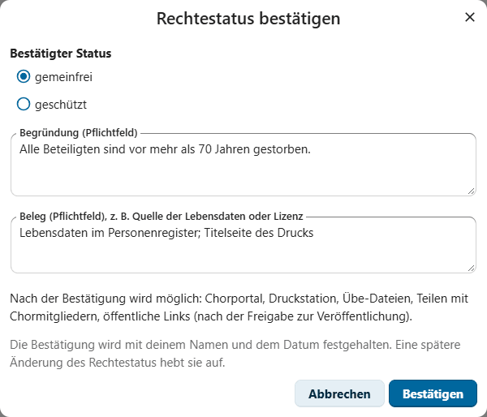
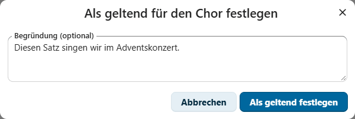
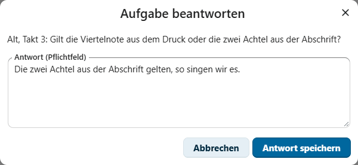

# Schnellstart

Diese Kurzanleitung zeigt der Archivverwaltung und der Chorleitung die ersten
Schritte im Notenarchiv. Ausführlich beschreiben es der
[User guide](../user-guide.md) und für die Einrichtung der
[Administration guide](../admin-guide.md), beide auf Englisch.

> [!NOTE]
> Du siehst das Notenarchiv nur, wenn dein Konto in einer Gruppe mit einer
> Rolle ist. Die Rollen ordnet die Administration den Gruppen zu. Die
> deutsche Oberfläche gibt es in der Du- und in der Sie-Form; du wählst sie
> mit der Sprache in deinen persönlichen Nextcloud-Einstellungen.

> [!TIP]
> Die App öffnet Dateien nur mit den Rechten deines eigenen Kontos. Meldet
> sie „Die Datei liegt in einem Ordner, der für dein Konto nicht freigegeben
> ist“, bitte die Archivverwaltung, den Archivordner für dich oder deine
> Gruppe freizugeben; Leserechte genügen.

## Zurechtfinden

### Startseite „Fällig“

Das Notenarchiv öffnet mit **Fällig**: Karten zeigen, was für deine Rollen
ansteht, zum Beispiel offene Aufgaben, Vorschläge im Eingang oder Fassungen,
deren Gemeinfreiheit zu bestätigen ist. Ein Klick auf eine Karte öffnet die
passende Liste. Darunter stehen die Konzertfristen und die Aufgaben für deine
Rollen, sortiert nach Archivmappe.

### Werkverzeichnis

1. Öffne **Werkverzeichnis**.
2. Tippe in **Signatur, Titel oder Komposition** eine Signatur wie `2-1`
   oder ein Wort aus Titel oder Komposition.
3. Grenze die Liste mit den Filtern ein, zum Beispiel nach **Archivmappe**,
   **Rechtestatus** oder **Mit MusicXML**.
4. Klicke auf eine Zeile. Die Seitenleiste zeigt die Reiter **Übersicht**,
   **Rechte**, **Aufgaben**, **Dateien** und **Protokoll**.

Das Rechte-Kennzeichen zeigt immer Text und Symbol: „gemeinfrei“,
„gemeinfrei (Empfehlung, unbestätigt)“, „geschützt“, „offen“ oder „Interne
Erhaltungskopie – keine Weitergabe“.

## Für die Archivverwaltung

### Rechte bestätigen

Ein importierter Rechtestatus bleibt eine Empfehlung, bis du ihn bestätigst.

1. Öffne das Exemplar, Reiter **Rechte**, und wähle **Bestätigen**.
2. Wähle den bestätigten Status: gemeinfrei oder geschützt.
3. Trage die **Begründung** und den **Beleg** ein, zum Beispiel „Alle Beteiligten sind
   vor mehr als 70 Jahren gestorben“ und „Lebensdaten aus dem
   Personenregister“. Beides ist Pflicht.
4. Wähle **Bestätigen**. Dein Name und das Datum werden festgehalten.

Wenn du unsicher bist: **Im Zweifel: auf offen setzen**.

> [!NOTE]
> Die Rechte-Hilfen bilden deutsches Urheberrecht ab. Sie unterstützen deine
> Entscheidung, sind aber keine Rechtsberatung.

### Rückfragen übernehmen

1. Die Karte **Beantwortete Aufgaben zum Übernehmen** führt zu den Antworten.
2. Berichtige, wenn nötig, das Werkverzeichnis oder die Datei.
3. Wähle bei der Aufgabe **Schließen** und dann **Übernommen** oder
   **Verworfen**, danach **Aufgabe abschließen**.

### Neuzugang erfassen

1. Öffne **Neuzugang** und dort **Neues Stück erfassen**.
2. Wähle die **Archivmappe**. Die App schlägt die nächste freie Nummer vor;
   Nummern werden nie wieder vergeben.
3. Trage Titel, Komposition, Titelquelle, Zugangsdatum und Herkunft ein.
4. Wähle **Zugang erfassen**. Das Etikett kommt auf den Etikettenbogen darunter.

### Sicherung

Die App legt jede Woche eine vollständige Sicherung in den Archivordner. Vor
größeren Änderungen wählst du unten in der Navigation **Archivverwaltung** und
dort **Vollständige Sicherung jetzt ablegen**.

## Für die Chorleitung

### Geltende Fassung festlegen

Nur die Chorleitung legt fest, welche Fassung der Chor singt.

1. Öffne ein Exemplar dieser Fassung, Reiter **Rechte**, Abschnitt **Gilt für
   den Chor**.
2. Wähle **Als geltend für den Chor festlegen**, auf Wunsch mit Begründung,
   und dann **Als geltend festlegen**.

Je Werk gilt höchstens eine Fassung. Die Rechte ändern sich dadurch nicht.

### Noten ansehen und anhören

1. Wähle in der Seitenleiste **Noten**.
2. Trage **Von Takt** und **Bis Takt** ein und wähle **Anzeigen**. Es gelten
   die gedruckten Taktnummern; der Auftakt ist Takt 0.
3. Wähle die **Hervorgehobene Stimme**. Sie erscheint farbig mit kräftigeren
   Notenköpfen, die übrigen Stimmen heller.
4. Wähle unter **Stimmen beim Abspielen** „Alle gleich“, „Stimme betont“ oder
   „Nur diese Stimme“ und dann **Abspielen**. Die Leertaste spielt und hält an.
   **Tempo und Lautstärke** öffnet die Regler und die Schalter für
   Wiederholungen und Mitscrollen.
5. Unter **Diese Stelle** kopierst du einen Textverweis, erstellst einen
   internen Link oder legst eine Rückfrage zu den gezeigten Takten an.

Abspielen gibt es für gemeinfreie Fassungen und für Fassungen mit einer
Lizenz für Übe-Audio, nie für interne Erhaltungskopien.

#### So übst du eine Stelle in Schleife

1. Trage die Stelle in **Von Takt** und **Bis Takt** ein.
2. Schalte daneben **Wiederholen** ein. Die Stelle wird gezeigt und beim
   Abspielen immer wieder gespielt, bis du **Pause** oder **Stopp** wählst.
3. Unter **Tempo und Lautstärke** wählst du einen **Einzähler** von 1 oder
   2 Takten. Die Wahl merkt sich dein Browser.

Ein Klick auf eine Note startet die Wiedergabe dort. Mit der Tastatur gehst
du in den Noten mit den Pfeiltasten links und rechts zum vorigen oder
nächsten Takt und spielst mit der Leertaste ab.

### Übe-Dateien erstellen

1. Stelle in der Notenansicht Takte, Tempo und Wiederholungen ein (Tempo und
   Wiederholungen unter **Tempo und Lautstärke**).
2. Wähle **Übe-Dateien …**.
3. Wähle **Eine Datei** oder **Jede Stimme und ein Tutti (ZIP)** und das
   Format **WAV (Audio)** oder **MIDI (eine Spur je Stimme)**.
4. Wähle **Datei erstellen** oder **ZIP-Archiv erstellen**. Der Browser legt
   das Ergebnis in deine Downloads.

> [!IMPORTANT]
> Übe-Dateien gibt es nur für bestätigt gemeinfreie Fassungen und für
> Fassungen mit einer gültigen Lizenz für Übe-Audio, nie für interne
> Erhaltungskopien. Jede Ausgabe steht im Protokoll der Fassung. Ins
> Chorsystem lädst du die Dateien selbst hoch; die App gibt nichts an
> Chormitglieder weiter.

### Rückfrage beantworten

1. Öffne die Rückfrage über die Startseite, über **Aufgaben** oder über die
   Benachrichtigung.
2. **In den Noten zeigen** zeigt dir die Stelle.
3. Wähle **Antworten**, schreib deine Antwort und wähle **Antwort speichern**.

Die Archivverwaltung übernimmt die Antwort danach ins Werkverzeichnis.

### Konzert planen

1. **Konzerte** → **Neues Konzert**: Titel, Datum, auf Wunsch Beginn und Ende,
   Ort. **Speichern**.
2. **Stück hinzufügen (Suche nach Signatur oder Titel)** → **Hinzufügen**.
   Bring die Stücke in die richtige Reihenfolge und trage die Dauer ein.
3. Prüfe die Warnungen: Erhaltungskopie, ungeklärte Rechte, keine oder eine
   andere geltende Fassung, geschützt ohne Lizenz.
4. **Programm festlegen**, wenn es steht.
5. Nach dem Konzert: **Gesungen bestätigen** und die Stücke anhaken, die
   nicht gesungen wurden. **Liederfolge (CSV)** liefert die Liste für
   Verwertungsgesellschaft und Programmheft.

Die App erinnert dich 10, 8 und 6 Wochen vor dem Konzert an die Fristen.

### Kalender, Dashboard und Dateien

- **In meinen Kalender eintragen** trägt ein Konzert in einen deiner
  Nextcloud-Kalender ein, **Kalenderdatei (.ics)** lädt es für jedes
  Kalenderprogramm herunter. Mit **Mit den Vorbereitungsfristen (10, 8 und 6
  Wochen vorher)** kommen die Fristen als ganztägige Einträge dazu.
- Das Widget **Notenarchiv – fällig** zeigt im Nextcloud-Dashboard dasselbe
  wie die Startseite „Fällig“, mit Links ins Notenarchiv.
- In der **Dateien**-App öffnet ein Klick auf eine MusicXML-Datei im
  Archivordner die Notenansicht ihres Exemplars. Bei Scans und anderen
  Dateien steht **Im Notenarchiv öffnen** im Aktionsmenü.

## Mehr

- **Auswertungen** zeigt Bestand, Rechte, Repertoire und Pflege in Zahlen;
  der **Jahresbericht** fasst ein Jahr für Vorstand und Mitgliederversammlung
  zusammen.
- [User guide](../user-guide.md): alle Funktionen, nach Rollen geordnet
- [Administration guide](../admin-guide.md): Installation, Rollen,
  Archivordner, Import, Sicherung
- [Demo-Bestand](../../tools/demo/README.md): ein erfundenes Notenarchiv zum
  Ausprobieren
