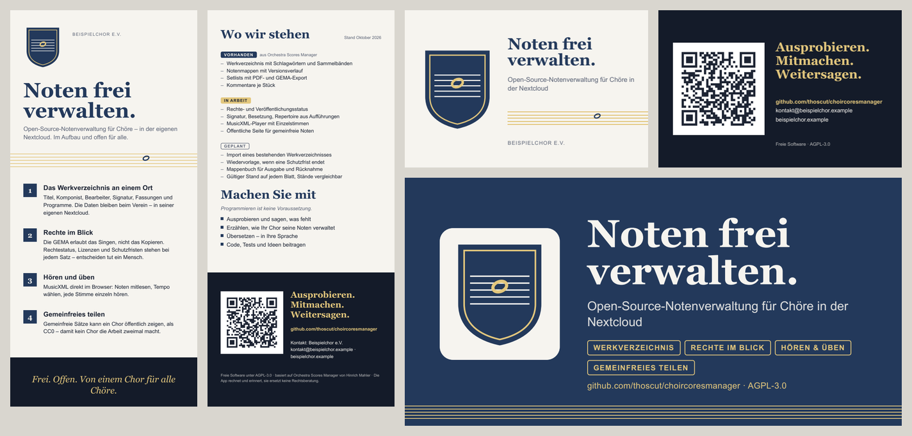

# Werbemittel: Flyer, Visitenkarte, Banner

*English: templates for a flyer, a business card and two banners that any
choir can build with its own name, logo and contact. Texts are German for now;
copy `content.json` to translate them.*

Mit diesen Vorlagen kann jeder Chor Infomaterial zum Projekt bauen, mit
eigenem Namen, Logo, Kontakt und eigenen Farben.



| Erzeugnis | Format | Dateien |
|---|---|---|
| Flyer DIN lang | 99 × 210 mm, zweiseitig | `flyer-dl.pdf` (Bildschirm), `flyer-dl-print.pdf` (Druck mit Beschnitt), Vorschau-PNGs |
| Visitenkarte | 85 × 55 mm, zweiseitig | `business-card.pdf`, `business-card-print.pdf`, Vorschau-PNGs |
| Banner für Linkvorschau | 1280 × 640 px | `banner-social.png`, z. B. als „Social preview" eines Repos |
| Breites Banner | 1500 × 500 px | `banner-web.png`, für Webseite oder Profilkopf |

## Was wo steht

| Datei | Inhalt | Wer pflegt |
|---|---|---|
| `content.json` | Projekttexte: Titel, vier Kernaussagen, „Wo wir stehen", „Machen Sie mit", Kleingedrucktes | das Projekt, zusammen mit der [Roadmap](../roadmap.md) |
| `example/sender.json` | Absender: Name, Logo, Web, E-Mail, Farben, Schriften | jeder Chor seine eigene Kopie |
| `templates/` | Layout als HTML/CSS (Jinja) | das Projekt |
| `build.py` | baut PDF und PNG | das Projekt |

**Die eigene Absenderdatei gehört nicht ins Repo**, sondern in die Ablage des
Chors, samt Logo und Schriften. Pfade darin sind relativ zur Absenderdatei.

## Bauen

```
pip install weasyprint jinja2 segno pypdfium2
python build.py --sender ../pfad/zu/absender.json --out ausgabe --print-out ausgabe/druck
```

- `--bleed 2` ändert den Beschnitt (Standard 3 mm), `--crop-marks` setzt
  Schnittmarken. Was die Druckerei verlangt, steht in ihrem Datenblatt.
- `--only flyer-dl` baut nur einzelne Erzeugnisse.
- Ohne `pypdfium2` nimmt das Skript `pdftoppm` (Poppler), falls vorhanden.

## Hinweise

- **QR-Code** zeigt auf `project.url` in `content.json`. Er wird bei jedem Bau
  neu erzeugt (Fehlerkorrektur M, Ruhezone vier Module, immer auf Weiß).
  Vor dem Druck einmal mit dem Handy scannen.
- **Schriften:** Ohne eigene Schriftdateien nimmt die Vorlage die
  Ausweichschriften aus der Absenderdatei. Variable Webschriften vorher in
  feste Schnitte umwandeln (z. B. mit `fontTools.varLib.instancer`), sonst
  wird „fett" im PDF nicht fett.
- **Logo auf dunklem Grund:** Ist `logo_on_dark` leer, steht das Logo auf
  einer hellen Plakette.
- **Farben** sind RGB; Online-Druckereien wandeln das in der Regel selbst um.
- **Ehrlich bleiben:** „Wo wir stehen" unterscheidet Vorhandenes, Arbeit und
  Planung. Bitte nicht als fertig ausgeben, was noch im PR liegt.
