# User guide

**English** | [Deutsch](de/benutzerhandbuch.md)

This guide is for the people who look after a choir's sheet music: music
librarians, the conductor, the board and the auditors. Choir members find
their part in [Shared with me](#shared-with-me). It first explains a few
terms and how to find your way around, then what each role does, task by
task, and at the end what to do about common problems. The interface is
available in English and German (informal and formal address), and in
French, Spanish, Italian, Dutch and Polish (made with the help of AI, not yet
reviewed by native speakers).

What you see depends on your roles. Roles are bound to Nextcloud groups; an
administrator assigns them (see the [administration guide](admin-guide.md)).
The server checks every request, so a button you do not see is a step your
role does not include.

**Contents**

- [Terms](#terms)
- [Getting around](#getting-around)
- [As a conductor](#as-a-conductor)
- [As a music librarian](#as-a-music-librarian)
- [As operations](#as-operations)
- [As the board or auditors](#as-the-board-or-auditors)
- [As a choir member](#as-a-choir-member)
- [As a contributor or tool](#as-a-contributor-or-tool)
- [Common problems](#common-problems)
- [Paper](#paper)

## Terms

The app uses a few words in a fixed sense. In the app, a small **?** next to
these words explains them briefly and links here (see
[Help next to a term](#help-next-to-a-term)).

### Work, version and copy

A **work** is the piece itself, with its title and composer, for example
"Der Mond ist aufgegangen". A **version** (German *Fassung*) is one edition
or arrangement of the work, for example a setting for men's choir from one
publisher; the rights belong to the version, not to the work. A **copy**
(German *Exemplar*) is one physical or digital copy of a version with its own
shelf mark, for example the printed sheets in a binder or a scan. One work
can have several versions, and one version several copies (see
[The details of a copy](#the-details-of-a-copy)).

### Shelf mark

The shelf mark says where a copy belongs: the number of the archive binder
and the number in the binder, for example `5-12` for copy 12 in binder 5.
Every copy has its own shelf mark, and a number is never given twice. The
names of the files in the archive folder start with the shelf mark, so that
the file sync links each file to its copy (see
[Imports, file sync and exports](#imports-file-sync-and-exports)).

### Rights status and confirmation

The rights status of a version is *public domain*, *protected* or *open*
(not clarified). The app proposes a status from the data, for example from
the life dates of the persons involved, but a proposal stays a suggestion.
A music librarian confirms the status with a reason and evidence, and only a
confirmed status counts for releases (see
[Confirming rights](#confirming-rights)). The app supports the decision; it
is no legal advice.

### Release

A release says whether a version may be given out in a certain way: in the
singers' portal, at the print station or as a publication. It follows from
the confirmed rights or from a valid license for that use. Internal
preservation copies are never released (see
[Releases: singers' portal and print station](#releases-singers-portal-and-print-station)).

### Valid version

The valid version is the version the conductor has chosen as the one the
choir sings. A work has at most one valid version, and only the conductor
sets it. It says nothing about the rights: a valid version can still be
protected or open (see
[Choosing the valid version](#choosing-the-valid-version)).

### Internal preservation copy

An internal preservation copy is kept only for the archive, for example a
paper copy of the choir's own original, kept as a reserve. It is never
shared, played or exported. A scan or a MusicXML transcription of a
protected print is a copy as well; for a choir archive the exception for
archive copies (§ 53 (2) UrhG) rarely covers a digital copy, so it usually
needs the consent of the publisher (license use "Digitisation"; see
[Legal background](legal-background.md#preservation-copies)). Only the
catalog librarian and the conductor see it; the catalog marks it with the
badge *Internal preservation copy – do not share* (see
[Finding a copy](#finding-a-copy)).

## Getting around

### Navigation

The navigation on the left lists the views of the app in groups:

- **Due**, **Tasks** and **Inbox** (the inbox only for the roles that see
  proposals: catalog, proposals and read only)
- **Archive:** **Catalog** with its filters, **Persons**, **Protection
  terms** and **Statistics**
- **Releases:** **Singers' portal**, **Print station**, **Ending licenses**
  and **Links**
- **Programmes:** **Concerts**, **Song lists** and **Unclear programme
  lines**
- **Maintaining the catalog:** **New accession** (for the other roles
  **Shelf labels**), **Merge**, **Inventory**, **Folder book** (for the
  roles that read it) and **Checksums**

The conductor also finds **Choose valid versions** (see
[Choosing the valid version](#choosing-the-valid-version)).

At the bottom, everyone finds **Help** (this guide, in a German interface
the German one) and **Customize view**, music librarians **Archive management**
(imports, file sync, exports, backups). **Settings** (for administrators and
the groups they have given the settings) leads to **Administration → Music
archive**, the settings page of the app in Nextcloud's administration.

Every view has its own address, so the browser's back button works and a
view can be bookmarked.

### Customize view

**Customize view** at the bottom of the navigation hides the areas of the
navigation and the parts of the start page you do not need, e.g. the
statistics or the concert deadlines. The choice is stored with your account
on the server, so it applies on every device. It only changes what you see:
your permissions stay the same, and a hidden area still opens through a
link or a notification. The start page and the catalog cannot be hidden.

Functions that the administration has switched off (see the admin guide,
"Modules and presets") are missing for everybody; a link to such a function
opens the start page with the note *This function is switched off.*

### Start page "Due"

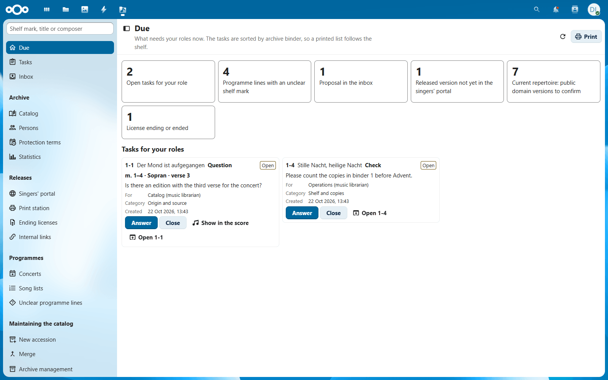

The app opens with **Due**: what your roles need now. Cards show how many
things are waiting, for example open tasks for your role, answered tasks to
apply, proposals in the inbox, versions to remove from or add to the singers'
portal, public domain versions of the current repertoire to confirm, licenses
ending or ended, or works of the current repertoire without a chosen valid
version. A click on a card opens the matching list or the catalog with the
right filters.

For conductors and music librarians, **Concert deadlines** lists the planned
concerts whose next preparation step is due: fix the programme and the valid
versions (from 10 weeks before), clarify the rights of all pieces (from 8
weeks), prepare the concert binders (from 6 weeks), and after the date
confirm what was sung (conductor only). **Tasks for your
roles** follow, sorted by archive binder, so that a printed list follows the
shelf.

### Finding a copy

Open **Catalog** and type into the search field **Shelf mark, title or
composer**:

- A shelf mark (`2-1`, also `2/1`, `2 - 01` or `2.1`) finds exactly that
  copy, also a retired one.
- Any other text finds the copies whose title or composer contain every word
  you typed; accents do not matter.

The search field and the filters **Rights status** and **Repertoire** are
always visible. **More filters** opens the other filters: archive binder,
status (active by default; retired, missing and lent copies only when you
choose their status or **All statuses**), **With MusicXML**, **Internal
preservation copies only**, **Public domain, not confirmed**, **No version
valid for the choir** and **Open review points**. A second click on **More
filters** closes them again; the app remembers whether they are open. While
filters under **More filters** are active, the button says how many.
**Reset search and filters** clears them. The list can be sorted by catalog
order, shelf mark or title; on a phone it shows one card per copy.

The **rights badge** always shows a text and a symbol, never only a colour:

| Badge | Meaning |
|---|---|
| *public domain* | public domain, confirmed by a music librarian |
| *public domain (suggestion, unconfirmed)* | public domain as imported or proposed, not confirmed yet |
| *protected* | protected by copyright |
| *open* | not clarified |
| *Internal preservation copy – do not share* | internal copy of a protected work: never shared or played |
| *not assessed* | no rights status yet |

### Finding a copy from the Nextcloud search

With the module **Nextcloud search** you find copies without opening the
app:

1. Click the magnifier in the Nextcloud header and type a shelf mark
   (`2-1`), a word of the title or the name of a person, at least two
   characters.
2. The section **Music archive** lists the copies, active ones first, with
   composer, arranger and, for other copies, their status.
3. Click a result: the app opens with that copy.

The search works like the search field of the catalog and finds persons of
the register as well. It shows only what your roles may see: internal
preservation copies only to the catalog librarian and the conductor, and
nothing to accounts without a role in the music archive.

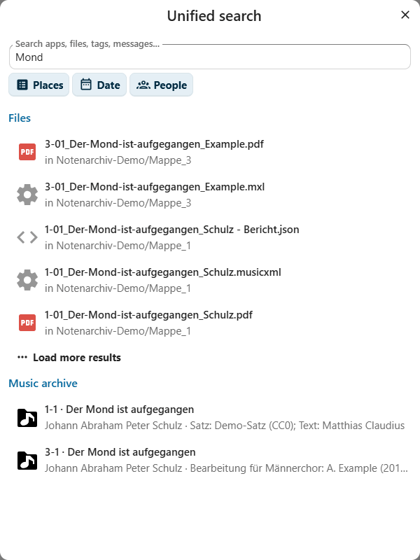

### The details of a copy

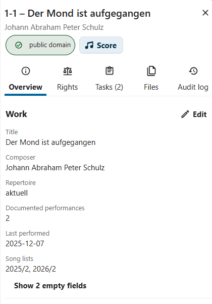

Click a row to open the sidebar. Its head shows the rights badge, the status
if the copy is not active, and **Score** if there is MusicXML you may view.
The tabs:

- **Details:** work, version and copy, the repertoire (class, documented
  performances, last performed, song lists), merges and the other copies of
  the same work.
- **Rights:** confirmation, releases, the valid version, licenses, open
  proposals, the persons involved with the protection-term suggestion, and
  the rights and MusicXML fields.
- **Queries:** questions and tasks of the copy and its excerpt links (the
  tab is called **Links** while the tasks are switched off).
- **Files:** the files linked from the archive folder, each with a symbol for
  its file type and the folder it lies in (not the full path). Each file
  opens in Nextcloud in a new tab (see
  [Files you cannot open](#files-you-cannot-open)).
- **History:** the audit log of the copy: every change with who, when, old
  and new value and reason.

A section you may change shows **Edit**. Change the fields, optionally enter
a **Reason for the change**, which is stored in the audit log, and **Save**.

> [!NOTE]
> Nothing is ever deleted. A copy that leaves the archive gets the status
> *retired*, *missing* or *lent*, and the status needs a reason.

### Help next to a term

Next to some terms (version, copy, shelf mark, rights status, release, valid
version, internal preservation copy and revision) the app shows a small **?**
button.
It opens a short explanation of the term with a link to the matching section
of this guide (see [Terms](#terms)). Escape closes the explanation.

### Files you cannot open

The app opens files only with the permissions of your own account, the same
as the **Files** app. The scores, scans and practice files lie in the
archive folder; if that folder is not shared with you, you see the catalog,
but no file opens. The app then says so:

- at the top of the page: *The archive folder is not shared with your
  account, so its files (scores, scans, practice files) do not open for you.*
- on the tab **Files** of a copy, and
- in the score view: *The score cannot be shown – The file lies in a folder
  that is not shared with your account. Please ask the music librarians to
  share the archive folder with you or your group.*

Nothing is wrong with the file or with your role. Ask the music librarians
(or the administration) to share the archive folder with you or, better,
with the group of your role; reading is enough. Afterwards reload the page.
If you may change the settings yourself, the button **Check access to the
archive folder** opens the access check under Administration → Music
archive, which lists everybody who cannot open the folder (see the
[administration guide](admin-guide.md#checking-who-can-open-the-archive-folder)).

### Error messages

An error message stays at the bottom right until you close it with **×**,
and says what to do: log in again, ask for a role, reload the page or try
again in a moment. When the server cannot finish something, the message
gives a **request ID**. Pass it on to the administration; it finds the error
in the Nextcloud log with it.

### Printing

**Print** in a view prints it as shown. At the top is a header with the
name of the Nextcloud (usually the choir), the view, the filters that are on
and the day of printing; at the foot of each page "Page 1 of 3", where your
browser can print page numbers (for example Chrome and Edge; Firefox
prints without).

### Notifications

The app notifies the holders of a role through Nextcloud's notifications, for
example about a question for your role, an answer to apply, a proposal in the
inbox or a concert deadline. A notification disappears when the matter is
done. Notifications never go to singers and contain no personal data. In your
personal Nextcloud settings you choose whether they also arrive by email and
how often, for example as a weekly summary. The
[administration guide](admin-guide.md#6-notifications) lists all of them.

### Dashboard widget

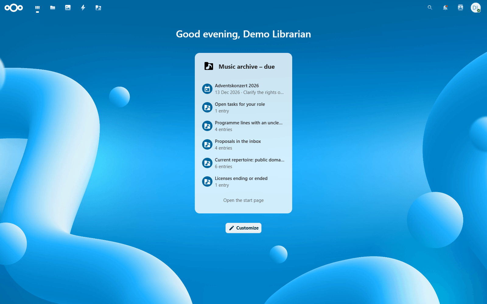

The Nextcloud dashboard can show the widget **Music archive – due**: the same
as the start page (concert deadlines, the cards with their numbers, tasks for
your roles), each entry with a link into the app, and **Open the start page**.
Each entry has a short title, the details in a second line and a symbol for
its kind (concert, card or task). Add the widget in the dashboard's settings.
Only accounts with an archive role can add it. It never shows the text of a
question or a person's name.

### Opening from the Files app

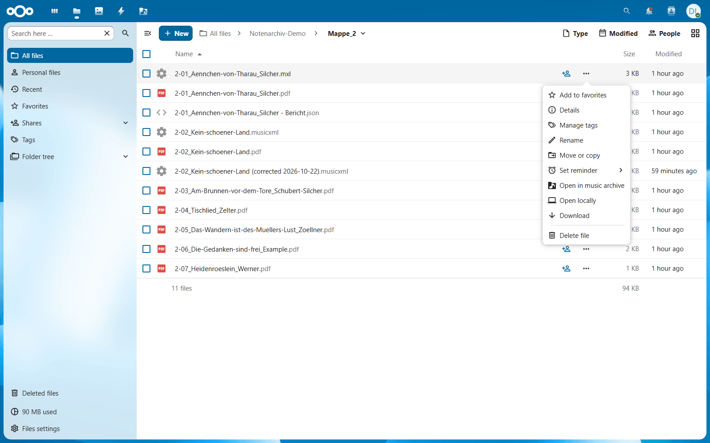

The archive folder is an ordinary folder in Nextcloud, so you can also find a
file there in the **Files** app. Files of the archive folder have the action
**Open in music archive** in their actions menu (⋯):

- **MusicXML** (`.musicxml`, `.mxl`): a click on the file opens the score
  viewer of its copy directly. If another app in your Nextcloud already opens
  MusicXML, a click stays with that app and the action is in the menu.
- **Scans (PDF), MuseScore, audio and the other files of a copy**: the action
  opens the copy in the sidebar of the music archive. A click on a PDF keeps
  opening Nextcloud's own viewer.

The action is there for accounts with an archive role and for
administrators, and only for files in the archive folder with a type the
file sync knows. When you choose it, the app asks the server which copy the
file belongs to. A file that is not listed in the catalog (for example a file
whose name does not start with a shelf mark) gives the message **This file
is not listed in the music archive.** Opening a file this way grants
nothing: the score viewer checks the rights as always, so internal
preservation copies are only shown to the catalog librarian and the
conductor and never played.

Administrators switch the action off with the module **Opening from the
Files app** (see the [administration guide](admin-guide.md)).

## As a conductor

The **Conductor** decides which version the choir sings, answers musical
questions and plans concerts with the music librarians. The conductor may
also enter key, scoring, language, duration and the review of a
transcription, view internal preservation copies (without playback), and
make practice files.

Music librarians use the score viewer, practice files, questions, sharing,
the review of transcriptions and the concerts in the same way; their chapter
links here. See also
[Statistics and annual report](#statistics-and-annual-report) and the
[Folder book](#folder-book), which the conductor can read.

### Choosing the valid version

Only the conductor decides which version of a work the choir sings (see
[Valid version](#valid-version)). There is at most one valid version per
work. Choosing it changes nothing about the rights.

**Several works at once.** **Choose valid versions** in the navigation (only
for the conductor, and only while the module "Valid version" is switched on)
lists the works that have several versions and none of them valid for the
choir.

1. Open **Choose valid versions**. Switch on **Only the current repertoire**
   to see only the works the choir sings at present.
2. Each work shows its versions, each with its copies (shelf marks), their
   kind and the rights status.
3. Enter a reason if you like and choose **Set as valid** at the version the
   choir sings. This is done right in the list; you do not need to open the
   copy.

**One work.**

1. Open a copy of the version the choir sings → tab **Rights** → section
   **Valid for the choir**.
2. **Set as valid for the choir**, optionally with a reason, and confirm.

If another version was valid, the dialog says so and that version is no
longer valid. **Set as no longer valid for the choir** clears it.

> [!TIP]
> The filter **No version valid for the choir** in the catalog and the start
> page card **Current repertoire: no valid version chosen** (it opens the
> catalog with the matching filters) show where a decision is missing.

Within the valid version the music librarians set the current
[revision](#revisions-of-a-version) of its MusicXML. You see the revisions
and [compare two of them](#how-to-compare-two-revisions-and-write-a-note-for-choir-members),
with a short note for the choir to copy.

### Answering a question

Questions for the conductor appear on the start page, in **Tasks** and as a
notification.

1. Open the question; **Show in the score** shows the place.
2. **Answer**, write the answer and **Save answer**.

The music librarian then applies the answer to the catalog or discards it.

### Score viewer

**Score** opens the MusicXML of a copy in the browser. Notation, fonts and
sounds are part of the app; nothing is loaded from other servers.

1. Enter **From measure** and **To measure** and choose **Show**. Measures
   are the printed numbers; the pickup is measure 0. **All measures** shows
   the whole piece again.
2. Choose a **Focus voice**, also one that shares a staff with another voice
   (for example Tenor II on the staff "Tenor I/II"). The focus voice is shown
   in colour with bolder note heads and stems, the other voices in a lighter
   grey; the lyrics of its staff stay dark.
3. Choose **Voices during playback**: **All equal**, **Focus voice louder**
   or **Focus voice only**. **Tempo, volume and practising** opens the sliders
   for tempo and volume, the switches **Play repeats** and **Scroll along**
   and the tools for practising (see below).
4. **Play**, **Pause** and **Stop** control the playback.

**Smaller** and **Larger** change the size of the notes; your browser
remembers it for the next piece. On a phone only **Play** and **Stop** are
above the notes at first; **Measures, voice and size** shows the other bars.

Keyboard: Space plays and pauses unless a control has the focus, `+` and `-`
change the size while the score has the focus, **Page Down** and **Page Up**
turn the score by one system (page-turn pedals send these keys, also in
shared pieces), Escape closes the viewer. The
current measure is announced to screen readers during playback, and the score
has a text description (measures, voices, focus voice, key and time
signature).

#### How to practise a passage in a loop

1. Enter the passage in **From measure** and **To measure**.
2. Switch on **Loop** next to the fields. The passage is shown, and the
   playback plays it again and again until you choose **Pause** or **Stop**.
   Screen readers hear "Loop on" with the measures.
3. Switch **Loop** off to play on to the end again.

#### How to count in before the playback

Under **Tempo, volume and practising**, choose **Count-in**: **Off**, **1 bar** or
**2 bars**. Before the music starts you hear clicks in the time signature and
tempo of the place where the playback starts, the first beat of each bar
higher. A pickup comes in on the last beats of the count-in. The choice is
remembered in your browser, also for shared excerpts.

#### How to practise with starting tones, metronome, pitch, mixer, passages and recordings

These tools are under **Tempo, volume and practising**, in the score view and
for shared pieces and excerpts. They work only in your browser: nothing
about your practising is stored on the server.

- **Starting tones** plays the first tone of every voice from the place where
  the playback starts, one after the other from the lowest, then together.
  With **Focus voice only** you hear the tone of the focus voice alone; a
  voice muted in the mixer is left out. Screen readers hear the names, for
  example "Starting tones: Bass F3, Tenor A3, Alto C4, Soprano F4".
- **Metronome** clicks every beat while the music plays, the first beat of
  each bar higher, like the count-in.
- **Pitch** moves the sound up to six semitones higher or lower, for example
  to sing a piece in a lower key. The notes stay as written. Practice files
  take the pitch, too.
- **Mixer** opens a slider for every voice. It works on top of **Voices
  during playback**: at 0 % a voice is muted, at 50 % it is half as loud.
  **All voices at 100 %** resets it. A practice file of a shared piece
  sounds like the mixer.
- **Remember** keeps the shown measures as a passage, with a name if you
  like ("Fugue", "Tenor entry"). A click on a remembered passage shows it
  and plays it in a loop; the cross removes it. The passages are kept per
  piece in this browser only.
- **Record myself** asks for the microphone and starts the playback (with
  the count-in) from the current place; sing along. **Stop recording** or
  **Stop** ends it. Then listen to the recording, choose **Listen with the
  accompaniment** to hear it together with the playback, **Save recording**
  to keep it as a file, or **Delete recording**. The recording stays in your
  browser and is gone when you leave the page. Use headphones, otherwise the
  accompaniment is recorded, too. Recording needs https.
- **Read the lyrics along** (where the score has lyrics) shows the line of
  your focus voice (or of the first voice with lyrics) above the score, large,
  with the sung syllable bold and underlined, and the next line below. In a
  repeat it shows the next verse. **Learn the lyrics** hides letters step by
  step: **Some hidden**, **Most hidden**, and **First letters**, where only
  the first letter of every word stays.
- **Show my pitch** (with a focus voice) asks for the microphone and shows
  above the score the tones of the focus voice as boxes and your singing as
  a line, and in words, for example "Soprano: A4 · You: G4, too low (−200
  ct)". Within 30 cents a tone counts as in tune. Your singing is compared
  in the octave of the voice, so a man can sing a soprano line along. The
  pitch is found in your browser; nothing is recorded, kept or scored.
  Switching it off releases the microphone. Use headphones, and it needs
  https.

#### How to start at a particular note

- **Mouse or touch:** click a note in the score (or a measure). The playback
  starts there, with the count-in. While it plays, it jumps there. In a
  repeated passage it takes the next pass from the current position.
- **Keyboard:** move the focus to the score (Tab) and use the arrow keys
  **left** and **right**: they go to the previous or next measure in playing
  order, and the measure is announced. Space then plays from there. You can
  also enter the measure in **From measure** and choose **Show**.

> [!IMPORTANT]
> Playback is offered for public domain versions and for versions with a
> valid license for practice audio. Internal preservation copies are never
> played; only the catalog librarian and the conductor may view them.
> Without the right, the viewer shows the reason instead.

### Practice files

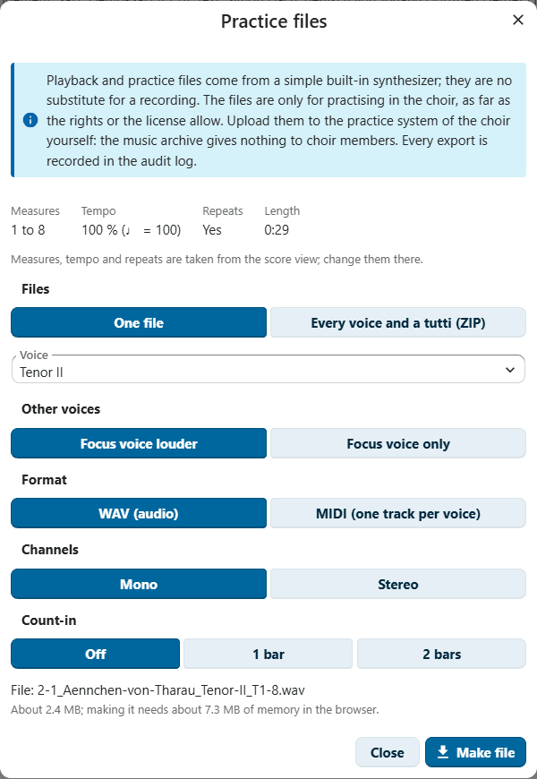

Music librarians and the conductor make practice files for the choir's
practice system from the score viewer:

1. Choose measures, tempo, repeats and count-in in the score viewer.
2. Open **Practice files …**. **Count-in** starts every file with one or two
   bars of clicks (in MIDI files on a drum track of their own).
3. Choose **One file** (a voice, with the other voices quieter or silent, or
   all voices equal) or **Every voice and a tutti (ZIP)**.
4. Choose the format: **WAV (audio)**, 16 bit, mono or stereo, rendered with
   the same synthesizer and playing order as the playback; or **MIDI (one
   track per voice)**, each track named after its voice, with the balance in
   the volume of each track.
5. **Make file** or **Make ZIP archive**. A progress bar shows how far it is;
   **Cancel** stops. The browser saves the result in your downloads.

File names follow `<shelf mark>_<title>_<voice>_T<from>-<to>`, for example
`2-2_Kein-schoener-Land_Tenor-1_T0-10.wav`. The dialog shows the length and
roughly how large the files are; excerpts longer than 10 minutes get a
warning.

> [!IMPORTANT]
> The server checks the rights before every export: practice files are only
> made for confirmed public domain versions and for versions with a valid
> license for practice audio, never for internal preservation copies. Without
> the right, the reason is shown instead of the button. Every export is
> recorded in the audit log of the version (measures, voice, mode, format).

The sound is synthetic and no substitute for a recording. The files are only
for practising in the choir, as far as the rights or the license allow.
Upload them to the practice system yourself. Where the administration has
switched on practice audio for choir members, they can also make a file of
their voice of a piece or excerpt shared with them (see
[Sharing with choir members and the public](#sharing-with-choir-members-and-the-public)).

### Asking a question or giving a task

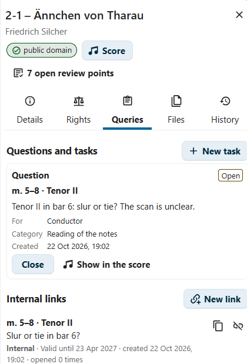

A question or task always belongs to a copy and may name a place in the
score: page, measures, voice and verse.

1. In the score viewer choose the place, then **This passage** and **New task
   for this place**, or
   in the tab **Queries** of the sidebar choose **New task**.
2. Choose the kind (**Question**, **Check** or **Report**) and the role it is
   **For** (conductor, catalog, operations or read only).
3. Describe it, add the place and optionally a category, a due date and its
   origin (for example a transcription round). **Create task**.

The addressed role is notified and answers with **Answer**. The music
librarian is notified of the answer and closes the task as **Applied** (the
catalog or the file was corrected) or **Discarded** (nothing to change); a
check can also be closed by the role it is addressed to. **Show in the
score** opens the place. **Tasks** in the navigation lists the tasks for your
roles or all tasks, also the closed ones, and can be printed.

When nothing is waiting, **Tasks** says so and offers **Open the catalog**:
a task is always created in the sidebar of a copy (tab **Queries**) or from
the score viewer.

### Sharing a place in the score

Share a place in two ways, both under **This passage** in the score viewer:

- **Copy text reference** copies a plain text such as
  `2-1 · Ännchen von Tharau · m. 5–8 · Tenor II`. It contains no notation and
  can be passed on anywhere.
- **Create internal link** (music librarians, operations and conductor) makes
  a link for people with a role in the music archive. It shows the whole
  piece or the measures with all voices and highlights the chosen voice. A
  link is valid for at most six months, can be revoked at any time by its
  creator or a music librarian, and says so when the score has changed
  since. The server checks the rights on every call; calls are counted
  without names. **Links** in the navigation lists all active links and says
  for each who can open it and what it shares. Where links for choir members
  or public links are switched on, the button is called **Share …** and the
  same dialog asks who can open the link (see
  [Sharing with choir members and the public](#sharing-with-choir-members-and-the-public)).

### Sharing with choir members and the public

Where the administration has switched them on, a whole piece or an excerpt
can be shared beyond the archive roles: with the **choir members** (they
sign in and see it under "Shared with me") or with **everyone** through a
public link without signing in. Both get only what you share, the whole
piece or the chosen measures, never the score file; the server sends only
that and checks the rights on every call. Optionally the link also offers
the **scan (PDF)** of the copy.

#### How to share a whole piece with the choir

Music librarians, operations and the conductor share from the score viewer
(or with **New link** on the tab of tasks and links of a copy):

1. Open the score and choose the **Focus voice**; set the tempo if needed.
2. Choose **Share …**.
3. Under **Who can open the link?** choose **Choir members**
   (or **Archive roles (internal)**, **Public (without signing in)**).
4. Under **What is shared?** keep **Whole piece**: all pages of the piece,
   with repeats and jumps as in the score. For a passage choose **Excerpt
   (measures)** and enter **From measure** and **To measure**; the dialog
   starts with the excerpt when the score viewer shows a range of measures.
5. Check voice, verse and tempo, and the **Valid until** date (at most six
   months). **Note (optional)**: the choir members see this note, for
   example "Please practise until Thursday".
6. Where the copy has a scan, **Include the scan (PDF)** offers it too (with
   several scans, choose one under **Which scan?**). The recipients open it
   in the PDF viewer of their browser. Whoever sees the scan can also save
   it; share it only where that is fine. The whole PDF is shared, also with
   a link to some measures.
7. **What the recipients see** lists what is shared (**Whole piece** or the
   measures), the focus voice, verse, tempo, whether they can play it,
   whether they can make practice files, whether the scan is included, and
   how long the link is valid.
8. **Create link**, then **Copy link** if you want to send it. Choir members
   find it under "Shared with me" anyway, until it expires.

A link for choir members is only possible for a version **released for the
singers' portal**: confirmed public domain, or a valid license with the use
"Singers' portal"; never for an internal preservation copy. The same holds
for the whole piece, an excerpt and the scan: legally an excerpt counts as
much as the whole. If it is not possible, the dialog says why and what to
do instead of offering **Create link**, for example *Public domain is not
confirmed yet. The catalog librarian confirms it on the tab "Rights"; then
the version can be shared with choir members.* An excerpt needs both
measures, and they must exist in the score.

Choir members can save and print a scan, which a license for the singers'
portal usually does not allow. Unless public domain is confirmed, the scan
in a link for choir members therefore needs a license with the use
"Download and printing by choir members (scan in links)" (or
"Self-printing by singers"); without it the dialog offers the notes and says
why the scan is missing.

Playback follows the same rules as in the archive (public domain, or a
license for practice audio). Practice files for choir members additionally
need the module "Practice audio for choir members" and a confirmed status
or a license for practice audio; they work for the whole piece as for an
excerpt.

**Links** in the navigation lists every active link with its circle
(**Internal**, **For choir members**, **Public**), what it shares
(**Whole piece** or the measures, and **with scan (PDF)**), validity and
number of calls; **Revoke link** stops a link at once for everyone.

> [!NOTE]
> The whole piece plays in the full order of the score, with all repeats,
> endings and jumps. In an excerpt, repeats and jumps that lead out of it
> are left out, so that it plays from its first to its last measure. A
> repeat back to a measure before the excerpt, its first and second
> endings, and a D.C. of an excerpt that does not start at the beginning
> are therefore not played. The score viewer of the archive, and the view
> of a shared whole piece, play a range of measures as part of the whole
> piece: measures 1 to 7 of "Der Mond ist aufgegangen" (1-1) sound there as
> 1–6, 1–5, 7, in a shared excerpt of these measures as 1–7.

#### Public links

A public link shows and plays a whole piece or an excerpt to anyone who has
the link, without signing in: without the score file, without names and
without a note. Choose **Public (without signing in)** in the same dialog.
It is only possible when

- the version is **released for publication**: the catalog librarian sets
  the publication status of the version to "Released for publication", and
- it is confirmed public domain, or has a valid license with the use
  "Online publication (public links)" (a license for "Publication" alone is
  not enough),
- and it is no internal preservation copy.

A protected version plays on a public link only with a license with the use
"Online playback (audio on public links)": a license for practice audio
covers the use inside the choir, not a sound version for everyone. Public
domain versions play as in the archive.

The scan (PDF) can be included under the same conditions. The page shows
title, composer, the whole piece or the measures, the focus voice and a text
description, plays it with the voice emphasised and, if included, links to
the scan. When the link expires, is revoked or the version is no longer
released, the page and the scan show "not found" without a reason.

### Reviewing transcriptions

When a scan is transcribed into MusicXML (by a person or with a tool), the
transcription ends with a **report** (`… - Bericht.json`, format
`bericht/1`). It says what was uncertain, what was left out and what was
found on the material, measure by measure. The app turns these findings into
**review points**, which the conductor and the music librarians decide in the
score view. The app proposes, people decide: nothing in the catalog changes
by itself.

As conductor, the musical review points of a transcription report are yours:
uncertain readings, marks that were not transcribed and questions about a
measure. You are notified when a report brings new ones. In the score view
each point shows its measures with the voice highlighted and plays them;
confirm the reading, order a correction, ask a question or dismiss the point,
or correct a wrong note or syllable in the app yourself (see
[Reviewing in the score view](#reviewing-in-the-score-view) and
[Small corrections in the app](#small-corrections-in-the-app)).

#### Where review points come from

- **File sync.** Put the report next to the MusicXML in the archive folder,
  named like the score file with ` - Bericht.json` at the end (for example
  `5-01_Title - Bericht.json`), and run the file sync. The sync lists the
  report as a report, not as a score file, and reads it.
- **Tools.** A tool with the role "Proposals (tools)" sends the report
  through the app's interface (see the [API](api.md)).

Reading the same report again creates nothing twice. Each report gives:

| In the report | Review point | Decides |
|---|---|---|
| uncertain readings, with measure and voice | **Uncertain reading** | conductor |
| marks left out (for example a breath mark) | **Not transcribed** | conductor |
| findings on the material (a missing page, notes in pencil) | **Material** | music librarian |
| questions | **Question** | conductor when a measure is named, otherwise music librarian |

The **catalog librarian may decide every point**; the conductor decides the
musical ones. The rights assessment and catalog fields of the report (for
example "Verlag / Bestellnummer") go to the
[inbox](#deciding-proposals-in-the-inbox) as proposals, while the proposals
inbox is switched on; otherwise they are only shown with the report. The
report's origin and review state of the transcription are shown with the
version.

When a new report for the same copy arrives (a new round of the
transcription with a new MusicXML file), the points it no longer names are
set to **Corrected** ("done in a new version"). If the MusicXML has not
changed, they stay open.

#### Reviewing in the score view

1. Open the copy and its **Score**, then **Review** (the sidebar of the copy
   also offers a button with the number of open review points, and a
   notification opens the review directly). The panel **Review of the
   transcription** lists the review points, the round and the review state;
   **Show review points** switches between **To do** and **All**.
2. Choose a point. The score jumps to its measures and highlights its voice
   as the focus voice. **Play this passage** plays exactly these measures
   (only where playback is allowed; the rights check is the same as
   always).
3. **Scan**: when a PDF scan is linked to the copy, **Show scan beside the
   score** shows it next to the score, and **Open scan in a new window** opens
   it in a second window, both at the **Page of the scan** (the page of the
   point, or the page you last looked at). Both use the browser's own PDF
   viewer; nothing is sent to another server. The second window helps on
   small screens and with a magnifier.
4. Decide:
   - **Reading is right** – the transcription stays as it is.
   - **Correct in the app …** – for a wrong pitch, accidental or syllable,
     see [Small corrections](#small-corrections-in-the-app).
   - **Correction order** – for anything larger: describe what is to be
     changed; the tool chain fetches the order and closes it with its next
     report.
   - **Ask a question** – becomes a question (task) with the measures and
     voice of the point, for the conductor or the music librarians.
   - **Dismiss** – not relevant; a reason is required.

   **Reopen** sets a decided point back to open. Who decided, when and why is
   stored; nothing is deleted.

Everything works with the keyboard; a change of status is announced to
screen readers. The catalog shows the number of open review points per copy,
and the filter **Open review points** lists the copies that still need a
decision. The responsible roles are notified of new review points (one
notification per report).

#### Small corrections in the app

Small errors are corrected in the app itself (music librarians and
conductor). Only these can be changed:

- the pitch of a note (step, sharp or flat, octave) and its visible
  accidental,
- the syllable of a verse under a note.

Note values, rests, measures and everything else stay as they are; the
measures keep their length.

1. In the score view show a measure (or up to eight), choose the focus
   voice and **Correct notes …**; or choose a review point and **Correct in
   the app …**.
2. The notes of the voice are listed one by one with their duration; change
   pitch, accidental or syllable.
3. The **preview** shows the measures with the changed notes highlighted,
   and the list of changes in words (for example "measure 12, Bass: C3 →
   D3").
4. Save, optionally with a reason, and choose the review points it settles.

The app saves the correction as a **new file next to the old one**, with
your Nextcloud permissions, for example
`5-01_Title (korrigiert 2026-10-22).mxl`. The old file is not changed and
stays linked to the copy; the new one becomes the MusicXML the score view
shows. The audit log lists every change (measure, voice, old → new), and the
chosen review points are set to **Corrected**. The music librarians are
notified of the correction. Without write permission in the folder of the
score, the app says so and saves nothing. Internal preservation copies are
not corrected in the app. With the module "Revisions of a version" the new
file becomes the next [revision](#revisions-of-a-version) of the version.

### Revisions of a version

A version (an arrangement, an edition) changes over time: a wrong note is
corrected, a syllable fixed, the tool chain delivers a better transcription.
Each such change of the MusicXML is a **revision** of the version
(module "Revisions of a version"; on in the presets "Standard" and
"Complete"). A revision is a record in the catalog: which file, its
checksum, which measures and voices changed, a note, who and when. The app
makes no copies of files and changes none.

Revisions are recorded by themselves:

- **A correction in the app** becomes the next revision, with the measures,
  voices and changes of the correction, its reason and the review points it
  settled.
- **The file sync** records a new or changed MusicXML of a copy, with the
  note "Change found by the file sync" (or the round of the transcription
  report read in the same sync). An unchanged file makes no new revision.
- **The first revision** of a version is recorded by the first file sync
  after the module is switched on (revision 1, "First recorded revision").

Nobody has to number anything; the revisions count 1, 2, 3 … per version.

#### How to see the revisions of a version

1. Open the copy and choose the tab **Files**.
2. Under **Revisions of this version** the newest revision comes first:
   number, where it came from, date and person, measures and voices
   changed, the note, the file and the beginning of its checksum.
3. The line above the list is the **version line** as outputs print it:
   shelf mark · version · revision · valid since.

Every archive role sees the revisions; choir members do not.

#### How to set the current revision

Only the music librarians (role "Catalog") set the current revision. It is
the revision that is valid for the choir within the version; the conductor
chooses the valid version itself ([Choosing the valid
version](#choosing-the-valid-version)). The app never sets a current
revision by itself.

1. Open the copy, tab **Files**, **Revisions of this version**.
2. Compare the newest revision with the current one (see below) or open the
   score.
3. **Set as current** at the revision that is valid, optionally with a
   reason, and confirm. From today on it is "current since" today; the
   revision that was current before loses the mark. Both are in the audit
   log.

When a newer revision than the current one exists, the list says so.

#### How to compare two revisions and write a note for choir members

1. Under **Compare two revisions** choose the **older revision** and the
   **newer revision** (the newest and the current one are preselected) and
   choose **Compare**.
2. The app reads both files and lists the differences measure by measure
   and voice by voice, for example "m. 12, Tenor II: D4 → E4", "m. 14, Bass,
   verse 1: syllable "Lie-" → "Lieb-"", "m. 20: measure added". In German
   the note names are German (H for B natural, B for B flat).
3. Below the list is the **Note for choir members**: a heading with title,
   shelf mark and both revisions, then one line per difference, as plain
   text without notation. **Copy the note** and paste it into an e-mail or
   a message.

Notes, rests, note values, accidentals and lyrics are compared; layout,
dynamics and slurs are not. The conductor and every other archive role can
compare; the files are read with your own Nextcloud permissions, as in the
score view.

#### Where the version line appears

- On top of the score view, next to the name of the file, and in the text
  reference you copy from the score view ("2-35 · Title · Revision 3 · m.
  12 · Tenor II").
- In practice files (WAV and MIDI) as a comment, so a file shows which
  revision it was made from.
- In the programme of a concert and its printed lists (column "Revision")
  and in the song order (CSV, columns "Revision" and "Revision valid
  since").
- When a concert is confirmed as sung, each piece keeps the revision that
  was sung: the current revision, or the newest when none is set. A later
  revision does not change it.

Shelf labels do not show a revision: they belong to the copy, not to the
state of its MusicXML.

#### Common problems with revisions

- **"No revision has been recorded yet."** The module has just been switched
  on, or the copy has no MusicXML. Run the file sync (**Archive management**
  → **Run file sync**, music librarians); it records the MusicXML of every
  copy as revision 1.
- **"The file of revision … has been changed since it was recorded."** The
  file was overwritten in place (for example by the tool chain), so its
  earlier content is no longer in the archive folder; the app keeps no
  copies. Compare newer revisions, or look under **Versions** of the file in
  the Files app of Nextcloud, which keeps earlier contents for a while. To
  avoid it, let the tool chain write a corrected MusicXML as a new file.
- **"No differences in notes and lyrics."** The two revisions differ only in
  what is not compared (layout, dynamics, slurs, metadata).
- **There is no "Set as current" button.** Only the music librarians (role
  "Catalog") set the current revision; ask them.
- **A score file could not be read during the file sync.** The archive
  folder is not shared with the account that runs the file sync, or the file
  is damaged. The next file sync tries again.

### Planning a concert

Conductors and music librarians plan concerts:

1. **Concerts** → **New concert**: title, date, optionally start and end time
   (local time at the venue), location, whether it is public and whether the
   board has agreed.
2. **Add a piece (search by shelf mark or title)** → **Add**. Order the
   pieces with the move buttons, enter duration, encore and a note per piece.
   The total duration is added up.
3. Check the warnings of each piece: internal preservation copy, rights not
   clarified, no valid version or another valid version, protected without a
   license for the binders and without a recorded number of originals.
4. **Fix programme** when it is settled; it can still be changed until the
   concert is confirmed as sung.

Deadline notifications go to the conductor and the music librarians 10, 8
and 6 weeks before the concert. If a concert does not take place, **Cancel
concert**: it stays in the list with its programme, the deadline
notifications stop, and **Reopen concert** takes the cancellation back.

### After the concert

On or after the date, **Confirm as sung** and tick the pieces that were not
sung. All other pieces count as documented performances; the repertoire
figures update by themselves, and the programme can no longer be changed.
**Song order (CSV)** is laid out like the music report of GEMA: first the
event (title, date, start, location), then per piece position, shelf mark,
title, composer, lyricist, arranger, publisher, the **Work number (GEMA)**
of the version, the rights status and the duration. Composer, lyricist and
arranger come from the register of persons, otherwise from the text fields;
the rights status matters because a public domain melody in a protected
setting counts only for the arranger. The columns are in the language of
your account. **Print** offers the programme, the concert binder list
with columns to tick and the song list, also in large print. With the
module "Revisions of a version" each piece keeps the
[revision](#revisions-of-a-version) that was sung, and the programme, the
printed lists and the song order name it.

### Concert folder

With the module "Concert folder", conductors and music librarians open
**Concert folder** in the navigation: a page of its own with the
programmes still to be sung (draft or fixed), the next one first, each piece
in its order. Choose a piece to see, play and practise it with the same
tools as on a shared page (tempo, voices, count-in, metronome, pitch,
mixer, passages, lyrics, recording yourself); **Show the scan (PDF)** opens
the scan inside the page, and **Next** turns to the next piece of the
programme.

For the rehearsal or the concert without a network, choose **Keep all …
pieces on this device** at a programme, with a network, optionally **With
the scans (PDF)**. Without a network, open the concert folder as usual (a
bookmark or the home screen): the kept pieces open from the device. As on
"Shared with me", every start with a network checks them with the server,
and after 30 days without one they are locked. An internal preservation copy
can be viewed, but never kept on a device. The concert folder only reads:
**Confirm as sung** stays in the concert in the archive.

### Concerts in your calendar

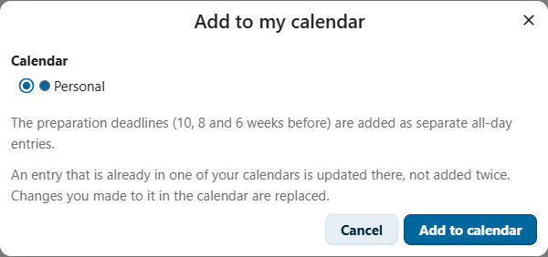

In a concert, and for all upcoming concerts in the concert list:

- **Add to my calendar** puts the concert into one of your Nextcloud
  calendars; choose the calendar in the dialog. If the concert is already in
  one of your calendars (also after a change or a cancellation), the entry
  there is updated instead of added a second time, and changes you made to it
  in the calendar are replaced. A cancelled concert is marked as cancelled,
  but not added anew.
- **Calendar file (.ics)** downloads the concert for any calendar program.
  Every concert keeps its identifier, so most programs update the entry when
  you import the file again.
- **With the preparation deadlines (10, 8 and 6 weeks before)** adds three
  all-day entries: programme and valid versions, rights, concert binders.
  They are marked as free, so they block no time.

A concert without a time is an all-day entry. The entries contain title,
date, time, location, status and a link back to the concert, nothing else.

> [!NOTE]
> There is no subscription link that updates by itself: a feed reachable
> without logging in would make concert data public. Add the concerts again
> after changes.

### Song lists and earlier performances

**Song lists** hold the pieces of a period (for example `2025/1`); they are
no proof of performance. Concerts and song lists of earlier years come from
the import in the archive management (see
[the administration guide](admin-guide.md#4-first-import)); **Show imported
history** shows them. Imported lines whose shelf mark is unclear wait under
**Unclear programme lines**: choose one of the candidates or another copy, or
**Not in the archive**, then **Assign**.

## As a music librarian

The role **Catalog (music librarian)** keeps the catalog: works, versions and
rights, imports, the file sync, proposals and closing tasks. It also may do
everything operations does with copies.

Music librarians also use the features described for the conductor: the
[Score viewer](#score-viewer), [Practice files](#practice-files),
[questions and tasks](#asking-a-question-or-giving-a-task),
[sharing](#sharing-with-choir-members-and-the-public),
[Reviewing transcriptions](#reviewing-transcriptions) and
[concerts](#planning-a-concert). The [Folder book](#folder-book) is
described for operations.

### Confirming rights

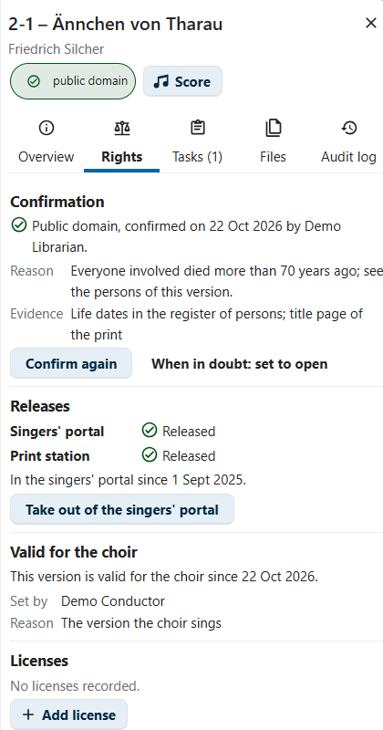

Rights belong to the version, not to the work. An imported or proposed status
stays a suggestion until a music librarian confirms it:

1. Open the copy → tab **Rights** → **Confirm**.
2. Choose the confirmed status: public domain or protected.
3. Enter a **Reason** and the **Evidence**, for example "All persons involved
   died more than 70 years ago" and "Life dates from the register of
   persons". Both are required.
4. Before you confirm, the dialog says what becomes possible afterwards,
   depending on the modules that are switched on: the singers' portal and
   the print station, practice files, sharing with choir members and, once
   the version is released for publication, public links. For *protected*
   it says that releases then need a valid license.
5. **Confirm**. Name and date are recorded.

Changing the rights status later removes the confirmation. **When in doubt:
set to open** sets the status to *open* with a reason and removes any
confirmation.

> [!NOTE]
> The rights helpers model German copyright law. They support a decision and
> are no legal advice.

### Recording a license

**Add license** on the rights tab records holder or publisher, the uses
(at least one), number of copies, validity, evidence and notes. Each use is
separate: copies for the binders, singers' portal, self-printing by singers,
print station, practice audio, recording, publication, online publication
(public links), online playback (audio on public links), download and
printing by choir members (scan in links), digitisation (scans, MusicXML
transcriptions) and **transfer to a legal successor**. The last one records
that the license may pass to a legal successor together with the archive,
for example when choirs merge or another body takes over the archive; tick
it only when the license says so. A license for printing does not allow the
singers' portal. Licenses are never deleted; an ended license stays as a
record. **Ending licenses** lists the licenses that end within the chosen
period or have ended.

**Notice on shared pages** (at most 1000 characters) is shown on the pages
of links for choir members and the public while the license is valid, for
example "By kind permission of …", when the license asks for a notice. These
pages also name the lyricists, arrangers and translators of the version from
the person register, by name only.

Above the licenses the rights tab warns when copies or files of a version
that is not confirmed public domain are not covered: photocopies (copies of
the kind "Photocopy" or a number of copies) without a license for copies for
the binders, more copies than the quantities of those licenses, and scans or
transcriptions without a license for digitisation. Photocopies of sheet
music need the consent of the rights holder, also for the choir's own use.
The warnings block nothing. The start page counts the versions of the
current repertoire with photocopies without a license, the catalog filter
**Photocopies without a license** lists them, and the programme of a concert
shows the warning at the piece.

### Releases: singers' portal and print station

The singers practise in the choir's own system; the app only keeps track of
what may be there. A version is released for the **singers' portal** or the
**print station** if it is confirmed public domain or has a valid license for
that use, and never if it is an internal preservation copy.

- **Provide in the singers' portal** records since when a version is there;
  it is offered only for released versions.
- **Take out of the singers' portal** records the removal with a reason.
- The lists **Singers' portal** and **Print station** compare the target and
  the actual state: what to remove, what to add (released and valid for the
  choir), and what waits for a valid version.

### Mirror folder for the print station

If the choir runs a print station, the app can keep a folder of it up to
date with the scans (PDF) of the versions on the list **Print station**
(module "Mirror folder for the print station"; an administrator chooses the
folder in the settings). Internal preservation copies are never copied. The
files are called `<shelf mark> <title>.pdf`; a file `LIESMICH.txt` in the
folder says when it was last changed and that the scores are only for the
choir.

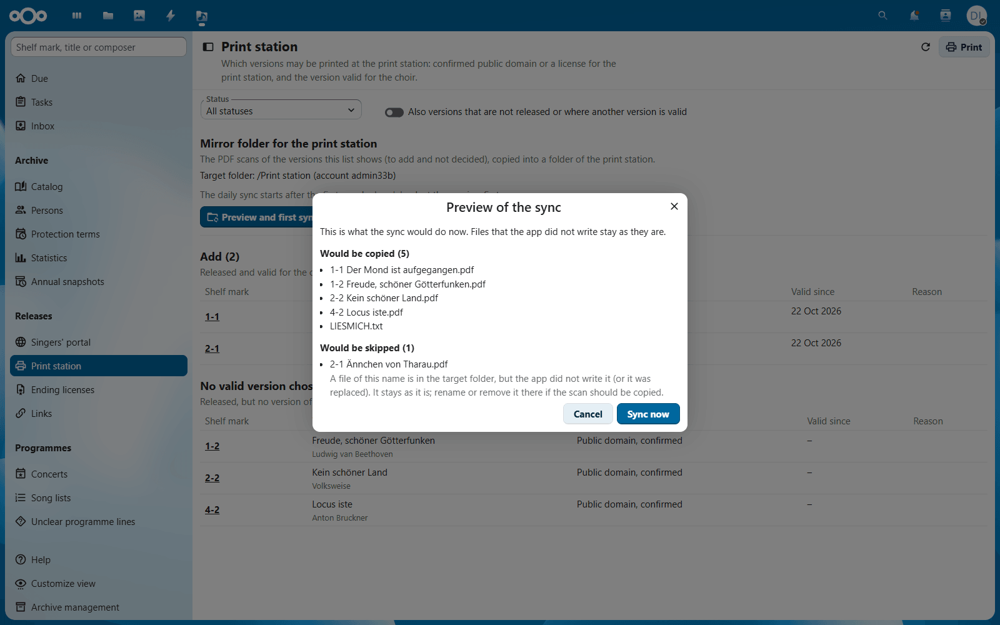

**How to start the first sync** (catalog role):

1. **Print station** → section **Mirror folder for the print station** →
   **Preview and first sync …**.
2. The preview lists what would be copied, replaced, removed or skipped,
   with the reason. Nothing has been written yet.
3. **Sync now**. From now on the app syncs daily in the background.

Later, **Sync now …** syncs at once, again after the preview. The report
of the last sync stays below the button.

What the sync does:

- A released scan that is missing in the folder is **copied**; a scan that
  changed in the archive is **replaced**; a scan no longer released is
  **removed**.
- The app only replaces or removes files it wrote itself and that nobody
  changed since. Other files in the folder stay as they are; the report
  lists them as **skipped** with the reason.
- Every copy, replacement and removal is in the audit log.

If the report lists skipped files or the sync fails, see
[Common problems](#common-problems).

### Hand-over to the choir system

If the choir uses a choir system (a member app or a website with a download
area), the app can keep a folder for it up to date with what the singers'
portal releases (module "Hand-over to the choir system"; an administrator
chooses the folder in the settings). The section sits in the list
**Singers' portal** and works like the mirror folder of the print station:
**Preview and first sync …**, then **Sync now**, then daily.

The folder holds the scans and MusicXML files the members may save, the
practice recordings the rights allow, a list `Liste.csv` with the version,
the revision and the license notice of every file, and per piece a file
`… Hinweise.txt` with the notes of the conductor: the notes you wrote on
links for choir members (see [Sharing with choir members and the public](#sharing-with-choir-members-and-the-public)).
Upload the files to the choir system, and remove there what has left the
folder.

### Comparing with the choir system

If the choir system can export its list of pieces (CSV or Excel), you no
longer have to keep "In singers' portal since" by hand. In the list
**Singers' portal**, section **Compare with the choir system**, choose
**Compare with an export …** and pick the file in your Nextcloud files. The
app recognises a piece by its shelf mark at the start of a cell (a column
with the shelf mark, titles like "2-3 Am Brunnen vor dem Tore" or the file
names of the hand-over folder all work).

The first result is a dry run. It names the pieces that are in the choir
system but not recorded as in the portal, the pieces recorded as in the
portal that are missing there, and the pieces that are in the choir system
although they are not released for it: remove those there, the archive
stays as it is. **Create proposals** puts the first two groups into the
**Inbox**; the catalog changes only when you accept them there (see
[Deciding proposals in the inbox](#deciding-proposals-in-the-inbox)).

### The public repertoire page

The catalog librarian can list works on a public page of the choir
(`/apps/cantoria/repertoire`) with title, composer and lyricist, life
dates, scoring and links to CPDL and IMSLP:

1. Confirm a version of the work as public domain (tab **Rights**).
2. In the fields of the work tick **On the public repertoire page**.
3. Optionally enter **Link to CPDL** and **Link to IMSLP**: the https
   address of the page of the work there, for example
   `https://www.cpdl.org/wiki/index.php/…` or `https://imslp.org/wiki/…`.

The page loads nothing from CPDL or IMSLP; it only links to them. Life dates
come from the register of persons. A work leaves the page as soon as no
version is confirmed public domain any more.

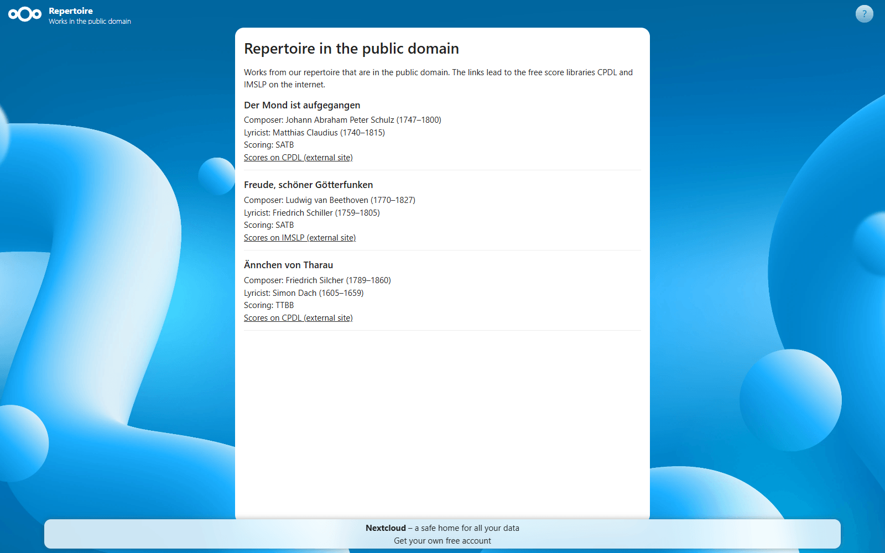

### Deciding proposals in the inbox

Tools and transcription rounds do not change the catalog. Their proposals
wait in the **Inbox**, grouped by the work, version or copy they concern,
with the current and the proposed value, the source and the reason. **Accept** applies the value with your rights and
records it in the audit log; **Reject** discards it. Both take an optional
reason.

When the inbox is empty, it says so, explains that tools and transcription
rounds put their proposals there (see
[As a contributor or tool](#as-a-contributor-or-tool)), and offers **Open the
start page**.

### Applying answers

Answered questions appear on the start page as **Answered tasks to apply**.
Correct the catalog or the file if needed, then close the task as **Applied**
or **Discarded** (see
[Asking a question or giving a task](#asking-a-question-or-giving-a-task)).

### Transcriptions and correction orders

Material findings and questions without a measure of a transcription report
are yours, and you may decide every other review point, too (see
[Reviewing transcriptions](#reviewing-transcriptions)). Correction orders wait
for the tool chain until its next report closes them. You are notified when a
correction arrives, from the app or with a new round. Each correction is a
new revision of the version; check it and [set it as
current](#how-to-set-the-current-revision) when it is valid.

### Imports, file sync and exports

**Archive management** at the bottom of the navigation holds the imports of
the catalog, of performances and song lists and of the persons register, the
**File sync** of the archive folder, the exports and the backups. Every
import first runs as a dry run with a report. The
[administration guide](admin-guide.md#4-first-import) describes the first
import and the file sync.

A file is linked to a copy by the shelf mark at the start of its name. A file
whose name does not fit can be linked by hand on the tab **Files** with
**Link a file …**; such a link stays, whatever the file is called. A file
whose name ends with `bericht.json` is a transcription report: the sync reads
it into review points instead of linking it as a score file.

### New accessions and shelf labels

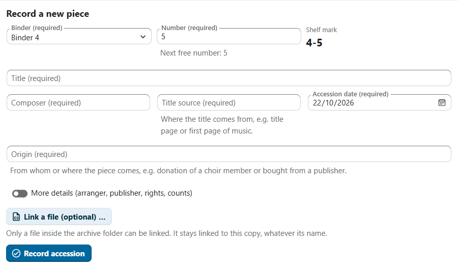

1. **New accession** → **Record a new piece**.
2. Choose the binder. The app suggests the next free number; numbers are never
   reused, not even those of retired copies.
3. Fill in title, composer, title source, accession date and origin; **More
   details** holds arranger, publisher, rights and counts.
4. Optionally **Link a file (optional) …** from the archive folder.
5. **Record accession**. Work, version and copy are created, and the label
   is added to the sheet below.

Next, confirm the rights and add the persons involved on the rights tab. New
copies go only into the **Binders open for new copies**; open a new binder
when the current one is full.

**Shelf labels:** enter shelf marks (separated by commas or line breaks;
`10-70..75` stands for 10-70 to 10-75) and **Add labels**. Choose the first
free place if a sheet has been used in part, then **Print labels**.

> [!TIP]
> The labels fit Avery 3653 and compatible sheets (2 × 7 labels of
> 105 × 42.3 mm on A4). Print at actual size (100 %), without fitting to the
> page and without the browser's headers and footers; Firefox adds them by
> default.

### Persons and protection terms

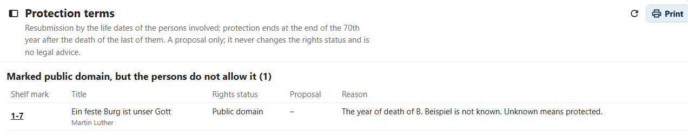

**Persons** is the register of composers, lyricists, arrangers, translators
and editors with their life dates, the precision and source of the dates, and
how certain the identification is. **Mark as checked** records who checked a
person and when. A person can only be deleted while no version names them.

On the rights tab, **Persons involved and protection** → **Add a person**
links a person to the version with a role. From their life dates the app
suggests the protection term with its reasoning: protection ends at the end
of the 70th year after the death of the last of them. Unknown or approximate
years of death, living persons and uncertain identifications count as
protected.

**Protection terms** lists what to check: versions marked protected that are
public domain by the life dates, versions marked public domain that the
recorded persons do not allow, and protected versions with a known end.

> [!IMPORTANT]
> The suggestion never changes the rights status. A music librarian checks it
> and confirms the rights.

#### Composer and lyricist, or traditional

A suggestion of public domain needs both parts of the piece: someone with
the role **Composer** and someone with the role **Lyricist**. If one of them
is missing, the suggestion says "unknown" and names the missing role. For a
folk song or a melody without known author, set **Melody** to
**Traditional**, and **Text** to **Traditional** or **Without text** (in the
section **Rights**, module "Protection terms"). Choose "Traditional" only
with evidence and note the source under **Notes**. A version without persons
whose melody and text are both traditional is suggested as public domain.

**Confirm** public domain against a suggestion that does not say public
domain is still possible: the dialog shows the reason and asks you to tick
that you checked the suggestion.

The daily check notifies the catalog role (**Public domain in doubt**) when
a version confirmed as public domain is protected by the suggestion, for
example after a person was added or life dates were changed. Nothing changes
automatically.

#### Special cases: scientific editions and posthumous works

Two special cases of German law give a right of 25 years after the end of a
year, independent of the life dates:

- **Scientific edition (§ 70 UrhG):** an edition of works that are no longer
  protected, made by scholarly work and clearly different from earlier
  editions, for example an urtext or critical edition. The right ends 25
  years after the edition appeared, or 25 years after it was made if it did
  not appear in that time; the app counts from the appearance, which is
  cautious.
- **Posthumous work (§ 71 UrhG):** a work whose protection had already ended
  when it first appeared or was first performed in public, for example a
  rediscovered manuscript. The right belongs to whoever first published or
  performed it and counts from the earlier of the two events.

To use a special case:

1. Open the copy → tab **Rights** → **Edit** in the section **Rights**.
2. Switch on **Scientific edition (§ 70 UrhG)** or **Posthumous work (§ 71
   UrhG)**; the hint below each switch says when it applies.
3. Enter the **Year first published**: the year the edition appeared, or the
   year the work first appeared or was first performed in public.
4. **Save**. The box **Persons involved and protection** shows the new
   suggestion and one line per special case.

With a special case, persons recorded only as **Editor** count with the 25
years instead of 70 years after their death; all other persons still count
as usual, and the later end decides. Reconstructions, completions or
realisations of a figured bass by an editor are often an arrangement of
their own (§ 3 UrhG): record that person as **Arranger**, so that 70 years
after their death count. An editor without creative work of their own is
not protected at all outside § 70; the app still counts them with 70 years,
which is cautious. The suggestion stays a suggestion: a
music librarian decides whether a special case applies and confirms the
rights.

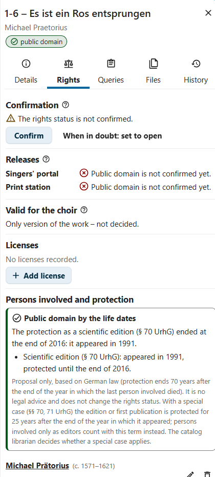

### Rights notices in MusicXML files

Many MusicXML files carry a rights notice, e.g. "Public domain" or "CC BY
4.0". The file sync reads it, and the tab **Files** of the copy shows it
below the file, marked **Not checked**. The notice is information from the
file, not a decision:

- It never changes the rights status (guideline 1).
- If it names the public domain or a license and the proposals inbox is on,
  the file sync puts at most one proposal into the **Inbox**: the rights
  status "public domain", or the license text for an empty field
  **License**. Accept it only after checking the rights yourself.

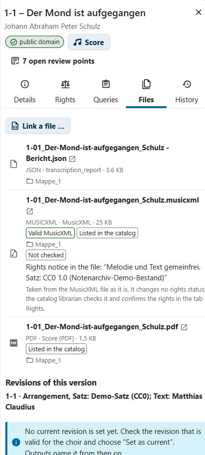

### Merging works and moving copies

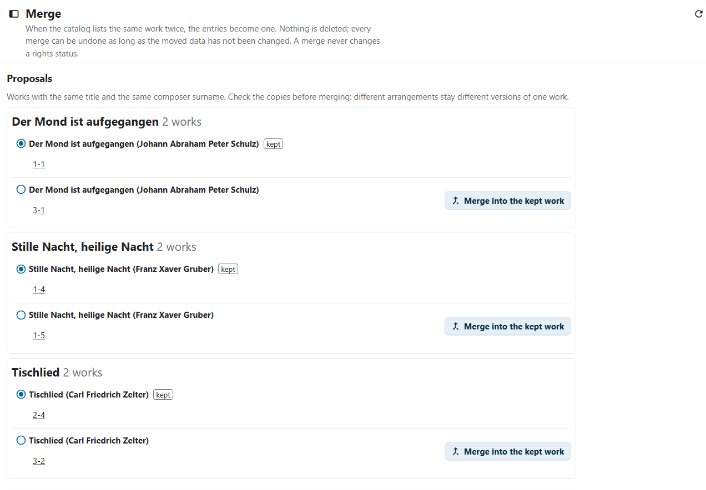

When the catalog lists the same work twice, **Merge** proposes the works with
the same title and the same composer surname:

1. Check the copies; different arrangements stay different versions of one
   work.
2. Choose the **Work to keep** and **Merge into the kept work**.

**Merge by shelf mark** merges any two works or moves a copy to another
version, for example a second copy of the same print. Nothing is deleted:
the merged work disappears from the lists, programme lines move along, and a
merge never changes a rights status. A merge is refused when both works have
a version valid for the choir. **Undo** works as long as the moved data has
not been changed.

### Checksums

A background job reads the archive files hour by hour and keeps their
checksum. **Checksums** lists files whose content changed although their
size and modification time stayed the same; they may be damaged. Restore such
a file from a backup or from the version history, and the mark disappears.
**Accept new content** only if the change was intended.

### Backups

**Archive management** → **Backup** → **Store a complete backup now** writes
the catalog as CSV, a spreadsheet with the audit log, and the complete JSON
backup into the archive folder; the app does this every week by itself.
**Complete backup and restore** downloads the complete backup and restores
it into an empty catalog. See the
[administration guide](admin-guide.md#5-backups-and-restore).

### Annual snapshots

With the module **Annual snapshots** the app freezes the state of the
archive once a year, for the records of the board and the auditors. A
snapshot is a dated folder
(`annual-snapshots/<year>_<date-time>/` in the backup folder of the account
that set the archive folder, outside the archive folder) with three files.
A snapshot is kept for years, so it names nobody: no accounts, no folder
book, no audit log.

| File | Content |
|---|---|
| `catalog.csv` | the catalog with all fields, as in the weekly backup, without accounts |
| `catalog.json` | the catalog tables: works, versions, copies, files, licenses, persons, concerts, folders |
| `manifest.csv` | SHA-256 checksum, size and path of every archive file the file sync knows |

The app never changes or deletes a snapshot.

**How to freeze the annual state**

1. Open **Annual snapshots**. The section **Freeze the state** says which
   year and which folder the snapshot is for.
2. Click **Freeze the state now …**. The dialog lists the three files and
   how many archive files are read for the checksums.
3. Click **Freeze** and keep the page open; with many files this takes a few
   minutes. A message names the folder of the new snapshot.

**At the turn of the year:** with **Freeze automatically at the turn of the
year** switched on (the default), the app makes the snapshot of the past year
by itself in January, as the account that set the archive folder.

**How to compare two years**

1. In **Compare two snapshots**, the newest snapshot and the newest one of the
   year before are already chosen; change them if you like.
2. Click **Compare**. The list shows new copies, copies no longer in the
   catalog, changed copies (status, kind, counts, title), versions with
   changed rights (status, confirmation, publication, special cases, valid
   version), license changes and archive files that are new, gone or changed
   by their checksum.
3. **Print** prints the comparison on A4.

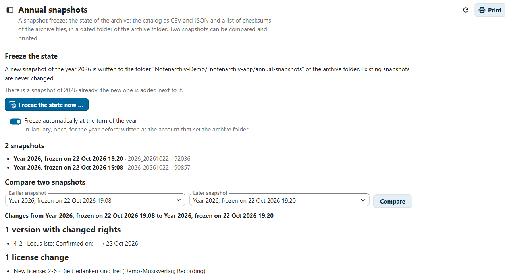

## As operations

The role **Operations (music librarian)** looks after the copies on the
shelf. It changes status, kind and counts of copies, counts the binders, and
answers and closes the checks addressed to it. Where the folder book is
switched on, it issues and takes back the choir folders (see
[Folder book](#folder-book)).

Operations also shares pieces and excerpts (see
[Sharing with choir members and the public](#sharing-with-choir-members-and-the-public))
and answers checks (see [Answering a question](#answering-a-question)).

### Changing the status of a copy

1. Open the copy → tab **Details** → **Edit** in the section **Copy**.
2. Choose the status *retired*, *missing* or *lent* and enter the **Reason
   for status**, or *active* when the copy is back.
3. **Save**.

### Inventory

1. **Inventory** → choose the archive binder and **Print** the list in shelf
   order.
2. Tick on paper what is there.
3. Back in the app, tick **Counted** for each copy that is there and enter a
   figure only where it differs; an empty field keeps the listed one.
4. Check the **Date of the count** and record the count.

The list shows when each copy was last counted and how many copies of the
binder were never counted.

### Gaps in the shelf marks

**Gaps in shelf marks** lists, for every binder, the numbers between 1 and
the highest number used that no copy has, e.g. `5-3 – 5-6, 5-12`. Use it at
the inventory or before an accession to find copies that were never entered
or have gone missing.

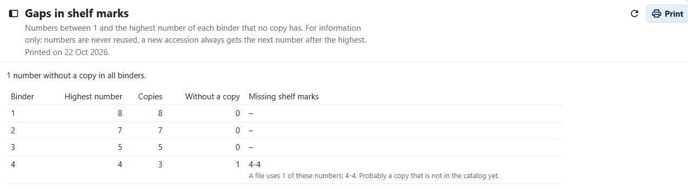

1. Open **Gaps in shelf marks** (with the inventory under maintaining the
   catalog).
2. Check each gap at the shelf. A note below the gaps names numbers that a
   file in the archive folder uses: probably a copy that is not in the
   catalog yet; enter it with **New accession**, which takes the file name
   into account.
3. **Print** prints the list on A4.

The list is for information only. Gaps are never filled: a new accession
always gets the next number after the highest, so a shelf mark always means
the same copy.

### Folder book

The **Folder book** records which choir folder is out with whom since
when, what it holds and what is missing. Music librarians (catalog and
operations) keep it; the conductor and the board read it. Choir members and
tools never see it. The administration switches it on (module "Folder
book"); it is part of the preset "Complete".

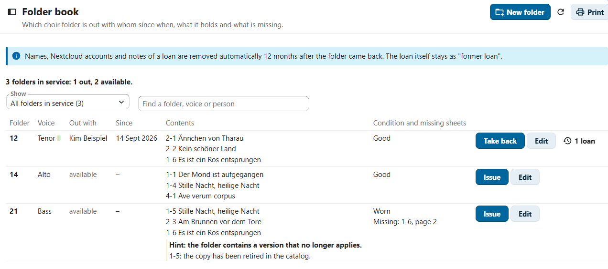

The folder book only records who has which folder. Attendance and handing
out at the door on rehearsal evenings are not part of the app.

#### How to create a folder

1. **Folder book** → **New folder**.
2. Enter the **Number or name** (for example `12` or `Tenor 3`) and the
   **Voice or section**.
3. Under **Contents**, **Add a copy** for every piece in the folder: type
   the shelf mark or the title and choose the copy, then the **Number** of
   sheets or copies of it.
4. Choose the **Condition** and enter **Missing sheets at the moment** if
   something is missing.
5. **Save**.

Two folders in service cannot have the same number or name.

#### How to issue a folder

1. In the row of the folder, choose **Issue**. Only folders that are
   available offer it: a folder that is out shows **Take back** instead.
2. **To whom?** Enter the **Name of the person**, or choose **Nextcloud
   account** and type at least two letters of the name to pick the account.
3. Check the day (**Handed out on**, today by default) and add a note if
   needed.
4. **Issue**.

#### How to take a folder back

1. In the row of the folder, choose **Take back**.
2. The day (today), the condition and the missing sheets known so far are
   already filled in. Correct what differs: tick the condition, add or
   remove missing sheets.
3. **Take back**. The condition and the missing sheets become those of the
   folder; the folder is available again.

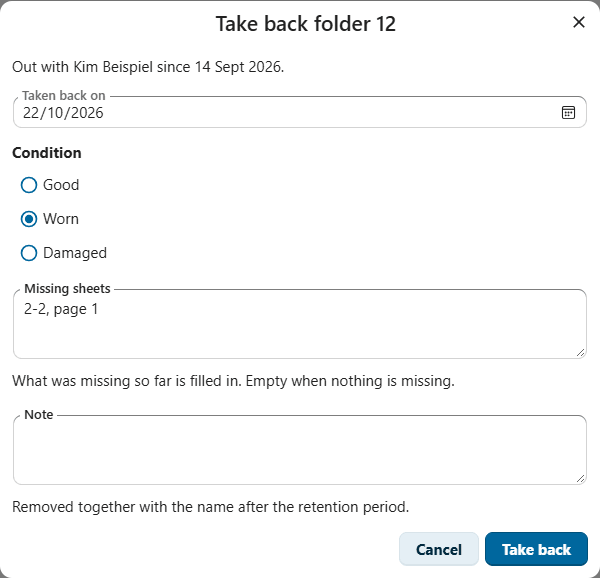

#### Taking a folder out of service

Folders are never deleted. **Edit** → **Take this folder out of service**
with a reason. This is only possible when the folder is back. **Out of
service** in **Show** lists these folders with their loans; **Edit** → **Put
this folder back into service** undoes it.

#### Overview and paper

The line above the list counts the folders in service, out and available.
**Show** narrows the list to folders that are out, available, with missing
sheets or a hint, or out of service; the search finds a number or name, a
voice or a person. **Print** prints the list as shown on A4 in black and
white: folder, voice, out with, since, contents, condition and missing
sheets. The button with the number of loans shows the history of a folder.

#### Hint "The folder contains a version that no longer applies"

The folder book shows this hint when a copy in the folder has been retired
in the catalog, or when the conductor has chosen another version of its work
as valid for the choir. It is a hint only: the app changes nothing in the
folder. Exchange the sheets, then **Edit** the contents.

#### When names are removed

A loan holds personal data: the name or the Nextcloud account and the
notes. Some months after the folder came back (the **retention period**, 12
months unless the administration set another) the app removes them
automatically:

- The loan stays as **Former loan** with its days, the condition and the
  missing sheets.
- The entries of the loan in the audit log lose the name, too; the audit
  log notes that it was removed, without the name.
- A folder that is still out keeps the name until it comes back.

The info box above the list says which period applies.

For messages of the folder book, see [Common problems](#common-problems).

## As the board or auditors

The role **Read only (board, auditors)** reads everything, including the
audit log of every copy, the inbox, the excerpt links and the statistics,
and answers the tasks addressed to it. It changes nothing.

- The [annual report](#statistics-and-annual-report) summarises a year for the
  general meeting.
- **Links** shows every active excerpt link with its circle, expiry and
  number of calls.
- The tab **History** of a copy shows its audit log: who changed what, when
  and why.
- **Annual snapshots** compares the frozen state of two years (see
  [Annual snapshots](#annual-snapshots)); the comparison needs access to the
  archive folder.

### Statistics and annual report

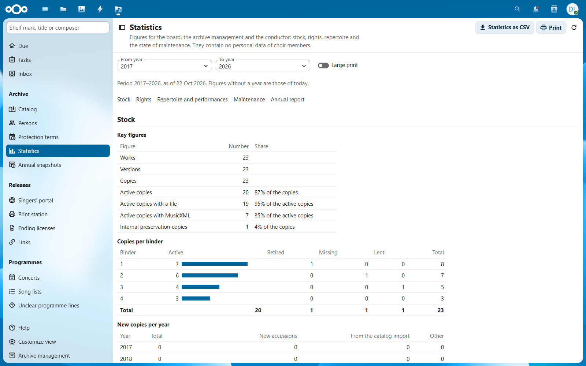

**Statistics** (under *Archive*) is open to every archive role. Choose the
period with **From year** and **To year** (default: the last ten years);
figures without a year are those of today. Each figure is a number in a
table; the bars beside it are only for a quick comparison.

- **Stock:** works, versions and copies; active copies with a file and with
  MusicXML; internal preservation copies; copies per binder by status; new
  copies per year, from new accessions and from the catalog import.
- **Rights:** rights status of the versions, confirmed and not confirmed;
  works with and without a valid version; licenses valid, ending, ended and
  not valid yet; the states of the singers' portal and print station lists;
  publication status.
- **Repertoire and performances:** concerts and pieces sung per year, the
  most performed works and composers of the period, the repertoire classes,
  and works not sung for a long time that can be sung from the archive.
- **Maintenance:** open tasks per role and age, proposals in the inbox,
  checksums, and the protection terms that end in the period (a proposal by
  the life dates, no legal advice).

The statistics contain no personal data of choir members and no account
names; internal preservation copies are counted but never listed by title or
shelf mark. **Print** prints the overview, **Statistics as CSV** downloads all
tables.

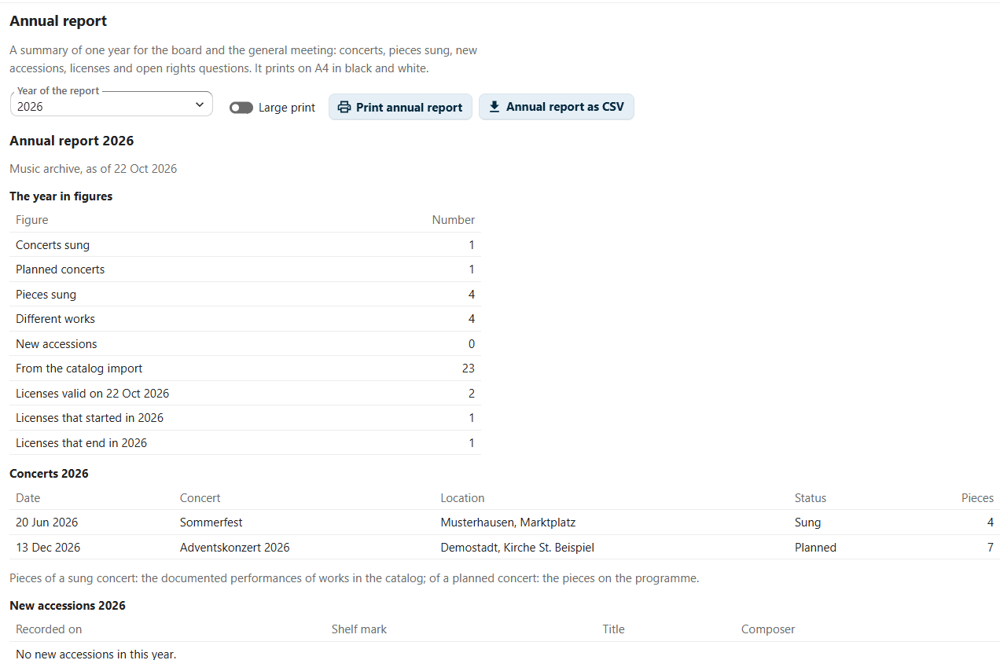

The **Annual report** at the end of the page summarises one year for the
board and the general meeting: concerts with their dates and pieces, new
accessions, licenses that started or ended, open rights questions and the
stock. In the first half of the year it proposes the past year. **Print
annual report** prints only the report on A4 in black and white, optionally
in large print; **Annual report as CSV** downloads its tables.

> [!NOTE]
> Open rights questions and the stock are always those of today, because the
> archive keeps no earlier states of them.

## As a choir member

Choir members have no role in the music archive. Where the administration
has switched on links for choir members, they see only the page **Shared
with me** with the pieces and excerpts shared with the choir. If you see no
music archive at all, see
[No access to the music archive](#no-access-to-the-music-archive).

### Shared with me

Choir members sign in to Nextcloud and open **Music archive**. They see
**Shared with me**: the pieces and excerpts shared with the choir, with
title, composer, **Whole piece** or the measures, voice, the note and how
long each is valid, whether it can be played (**Playback: yes** or
**Playback: no**) and whether the scan is included (**with scan (PDF)**).

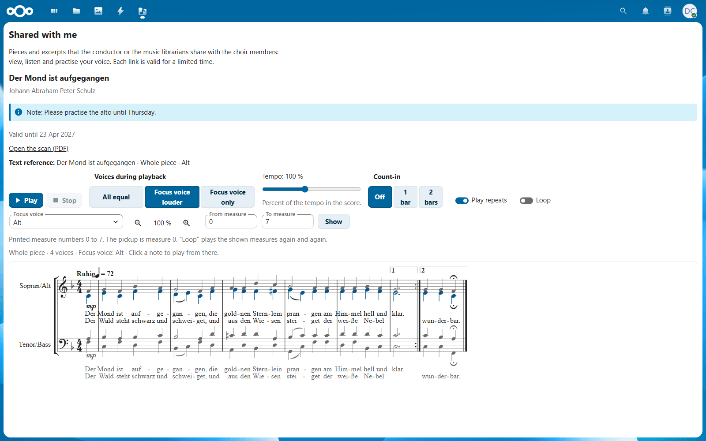

1. Choose a piece in the list (a link sent to you opens it directly). The
   notes appear below the list, on a wide screen beside it, for a whole
   piece all pages of it.
2. **Play**, **Pause** and **Stop**, **Smaller** and **Larger** (the size;
   your browser remembers it for the next piece) and **Settings** are in a bar that stays at the top while you scroll
   through the notes. **Settings** shows or hides the other choices; on a
   phone they are hidden at first. Under **Voices during playback** choose
   **All equal**, **Focus voice louder** or **Focus voice only**, and set
   the tempo. **Focus voice** chooses another voice. Space plays and
   pauses. **Count-in** clicks one or two bars before the music. A click or
   a tap on a note starts there; with the keyboard, the arrow keys left and
   right in the score go to the previous or next measure.
3. To practise a passage, enter **From measure** and **To measure** and
   choose **Show**; **Loop** plays the shown measures again and again.
   **All measures** shows everything again. **Starting tones**,
   **Metronome**, **Pitch**, **Mixer**, remembered passages and **Record
   myself** work as in the score view (see
   [How to practise with starting tones, metronome, pitch, mixer, passages and recordings](#how-to-practise-with-starting-tones-metronome-pitch-mixer-passages-and-recordings)).
4. **Open the scan (PDF)** (where included) opens the scan in the PDF viewer
   of your browser, in a new tab.
5. **Text reference** and **Description of the piece** (or **of the
   excerpt**) describe it in words.
6. Where practice files are offered (**Practice files: yes**): choose the
   voice and "Focus voice louder" or "Focus voice only", then under
   **Practice file** the format **WAV (audio)** or **MIDI** and **Make
   practice file**. The file covers the shown measures; it is made in your
   browser, and every practice file is recorded in the audit log of the
   music archive.

Your browser remembers the tempo, **Pitch**, **Metronome**, the **Mixer**
and the passages of each piece, also for a new link to the same piece.

### Practising without a network

Where the administration has switched it on, a piece can be kept on your
device and then be viewed, played and practised without a network, for
example on the train or in a church without Wi-Fi. No app to install: it
works in the browser.

1. With a network, open **Shared with me** and choose **Keep on this
   device** in the list for each piece you need; **With the scan (PDF)**
   also keeps the scan, which may need a lot of space. **Keep all … pieces
   on this device**, above the list, keeps every piece that may be kept at
   once, without the scans. Some pieces say "Cannot be kept on this
   device": their rights allow viewing, not saving.
2. Without a network, open the same page as usual (a bookmark or the home
   screen). A note says that the pieces kept on this device are shown.
   Playing, count-in, metronome, pitch, mixer, passages, lyrics and
   recording yourself all work; **Practice file** needs a network.
3. Each start with a network checks the kept pieces: expired or revoked
   links disappear from the device. After 30 days without a network the
   kept pieces are locked until the page is opened once with one.
4. **On this device**, at the bottom of the page, shows how many pieces are
   kept and the space used. **Delete everything on this device** removes
   the kept pieces, passages and settings; do this on a shared device.
   Signing out of Nextcloud does not delete them.

On an iPhone or iPad, add the page to the home screen (Share → **Add to
Home Screen**) and open it from there: otherwise Safari may delete the kept
pieces after some days without use. **Show the scan (PDF)** opens the scan
inside the page, also without a network where it was kept.

A **public link** to a piece whose public domain is confirmed offers
**Keep on this device** at the bottom of its page, too: then the page opens
without a network while the link is valid. Each visit with a network checks
it; a link that was revoked or has expired disappears from the device at
the next visit. Open it with a network at least every 30 days.

## As a contributor or tool

The role **Proposals (tools)** is meant for transcription rounds and scripts.
They send proposals for catalog fields through the app's interface (see the
[API](api.md)); nothing changes until a music librarian accepts a proposal in
the inbox. Contributors see the inbox and can ask questions about a copy.
They also send transcription reports, which become review points, and fetch
the correction orders; the next report of a round closes them (see
[Reviewing transcriptions](#reviewing-transcriptions)).

## Common problems

Each entry starts with the message of the app (in italics or quotes) or with
what you notice, and says what to do. Problems of the setup are in the
[administration guide](admin-guide.md#common-problems).

### No access to the music archive

*"You have no access to the music archive."* Your account has no role in the
music archive; the app, or the page "Access forbidden", says so. Roles are
bound to Nextcloud groups, not to persons. Ask the administration to add your
account to the group of your role (see the
[administration guide](admin-guide.md#2-roles-and-groups)). Choir members
have no role: they see only **Shared with me**, and only while links for
choir members are switched on.

### "The score cannot be shown"

*"The file lies in a folder that is not shared with your account."* Nothing
is wrong with the file or your role: the archive folder is not shared with
you. See [Files you cannot open](#files-you-cannot-open).

### The section "Music archive" is missing in the Nextcloud search

The module is switched off, or your account has no role in the music
archive. Ask the administration.

### A copy is not found in the Nextcloud search

Check the spelling; a shelf mark must be complete (`2-1`, not `2-`).
Internal preservation copies are hidden from roles that may not view them.

### Messages when sharing

| Message or problem | What to do |
|---|---|
| The button says **Create internal link**, there is no choice of circle | Links for choir members and public links are switched off; an administrator switches them on (Settings → Modules). |
| *This kind of link is switched off. …* | The same, for one circle. |
| *Public domain is not confirmed yet. …* | The catalog librarian confirms the rights on the tab **Rights**. |
| *Not released for choir members: …* | Confirm public domain or record a license with the use "Singers' portal". |
| *Not released for publication. …* | Set the publication status of the version to "Released for publication". |
| *A public link needs confirmed public domain or a valid license for online publication. …* | Record a license with the use "Online publication (public links)", or confirm public domain. |
| *Internal preservation copy: …* | Preservation copies are never shared; share another version. |
| *This copy has no MusicXML file. …* | Link a MusicXML file to the copy (tab **Files**). |
| *Please give both the first and the last measure of the excerpt, …* / *There is no measure … in this score.* | Enter both measures as printed in the score, or choose **Whole piece**. |
| **Include the scan (PDF)** is missing | The copy has no PDF scan (tab **Files**), or the link is not allowed or internal: the archive roles see the scan beside the score. |
| *This scan does not belong to the copy. …* | Choose one of the PDF files of the copy; link the scan on the tab **Files** first. |
| *The scan of this link is not available at the moment.* | The PDF was moved or removed from the archive folder, or the account of the archive folder cannot read it; link the scan again and make a new link. |
| *A public link has no note, …* | Leave the note empty. |
| A choir member does not see the piece or excerpt | It has expired or was revoked, or the version is no longer released; make a new link. If they see no app at all, see the [administration guide](admin-guide.md#14-sharing-with-choir-members-and-the-public). |
| *Only works with a version confirmed as public domain can be shown on the public repertoire page. …* | Confirm the rights of a version of the work first (tab **Rights**). |

### "The year in which it first appeared is missing"

A special case (scientific edition or posthumous work) is switched on.
Enter the **Year first published**; until then the version counts as
protected (see
[Special cases: scientific editions and posthumous works](#special-cases-scientific-editions-and-posthumous-works)).

### "Only editors are recorded for this version"

Add the composer and the other persons involved under **Add a person**.

### The year first published is refused

It must be a year between 1000 and this year, with four digits (e.g. 1998).

### The switches for the special cases are missing

The module **Protection terms** is switched off.

### No rights notice is shown for a MusicXML file

The file has none, the module **Rights confirmation and licenses** is off,
or the file was not read yet; run the file sync (**Archive management** →
**File sync**). Large archives are read in parts of 300 files per sync.

### The rights notice contradicts the catalog

The notice often describes the digital file (e.g. CC0 for a transcription),
not the arrangement. Reject the proposal in the inbox; the rights status
stays as it is (see
[Rights notices in MusicXML files](#rights-notices-in-musicxml-files)).

### Print station sync: "A file of this name is in the target folder, but the app did not write it …"

The report lists the file as skipped. Someone put a file of that name in the
target folder. Rename or remove it in the folder if the app should copy the
scan.

### Print station sync: "The file was changed in the target folder …"

The report lists the file as skipped. The app leaves the changed file alone
and no longer looks after it. Remove it in the folder, and the next sync
copies the scan again.

### Print station sync: "The account of the target folder cannot read this scan."

The report lists the scan as skipped. The account that chose the folder has
no access to that part of the archive folder.

### "The target folder of the print station is not accessible …"

The folder was deleted, moved or is no longer shared. An administrator
chooses it again. The catalog role and the administrators are also notified
when the daily sync fails (see
[Mirror folder for the print station](#mirror-folder-for-the-print-station)).

### "No write permission for exports in the archive folder"

The account that set the archive folder needs write access to it; ask the
administration.

### "The snapshots lie in the archive folder, which is not shared with your account"

The comparison of annual snapshots reads the snapshots with your own access.
Ask the catalog librarian to share the archive folder with you, or to print
the comparison.

### An annual snapshot is listed as incomplete

A file is missing, e.g. because the page was closed while it was written.
Freeze the state again; delete the incomplete folder in the Files app if you
like.

### "The last automatic snapshot failed"

The message says why; freeze the state by hand. The automatic snapshot tries
again daily until the end of January (see
[Annual snapshots](#annual-snapshots)).

### The button to compare annual snapshots is missing

A comparison needs two complete snapshots.

### There is no Issue button in the folder book

The folder is out (take it back first) or out of service (put it back into
service), or your role reads only.

### "This folder is already out with someone. Take it back first."

Someone else issued it in the meantime. Reload the folder book.

### The account is not found when issuing a folder

Type at least two letters. Nextcloud only finds accounts your account may
find; enter the name instead.

### "The date lies in the future."

A folder can only be issued or taken back up to today.

### "A folder in service is already called …"

Choose another number or name, or take the old folder out of service first.

### The folder book is missing in the navigation

It is switched off, or your role does not read it (tools never do).

## Paper

Paper stays the fallback. The views with a **Print** button print on A4 in
black and white: the start page, tasks, inbox, release lists, ending
licenses, links, concerts and song lists, unclear programme lines, persons,
protection terms, the inventory of a binder, the gaps in the shelf marks,
the folder book, the comparison of two annual snapshots, and the statistics. A
programme prints as programme, concert binder list with columns to tick or
song list; programmes, statistics and the annual report also in large print.
Shelf labels print on label sheets (see
[New accessions and shelf labels](#new-accessions-and-shelf-labels)).
